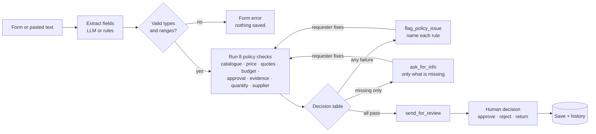

# PROJECT_PLAN — AI Procurement Review (Option C)

> Design sheet completed **before any code**, as required by the AI Systems Building Challenge.
> **Third project in a series:** [AI Data Analyst](https://github.com/Ayatalat0101/ai-data-analyst) (1) analyses aid distributions · [AI Community Feedback Desk](https://github.com/Ayatalat0101/ai-community-feedback-desk) (2) hears what people say about them · **this project (3)** checks the purchases that respond to both.
> Arabic version: [PROJECT_PLAN_AR.md](PROJECT_PLAN_AR.md)
> Stack: Python · Streamlit · SQLite · Pandas · Pydantic · Gemini (extraction + explanation) · rule fallback
> Language: staff screens in English; justifications and the explanation of the result in Arabic or English.

---

## 1. Project name and one-sentence problem

**Name:** AI Procurement Review — *every relief purchase checked against the written policy, and decided by a person*

**Problem:** When a distribution is cancelled or families report spoiled items, programme staff send purchase requests by email or WhatsApp. The procurement officer checks each one by hand against an 8-page policy: is the price reasonable, is there budget, are there enough quotations, is the supplier allowed, does the evidence exist? Requests bounce back and forth for days, and an over-priced purchase from a supplier with a conflict of interest can slip through on a busy day.

**Realistic example:** *"We need 200 winter kits at 42 USD from Al-Noor Trading to replace the cancelled Khan Younis distribution DST-001."* The officer must confirm that DST-001 really was a cancelled **winter kit** distribution (Project 1's data), that 42 USD is in line with past purchases (also Project 1's data), that 8,400 USD fits the winter budget line, that 3 quotations exist, and that a manager, not the requester, approved it.

**How it continues Projects 1 and 2:**

```
Project 1  aid_distributions.csv ──► price benchmarks per item + "does DST-001 exist, what item, how many?"
Project 2  feedback_log.csv      ──► "does feedback FB-0005 exist, and is it about this item?"
Project 3  purchase request ──► 8 policy checks ──► ask / flag / send for human review ──► decision + history
```

## 2. Target users and goal

- **Requester** (programme or logistics staff): submits a request, sees exactly what is missing or which rule fails, corrects it and resubmits without retyping.
- **Procurement reviewer**: sees only requests that are complete, with every check and its evidence, and records the human decision.
- **Goal in one visit:** submit → see the result of every check → fix → a request that passes all checks lands in the reviewer's queue, clearly labelled *recommendation, not approval*.

## 3. Scope

| The system WILL | The system WILL NOT |
|---|---|
| Collect a purchase request in a form (or extract it from pasted text) | Approve, order or pay for anything by itself |
| Validate types and ranges (quantity > 0, price > 0) | Negotiate prices or contact suppliers |
| Run 8 written policy checks and record the result of each | Handle training requests, salaries or services (one process only) |
| Tell missing information apart from a genuine policy failure | Run a tender (> 10,000 USD): it routes those out |
| Ask only for the missing details; name the exact rule that fails | Change the budget, the catalogue or Project 1's data |
| Send compliant requests to a person with a clear summary; keep a history | Call an AI recommendation an approval |

**Out-of-scope example:** *"Request: 50 solar lamps"* → C1 fails: not in the relief catalogue; the reviewer can still see it, but the system does not treat it as a normal purchase.

## 4. Input contract

| Field | Required to submit | Type / valid values | Example | If missing / invalid |
|---|---|---|---|---|
| Requester | Yes | text 2–60 | Lina Odeh | form error, nothing saved |
| Department | Yes | Programs · Logistics · MEAL | Programs | form error |
| Item | Yes | catalogue item or free text | Winter Kit | free text not in catalogue → C1 fails |
| Quantity | Yes | whole number ≥ 1 | 200 | 0, negative, decimal → form error |
| Unit price (USD) | Yes | number > 0, ≤ 10,000 | 42 | 0, negative, text → form error |
| Justification | Yes | text 10–1,000 (Arabic or English) | "Replace the cancelled…" | form error |
| Supplier | No at submit | text | Al-Noor Trading | **missing → ask** |
| Number of quotations | No at submit | whole number ≥ 0 | 3 | **missing → ask** |
| Budget line | No at submit | code from `budget_lines.csv` | BL-WIN-26 | **missing → ask**; unknown code → ask |
| Approving manager | No at submit | text | Samir Haddad | **missing → ask** |
| Evidence | No at submit | `DST-xxx` (Project 1) or `FB-xxxx` (Project 2) | DST-001 | **missing → ask**; not found → ask |

**Missing vs failure:** a *missing* or unknown value can be fixed by adding information → `ask_for_info`. A *failure* is a real policy problem that more information will not fix (price too high, over budget, conflict of interest) → `flag_policy_issue`.

## 5. Output contract

A **decision-support summary** for every submission:

| Section | Example |
|---|---|
| Submitted details | Winter Kit · 200 × 42 USD = **8,400 USD** · Al-Noor Trading · BL-WIN-26 · DST-001 |
| Checks | ✅ C1 catalogue · ✅ C2 price 42 ≤ 46.20 · ✅ C3 3 quotations (8,400 needs 3) · ✅ C4 8,400 ≤ 10,500 left · ✅ C5 manager ≠ requester · ✅ C6 DST-001 is a Winter Kit distribution · ✅ C7 200 ≤ 275 · ✅ C8 supplier pre-qualified |
| Missing | — |
| Policy issues | — |
| Next action | **Sent for human review.** *This is a recommendation, not an approval.* |
| Explanation | in the language of the justification (Arabic or English) |

Reviewer decision: **Approved by <name>** · **Rejected by <name> + reason** · **Returned for changes + reason**, with a timestamped history.

## 6. Workflow



## 7. Agent specification

**Goal:** turn one purchase request into a complete, policy-checked request with a clear next action. It never approves.

**Allowed actions:** `ask_for_info` · `flag_policy_issue` · `send_for_review` · `finish` (the challenge's four).

**State:** the request fields, the result of each check (`pass` · `fail` · `missing` · `n/a`), the action, and the history of versions.

**Written policy (Gaza Relief Consortium, fictional, v1):**

| Check | Rule | Missing when | Fails when |
|---|---|---|---|
| **C1 Catalogue** | Item must be in `catalogue.csv` | — | item not in the catalogue |
| **C2 Price** | Unit price ≤ **110%** of the benchmark (average unit cost for that item in Project 1's data) | — | above 110% |
| **C3 Quotations** | total < 1,000 → ≥ 1 · 1,000 ≤ total ≤ 10,000 → ≥ 3 · total > 10,000 → tender (not this process) | number of quotations empty | too few, or total > 10,000 |
| **C4 Budget** | Budget line exists, pays for this item's category, and total ≤ remaining | budget line empty or unknown | wrong category, or total > remaining |
| **C5 Approval** | A manager approved, and the manager is not the requester | manager empty | requester = manager |
| **C6 Evidence** | A `DST-xxx` from Project 1 or `FB-xxxx` from Project 2 that exists and is about the **same item** | empty, or the reference does not exist | reference is about a different item |
| **C7 Quantity** | If the evidence is a distribution: quantity ≤ **110%** of its planned quantity | — | above 110% |
| **C8 Supplier** | Pre-qualified in `suppliers.csv` and no declared conflict of interest | supplier empty | not pre-qualified, or conflict of interest |

Checks that depend on an unknown item (C2, C4 category, C6 item match) are `n/a` when C1 fails.

**Decision table:**

| Situation | Action | What the requester sees |
|---|---|---|
| Invalid type or range | *(form error)* | the field and the valid range; nothing saved |
| At least one check **fails** | `flag_policy_issue` | each failed rule, the numbers, and how to fix it; missing fields listed too |
| No failure, at least one **missing** | `ask_for_info` | only the missing fields, one line each |
| All checks pass | `send_for_review` | "Sent for human review — recommendation, not approval" |
| A person decides | `finish` | Approved / Rejected / Returned, by name, with the reason |

**Boundaries (written before coding):** exactly 110% passes · exactly the remaining budget passes · 999 USD needs 1 quotation, 1,000 needs 3 · exactly 10,000 needs 3, 10,000.01 needs a tender.

**Where the AI helps (optional, with fallback):** (1) extracting fields from a pasted request (structured output), which the requester confirms in the form; (2) a plain explanation of the result in Arabic or English, built only from the check results. The AI **never** decides a check, the action or the approval.

**Never:** approve or imply approval; invent a reference, price or budget; skip a check.

## 8. Data preparation

- `aid_distributions.csv` — Project 1's file, unchanged: price benchmarks and evidence.
- `feedback_log.csv` — exported by Project 2 (no personal data): evidence.
- `catalogue.csv` — 5 relief items, units, budget category, benchmark from Project 1.
- `budget_lines.csv` — 5 lines with annual budget and committed amount (remaining = budget − committed).
- `suppliers.csv` — 4 suppliers, one with a declared conflict of interest.
- `sample_requests.csv` — 22 requests with the expected action, failed checks and missing fields.
- All people, companies and amounts are fictional.

## 9. Interface sketch

```
┌──────────────── Page 1: New request ─────────────────┐┌── Policy summary ──┐
│ Paste a request (optional) [                  ] [Extract]││ C1 catalogue       │
│ Requester [    ] Department [▾] Item [▾] Qty [ ] Price[ ]││ C2 price ≤ 110%    │
│ Supplier [ ] Quotes [ ] Budget line [▾] Manager [ ]      ││ C3 quotations      │
│ Evidence (DST/FB) [ ]  Justification [              ]    ││ ...                │
│ [Check request]                                          │└────────────────────┘
│ ✅ C1 … ❌ C4 1,708 > 1,680 left … ⚠️ Missing: supplier    │
│ Next action: Flag policy issue — fix and resubmit         │
└──────────────────────────────────────────────────────────┘
┌──────────────── Page 2: Review queue ────────────────────┐
│ PR-0007 Winter Kit 8,400 USD  All checks passed  [Open]   │
│ Recommendation (not approval) · checks · history           │
│ [Approve] [Reject] [Return for changes]   reason [      ]  │
└──────────────────────────────────────────────────────────┘
```

## 10. Success tests (written before coding)

| ID | Input | Expected |
|---|---|---|
| T1 | R01 complete, compliant | `send_for_review`; status "awaiting human decision"; **never** approved automatically |
| T2 | R02 supplier, quotes, manager empty | `ask_for_info` listing **exactly** those three |
| T3 | R03 blanket at 12 USD | `flag_policy_issue` C2, shows 12 vs limit 9.90 |
| T4 | R04 / R05 budget 1,708 vs 1,680 left / exactly 1,680 | R04 fails C4 · R05 passes (boundary) |
| T5 | R06 / R07 price 46.20 / 46.30 | pass / fail C2 (boundary 110%) |
| T6 | R08 / R09 999 / 1,008 USD with 1 quotation | pass / fail C3 (boundary 1,000) |
| T7 | R10 10,500 USD | fail C3: tender required |
| T8 | R14 evidence DST-099 | `ask_for_info`: evidence not found, nothing invented |
| T9 | R15 kitchen sets citing a blanket distribution | fail C6 |
| T10 | R12 / R13 conflict of interest / unknown supplier | fail C8 |
| T11 | R17 requester = manager | fail C5 |
| T12 | R20 / R21 quantity −5 / price 0 | form error, nothing saved |
| T13 | R02 then add the three fields | same request, resubmitted without retyping, `send_for_review` |
| T14 | reviewer approves / rejects / returns | status and history show the **person's** name and reason |
| T15 | LLM unavailable | extraction falls back to rules; checks and actions unchanged |

## 11. Technology plan

| Layer | Tool | Already known (projects 1–2) | New to learn | Docs |
|---|---|---|---|---|
| UI | Streamlit | forms, pages, roles | side-by-side policy panel, editable resubmission | https://docs.streamlit.io |
| Rules | Python + Pandas | loading CSVs, lookups | a check engine that returns one result per rule | https://pandas.pydata.org/docs |
| Contracts | Pydantic | validation, LLM contracts | decimal money | https://docs.pydantic.dev |
| Storage | SQLite | audit log, migrations | request versions | https://docs.python.org/3/library/sqlite3.html |
| AI | Gemini | structured output, fallback chain | extraction from free text | https://ai.google.dev/gemini-api/docs |
| Tests | pytest | data-driven, fakes, mutation checks | boundary tables | https://docs.pytest.org |

## 12. Build order

**MVP:**
1. Data loaders + request model and validation → T12
2. The 8 checks, one function each, one result each → T3–T11
3. Decision table + agent → T1, T2
4. Store with versions + resubmission → T13
5. Streamlit: request form with policy panel, summary, review queue, history → T14

**Enhancements:**
6. Gemini extraction from pasted text + explanation in Arabic/English, with rule fallback → T15
7. README, test results, screenshots, deploy
