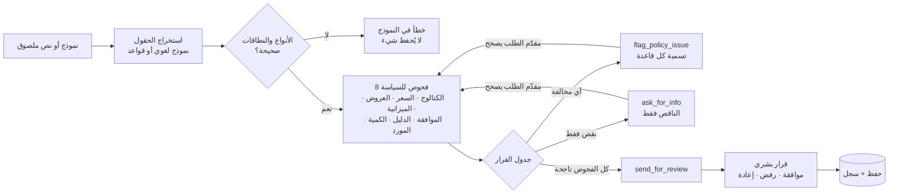

<div dir="rtl">

# خطة المشروع: مراجعة المشتريات بالذكاء الاصطناعي (الخيار C)

> ورقة تصميم اكتملت **قبل كتابة أي كود**، كما يشترط تحدّي AI Systems Building Challenge.
> **المشروع الثالث في سلسلة:** [المحلل الذكي](https://github.com/Ayatalat0101/ai-data-analyst) (1) يحلل التوزيعات · [مكتب ملاحظات المجتمع](https://github.com/Ayatalat0101/ai-community-feedback-desk) (2) يسمع ما يقوله الناس عنها · **هذا المشروع (3)** يفحص المشتريات التي تستجيب للاثنين.
> النسخة الإنجليزية الأصلية: [PROJECT_PLAN.md](PROJECT_PLAN.md)
> التقنيات: Python · Streamlit · SQLite · Pandas · Pydantic · Gemini (استخراج + شرح) · قواعد احتياطية
> اللغة: شاشات الموظفين بالإنجليزية؛ المبرّر وشرح النتيجة بالعربية أو الإنجليزية.

---

## 1. اسم المشروع والمشكلة في جملة واحدة

**الاسم:** مراجعة المشتريات الذكية: *كل شراء إغاثي يُفحص مقابل السياسة المكتوبة، والقرار لإنسان*

**المشكلة:** عندما يُلغى توزيع أو يبلّغ الناس عن مواد تالفة، يرسل موظفو البرامج طلبات شراء بالإيميل أو واتساب. موظف المشتريات يفحص كل طلب يدوياً مقابل سياسة من 8 صفحات: هل السعر معقول، هل توجد ميزانية، هل عروض الأسعار كافية، هل المورد مسموح، هل الدليل موجود؟ الطلبات تذهب وتعود لأيام، وفي يوم مزدحم قد يمر شراء بسعر مرتفع من مورد عنده تضارب مصالح.

**مثال واقعي:** *"نحتاج 200 حقيبة شتوية بسعر 42 دولاراً من شركة النور للتجارة لتعويض توزيع خان يونس الملغى DST-001."* يجب على الموظف التأكد أن DST-001 فعلاً توزيع **حقائب شتوية** ملغى (بيانات المشروع الأول)، وأن 42 دولاراً متوافق مع المشتريات السابقة (بيانات المشروع الأول أيضاً)، وأن 8,400 دولار ضمن ميزانية الشتاء، وأن هناك 3 عروض أسعار، وأن مديراً وافق، وليس مقدّم الطلب نفسه.

**كيف يكمّل المشروعين الأول والثاني:**

<div dir="ltr">

```
Project 1  aid_distributions.csv ──► price benchmarks per item + "does DST-001 exist, what item, how many?"
Project 2  feedback_log.csv      ──► "does feedback FB-0005 exist, and is it about this item?"
Project 3  purchase request ──► 8 policy checks ──► ask / flag / send for human review ──► decision + history
```

</div>

## 2. المستخدمون والهدف

- **مقدّم الطلب** (موظف برامج أو لوجستيات): يرسل الطلب، ويرى بالضبط ما الناقص أو أي قاعدة لم تتحقق، ويصحح ويعيد الإرسال بدون إعادة الكتابة.
- **مراجع المشتريات:** يرى فقط الطلبات المكتملة، مع كل فحص ودليله، ويسجل القرار البشري.
- **الهدف في زيارة واحدة:** إرسال ← نتيجة كل فحص ← تصحيح ← الطلب الذي ينجح في كل الفحوص يصل لقائمة المراجع، وعليه عبارة واضحة: *توصية، وليست موافقة*.

## 3. النطاق

| النظام سيفعل | النظام لن يفعل |
|---|---|
| يجمع طلب الشراء في نموذج (أو يستخرجه من نص ملصوق) | يوافق أو يطلب أو يدفع ثمن أي شيء من تلقاء نفسه |
| يتحقق من الأنواع والنطاقات (الكمية > 0، السعر > 0) | يفاوض على الأسعار أو يتواصل مع الموردين |
| يشغّل 8 فحوص مكتوبة ويسجل نتيجة كل فحص | يتعامل مع طلبات التدريب أو الرواتب أو الخدمات (عملية واحدة فقط) |
| يميّز المعلومات الناقصة عن المخالفة الحقيقية للسياسة | يدير مناقصة (> 10,000 دولار): يحوّلها للجنة |
| يطلب الناقص فقط، ويسمّي القاعدة المخالَفة بالضبط | يغيّر الميزانية أو الكتالوج أو بيانات المشروع الأول |
| يرسل الطلبات المطابقة لإنسان مع ملخص واضح، ويحفظ السجل | يسمّي توصية الذكاء الاصطناعي موافقة |

**مثال خارج النطاق:** *"طلب: 50 مصباحاً شمسياً"* ← الفحص C1 يفشل: ليس في الكتالوج الإغاثي.

## 4. عقد المدخلات

| الحقل | إلزامي للإرسال | النوع / القيم الصالحة | مثال | إذا كان ناقصاً أو غير صالح |
|---|---|---|---|---|
| مقدّم الطلب | نعم | نص 2 إلى 60 | Lina Odeh | خطأ في النموذج، لا يُحفظ شيء |
| القسم | نعم | Programs · Logistics · MEAL | Programs | خطأ في النموذج |
| المادة | نعم | من الكتالوج أو نص حر | Winter Kit | نص خارج الكتالوج ← يفشل C1 |
| الكمية | نعم | عدد صحيح ≥ 1 | 200 | صفر أو سالب أو كسر ← خطأ |
| سعر الوحدة (دولار) | نعم | رقم > 0 و ≤ 10,000 | 42 | صفر أو سالب أو نص ← خطأ |
| المبرّر | نعم | نص 10 إلى 1,000 (عربي أو إنجليزي) | "تعويض التوزيع الملغى…" | خطأ في النموذج |
| المورد | لا عند الإرسال | نص | Al-Noor Trading | **ناقص ← يُطلب** |
| عدد عروض الأسعار | لا عند الإرسال | عدد صحيح ≥ 0 | 3 | **ناقص ← يُطلب** |
| بند الميزانية | لا عند الإرسال | رمز من `budget_lines.csv` | BL-WIN-26 | **ناقص ← يُطلب**؛ رمز غير معروف ← يُطلب |
| المدير الموافق | لا عند الإرسال | نص | Samir Haddad | **ناقص ← يُطلب** |
| الدليل | لا عند الإرسال | `DST-xxx` (المشروع 1) أو `FB-xxxx` (المشروع 2) | DST-001 | **ناقص ← يُطلب**؛ غير موجود ← يُطلب |

**الناقص مقابل المخالفة:** القيمة *الناقصة* أو غير المعروفة تُصلح بإضافة معلومة ← `ask_for_info`. *المخالفة* مشكلة حقيقية في السياسة لا تحلها معلومة إضافية (سعر مرتفع، تجاوز الميزانية، تضارب مصالح) ← `flag_policy_issue`.

## 5. عقد المخرجات

**ملخص دعم القرار** لكل إرسال:

| القسم | مثال |
|---|---|
| التفاصيل المُرسلة | Winter Kit · 200 × 42 = **8,400 دولار** · Al-Noor Trading · BL-WIN-26 · DST-001 |
| الفحوص | ✅ C1 الكتالوج · ✅ C2 السعر 42 ≤ 46.20 · ✅ C3 ثلاثة عروض · ✅ C4 8,400 ≤ 10,500 متبقٍ · ✅ C5 المدير غير مقدّم الطلب · ✅ C6 DST-001 توزيع حقائب شتوية · ✅ C7 200 ≤ 275 · ✅ C8 المورد مؤهل |
| الناقص | — |
| المخالفات | — |
| الإجراء التالي | **أُرسل للمراجعة البشرية.** *هذه توصية، وليست موافقة.* |
| الشرح | بلغة المبرّر (عربي أو إنجليزي) |

قرار المراجع: **وافق <الاسم>** · **رفض <الاسم> + السبب** · **أعاده للتعديل + السبب**، مع سجل زمني.

## 6. سير العمل



## 7. مواصفات الوكيل

**الهدف:** تحويل طلب شراء واحد إلى طلب مكتمل ومفحوص مقابل السياسة مع إجراء تالٍ واضح. لا يوافق أبداً.

**الإجراءات المسموحة:** `ask_for_info` · `flag_policy_issue` · `send_for_review` · `finish` (الأربعة التي يحددها التحدي).

**الحالة:** حقول الطلب، ونتيجة كل فحص (`pass` · `fail` · `missing` · `n/a`)، والإجراء، وسجل النسخ.

**السياسة المكتوبة (اتحاد إغاثة غزة، وهمي، الإصدار 1):**

| الفحص | القاعدة | ناقص عندما | يفشل عندما |
|---|---|---|---|
| **C1 الكتالوج** | المادة موجودة في `catalogue.csv` | — | المادة ليست في الكتالوج |
| **C2 السعر** | سعر الوحدة ≤ **110%** من السعر المرجعي (متوسط تكلفة الوحدة لهذه المادة في بيانات المشروع الأول) | — | أعلى من 110% |
| **C3 عروض الأسعار** | المجموع < 1,000 ← عرض واحد على الأقل · 1,000 ≤ المجموع ≤ 10,000 ← 3 على الأقل · المجموع > 10,000 ← مناقصة (خارج هذه العملية) | عدد العروض فارغ | عروض أقل من المطلوب، أو المجموع > 10,000 |
| **C4 الميزانية** | بند الميزانية موجود، ويغطي فئة هذه المادة، والمجموع ≤ المتبقي | البند فارغ أو غير معروف | فئة خاطئة، أو المجموع > المتبقي |
| **C5 الموافقة** | وافق مدير، والمدير ليس مقدّم الطلب | المدير فارغ | مقدّم الطلب = المدير |
| **C6 الدليل** | `DST-xxx` من المشروع الأول أو `FB-xxxx` من المشروع الثاني، موجود ويخص **نفس المادة** | فارغ، أو المرجع غير موجود | المرجع يخص مادة أخرى |
| **C7 الكمية** | إذا كان الدليل توزيعاً: الكمية ≤ **110%** من الكمية المخططة فيه | — | أعلى من 110% |
| **C8 المورد** | مؤهل مسبقاً في `suppliers.csv` وبدون تضارب مصالح مُعلَن | المورد فارغ | غير مؤهل، أو تضارب مصالح |

الفحوص التي تعتمد على مادة غير معروفة (C2، وفئة C4، ومطابقة المادة في C6) تكون `n/a` عندما يفشل C1.

**جدول القرار:**

| الحالة | الإجراء | ما يراه مقدّم الطلب |
|---|---|---|
| نوع أو نطاق غير صالح | *(خطأ في النموذج)* | الحقل والنطاق الصالح؛ لا يُحفظ شيء |
| فشل فحص واحد على الأقل | `flag_policy_issue` | كل قاعدة مخالَفة، والأرقام، وكيف تُصلح؛ والناقص أيضاً |
| لا مخالفة، ونقص واحد على الأقل | `ask_for_info` | الحقول الناقصة فقط، سطر لكل حقل |
| كل الفحوص ناجحة | `send_for_review` | "أُرسل للمراجعة البشرية: توصية، وليست موافقة" |
| إنسان يقرر | `finish` | وافق / رفض / أعاد، بالاسم والسبب |

**الحدود (كُتبت قبل البرمجة):** 110% بالضبط تنجح · المتبقي من الميزانية بالضبط ينجح · 999 دولاراً تحتاج عرضاً واحداً، و 1,000 تحتاج 3 · 10,000 بالضبط تحتاج 3، و 10,000.01 تحتاج مناقصة.

**أين يساعد الذكاء الاصطناعي (اختياري، مع احتياط):** (1) استخراج الحقول من طلب ملصوق (مخرجات منظّمة)، ويؤكدها مقدّم الطلب في النموذج؛ (2) شرح مبسط للنتيجة بالعربية أو الإنجليزية، مبني فقط على نتائج الفحوص. الذكاء الاصطناعي **لا** يقرر أي فحص أو إجراء أو موافقة.

**ممنوع أبداً:** الموافقة أو الإيحاء بها؛ اختراع مرجع أو سعر أو ميزانية؛ تخطي أي فحص.

## 8. تجهيز البيانات

- `aid_distributions.csv`: ملف المشروع الأول بدون تعديل: الأسعار المرجعية والأدلة.
- `feedback_log.csv`: مُصدَّر من المشروع الثاني (بدون بيانات شخصية): أدلة.
- `catalogue.csv`: 5 مواد إغاثية، ووحداتها، وفئة الميزانية، والسعر المرجعي من المشروع الأول.
- `budget_lines.csv`: 5 بنود بالميزانية السنوية والمبلغ الملتزم به (المتبقي = الميزانية − الملتزم).
- `suppliers.csv`: 4 موردين، أحدهم بتضارب مصالح مُعلَن.
- `sample_requests.csv`: 22 طلباً مع الإجراء المتوقع والفحوص الفاشلة والحقول الناقصة.
- كل الأشخاص والشركات والمبالغ وهمية.

## 9. رسم مبدئي للواجهة

<div dir="ltr">

```
┌──────────────── Page 1: New request ─────────────────┐┌── Policy summary ──┐
│ Paste a request (optional) [                  ] [Extract]││ C1 catalogue       │
│ Requester [    ] Department [▾] Item [▾] Qty [ ] Price[ ]││ C2 price ≤ 110%    │
│ Supplier [ ] Quotes [ ] Budget line [▾] Manager [ ]      ││ C3 quotations      │
│ Evidence (DST/FB) [ ]  Justification [              ]    ││ ...                │
│ [Check request]                                          │└────────────────────┘
│ ✅ C1 … ❌ C4 1,708 > 1,680 left … ⚠️ Missing: supplier    │
│ Next action: Flag policy issue — fix and resubmit         │
└──────────────────────────────────────────────────────────┘
┌──────────────── Page 2: Review queue ────────────────────┐
│ PR-0007 Winter Kit 8,400 USD  All checks passed  [Open]   │
│ Recommendation (not approval) · checks · history           │
│ [Approve] [Reject] [Return for changes]   reason [      ]  │
└──────────────────────────────────────────────────────────┘
```

</div>

## 10. اختبارات النجاح (كُتبت قبل البرمجة)

| الرقم | المدخل | المتوقع |
|---|---|---|
| T1 | R01 مكتمل ومطابق | `send_for_review`؛ الحالة "بانتظار قرار بشري"؛ **لا** موافقة تلقائية أبداً |
| T2 | R02 المورد والعروض والمدير فارغة | `ask_for_info` يذكر هذه الثلاثة **بالضبط** |
| T3 | R03 بطانيات بسعر 12 | `flag_policy_issue` C2، ويعرض 12 مقابل الحد 9.90 |
| T4 | R04 / R05 ميزانية 1,708 مقابل 1,680 متبقٍ / 1,680 بالضبط | R04 يفشل C4 · R05 ينجح (حد) |
| T5 | R06 / R07 سعر 46.20 / 46.30 | ينجح / يفشل C2 (حد 110%) |
| T6 | R08 / R09 مبلغ 999 / 1,008 بعرض واحد | ينجح / يفشل C3 (حد 1,000) |
| T7 | R10 مبلغ 10,500 | يفشل C3: مناقصة مطلوبة |
| T8 | R14 الدليل DST-099 | `ask_for_info`: الدليل غير موجود، بدون اختراع |
| T9 | R15 أطقم مطبخ بدليل توزيع بطانيات | يفشل C6 |
| T10 | R12 / R13 تضارب مصالح / مورد غير معروف | يفشل C8 |
| T11 | R17 مقدّم الطلب = المدير | يفشل C5 |
| T12 | R20 / R21 كمية −5 / سعر 0 | خطأ في النموذج، لا يُحفظ شيء |
| T13 | R02 ثم إضافة الحقول الثلاثة | نفس الطلب، يُعاد إرساله بدون إعادة كتابة، `send_for_review` |
| T14 | المراجع يوافق / يرفض / يعيد | الحالة والسجل يظهران **اسم الشخص** والسبب |
| T15 | النموذج اللغوي غير متاح | الاستخراج يعود للقواعد؛ الفحوص والإجراءات لا تتغير |

## 11. خطة التقنيات

| الطبقة | الأداة | معروف مسبقاً (المشروعان 1 و 2) | جديد للتعلم | المرجع |
|---|---|---|---|---|
| الواجهة | Streamlit | النماذج، الصفحات، الأدوار | لوحة السياسة بجانب النموذج، إعادة الإرسال مع التعديل | https://docs.streamlit.io |
| القواعد | Python + Pandas | تحميل CSV، البحث | محرك فحوص يرجع نتيجة لكل قاعدة | https://pandas.pydata.org/docs |
| العقود | Pydantic | التحقق، عقود النموذج اللغوي | المبالغ المالية الدقيقة | https://docs.pydantic.dev |
| التخزين | SQLite | سجل التدقيق، الترقية | نسخ الطلب | https://docs.python.org/3/library/sqlite3.html |
| الذكاء الاصطناعي | Gemini | المخرجات المنظّمة، سلسلة الاحتياط | الاستخراج من نص حر | https://ai.google.dev/gemini-api/docs |
| الاختبارات | pytest | من البيانات، خدمات وهمية، الطفرة | جداول الحدود | https://docs.pytest.org |

## 12. ترتيب البناء

**النسخة الأساسية MVP:**
1. تحميل البيانات + نموذج الطلب والتحقق ← T12
2. الفحوص الثمانية، دالة لكل فحص، ونتيجة لكل فحص ← T3 إلى T11
3. جدول القرار + الوكيل ← T1، T2
4. التخزين بالنسخ + إعادة الإرسال ← T13
5. Streamlit: نموذج الطلب مع لوحة السياسة، الملخص، قائمة المراجعة، السجل ← T14

**التحسينات:**
6. استخراج Gemini من النص الملصوق + الشرح بالعربية/الإنجليزية، مع احتياط القواعد ← T15
7. README، نتائج الاختبارات، الصور، النشر

</div>
