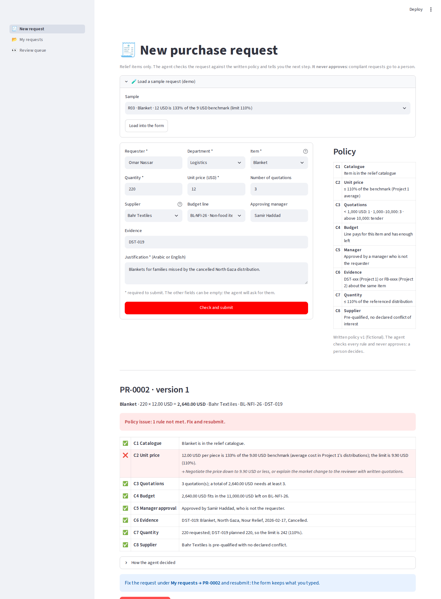
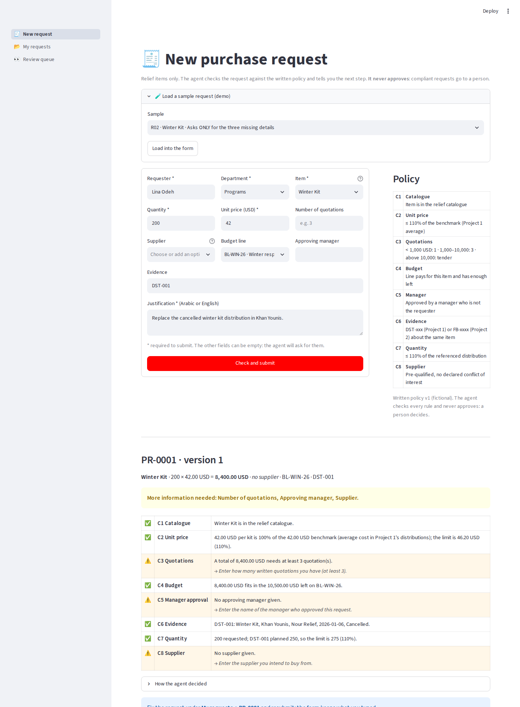
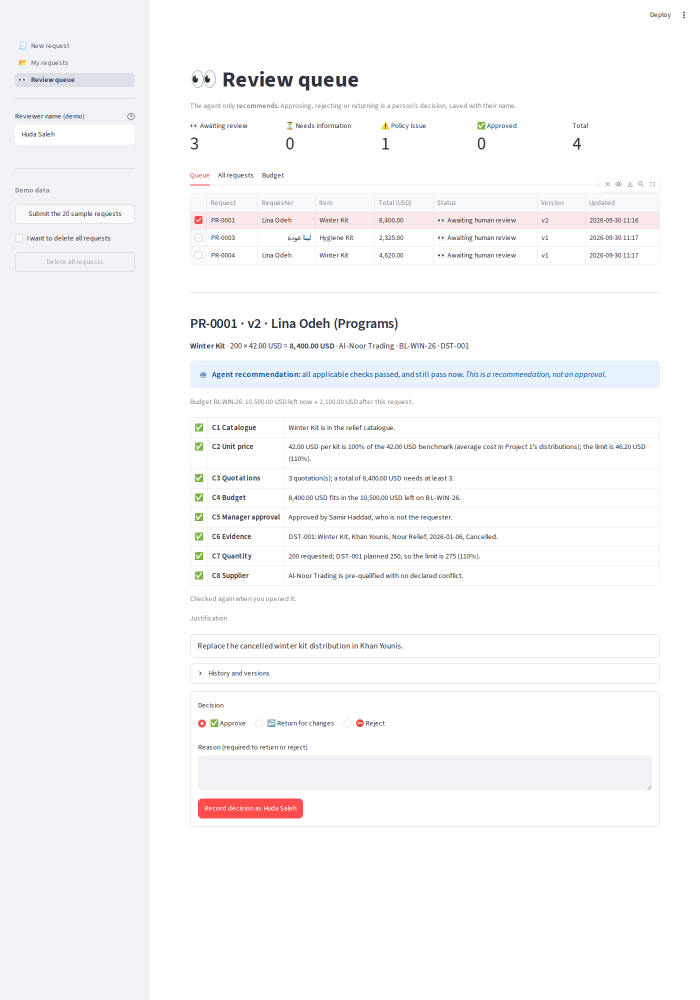
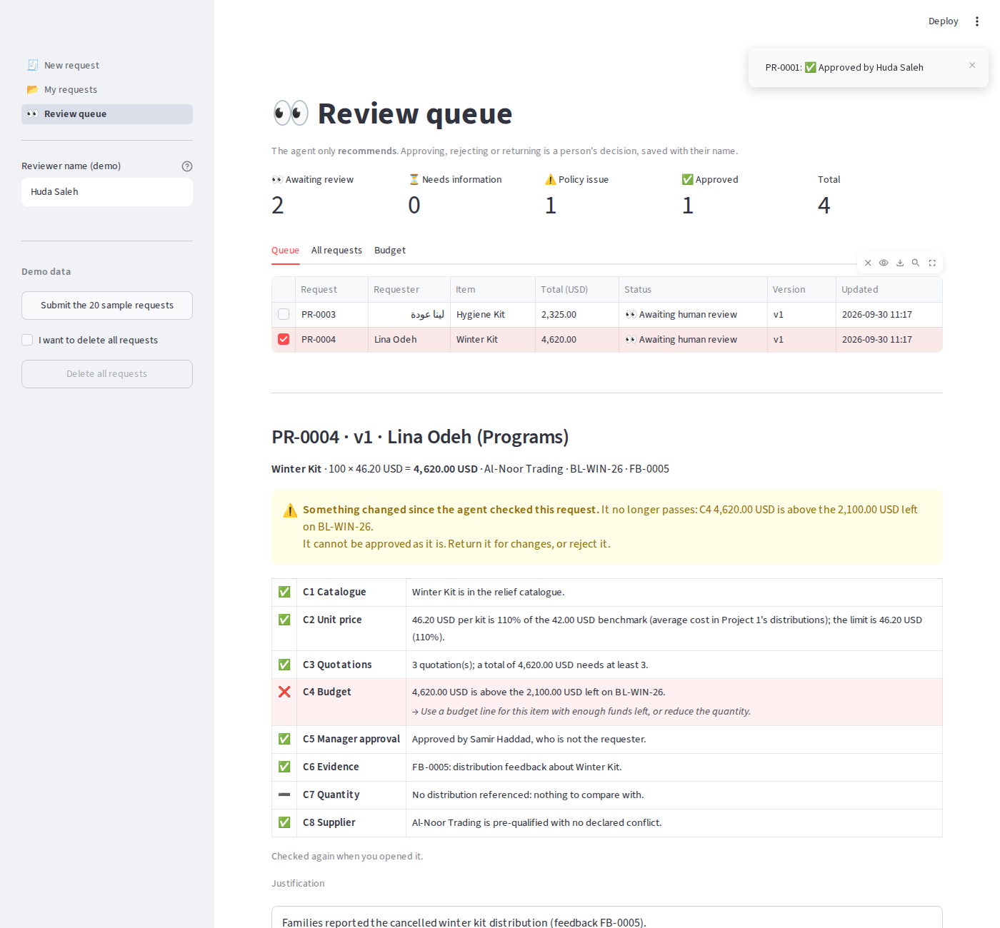
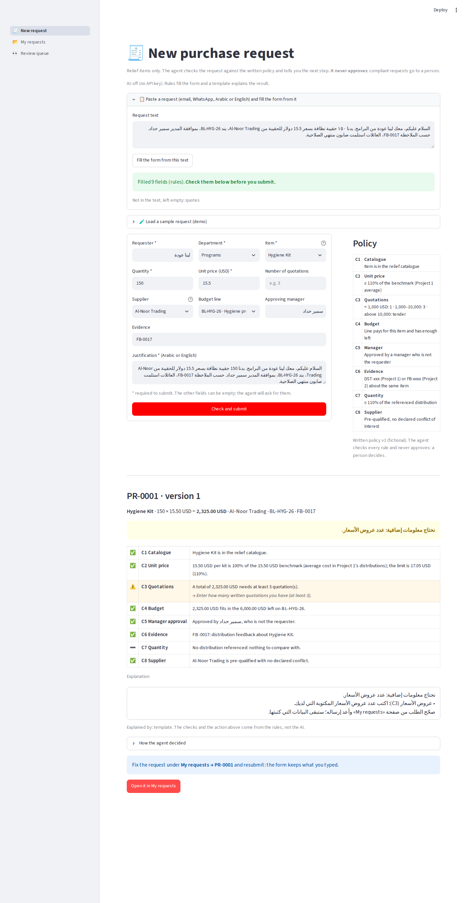

Claude


Project3 readme · PATCH
From d55a062ea49e2bcb81015e1fda2501e05bc55c28 Mon Sep 17 00:00:00 2001
From: Aya Talat Samra <77492850+Ayatalat0101@users.noreply.github.com>
Date: Tue, 10 Nov 2026 15:51:51 +0200
Subject: [PATCH 1/2] README: full project README (was a stub)
 
Problem, the 8 rules, who-decides-what, how it links Projects 1 and 2, screenshots,
results (296 tests; extractor 99/100 dev, 53/60 held-out; the concurrency bug),
run and deploy steps, structure and limits. Live-demo line pending deployment.
 
Co-Authored-By: Claude Opus 4.8 <noreply@anthropic.com>
Claude-Session: https://claude.ai/code/session_01UVm6yuNLML38rM87E8FuEK
---
 README.md | 162 ++++++++++++++++++++++++++++++++++++++++++++++++++++--
 1 file changed, 158 insertions(+), 4 deletions(-)
 
diff --git a/README.md b/README.md
index ec8bcbc..fa128cf 100644
--- a/README.md
+++ b/README.md
@@ -1,6 +1,160 @@
-# AI Procurement Review
+# 🧾 AI Procurement Review
 
-Work in progress. Project 3 in a series: [AI Data Analyst](https://github.com/Ayatalat0101/ai-data-analyst) (1) · [AI Community Feedback Desk](https://github.com/Ayatalat0101/ai-community-feedback-desk) (2) · **AI Procurement Review** (3).
-Relief purchase requests are checked against a written policy, using price benchmarks and evidence from projects 1 and 2, and every decision is made by a person.
+**Relief-item purchase requests, checked against a written policy — and every decision is made by a person.**
+Project 3 of a connected series: the price benchmark and the evidence come from [AI Data Analyst](https://github.com/Ayatalat0101/ai-data-analyst) (1) and [AI Community Feedback Desk](https://github.com/Ayatalat0101/ai-community-feedback-desk) (2); this project decides the replacement purchases those two surface.
 
-Design: [PROJECT_PLAN.md](PROJECT_PLAN.md) · [بالعربي](PROJECT_PLAN_AR.md) · Test requests: [data/sample_requests.csv](data/sample_requests.csv)
+
+
+
+
+
+
+> **Live demo:** _added after deployment (see [Deploy](#deploy-on-streamlit-community-cloud))._
+> Option C of the *AI Systems Building Challenge* (decision support) · Plan: [PROJECT_PLAN.md](PROJECT_PLAN.md) · [بالعربي](PROJECT_PLAN_AR.md)
+
+
+
+---
+
+## The problem
+
+A relief organisation buys replacement items constantly: winter kits, blankets, food parcels. Every purchase has to follow a written policy — a price ceiling, enough quotations for the amount, a budget line with money left, a supplier with no conflict of interest, a manager who isn't the requester. Usually one officer checks this by memory. Rules get skipped, a price above the limit slips through, or the same budget line is spent twice. And whoever checks also approves — so nothing is really a second pair of eyes.
+
+**Example:** a request for *220 blankets at 12 USD* → the agent flags **C2** (12 USD is 133% of the 9 USD benchmark; the limit is 110%), lists it with the number, and sends the request back to be fixed — it is never approved automatically.
+
+*The organisation, its policy, people, suppliers and amounts are fictional.*
+
+## What it does
+
+A staff member fills a purchase request. The agent checks it against **8 rules** and returns **one** of three outcomes:
+
+| Outcome | When | What the person sees |
+|---|---|---|
+| 🟡 **Ask for info** | a required field is missing | exactly what is missing ("needs: quotations, approving manager"), never a vague "incomplete" |
+| 🔴 **Policy issue** | a rule fails | the rule, the numbers, and how to fix it |
+| 🟢 **Send for review** | complete and compliant | it goes to a **named reviewer** — never auto-approved |
+
+**The 8 rules**
+
+| | Rule | Checks |
+|---|---|---|
+| C1 | Catalogue | the item is in the relief catalogue |
+| C2 | Unit price | ≤ 110% of the benchmark (Project 1's average unit cost) |
+| C3 | Quotations | < 1,000 USD → 1 · 1,000–10,000 → 3 · above 10,000 → tender |
+| C4 | Budget | the line exists and has enough left **after** approved requests |
+| C5 | Manager approval | approved by a manager who is **not** the requester |
+| C6 | Evidence | a DST/FB reference (from Projects 1 & 2) that justifies the need |
+| C7 | Quantity | sensible against the referenced distribution |
+| C8 | Supplier | pre-qualified, with no declared conflict of interest |
+
+## Who decides what
+
+| Decision | Made by | Why |
+|---|---|---|
+| Does the request pass each rule | **Code** (8 checks, a decision table) | explainable and testable; every result carries its numbers |
+| Approve / reject | **A named person** | a system that moves money must never move it by itself |
+| The wording of the explanation | **Gemini**, from the result only (→ Groq → a plain template) | natural, and in the request's language |
+| Reading a pasted request into the form | **Code** first, Gemini for messy wording | you see every field before anything is checked |
+
+**Two safeguards that only exist because this is about money:**
+- 🔁 **Approval re-runs the checks.** Between the agent's check and the reviewer's click, another request may have used the budget. The reviewer can approve only if the request **still** passes, on the exact version they looked at.
+- 💰 **Approved requests use up the budget.** The budget check reads what's left *after* approvals, so two 6,000 requests can't both pass a 10,500 line.
+
+Every submission is a **saved version** — fix and resubmit, and the reviewer sees what changed between v1 and v2. Nothing is ever overwritten.
+
+## How it connects the projects
+
+```
+Project 1  average unit cost ───► C2 price benchmark (the 110% limit)
+Project 1  distributions     ───► C6/C7 evidence and quantity (DST-xxx)
+Project 2  complaints        ───► C6 evidence (FB-xxxx: the need behind the purchase)
+Project 3  request ──► 8 checks ──► ask / flag / send for review ──► a person approves
+```
+
+## Screenshots
+
+| A policy issue, with the rule | Ask for the missing fields |
+|---|---|
+|  |  |
+| **The reviewer queue** | **Review detail: approve / reject with a reason** |
+|  |  |
+| **Re-checked because the budget changed** | **An Arabic request, explained in Arabic** |
+|  |  |
+
+## Results
+
+**296 automated tests**, all passing. The text-to-form extractor was measured on two sets:
+
+| Fields filled correctly | Dev set (10 requests) | **Held-out (6, never used to tune)** | Gemini |
+|---|---|---|---|
+| All fields | 99/100 | **53/60** | run `python benchmark.py` |
+
+The held-out misses are reported, not tuned away: a manager name the rules didn't catch, a dialect price, an Arabic name with an extra word. These are exactly where Gemini's extraction helps, and the numbers to watch when it runs.
+
+**A bug found by testing, not by reading:** the review queue is shared by every session. A reviewer opening the queue while another session was mid-submission (the request inserted, its `PR-xxxx` reference not set yet) crashed the page — the same class of bug that hit Project 2 on the live server. Reproduced with two threads, then fixed with a locked connection and covered by a test.
+
+## Run it locally
+
+Python 3.11+.
+
+```bash
+git clone https://github.com/Ayatalat0101/ai-procurement-review.git
+cd ai-procurement-review
+python -m venv .venv
+source .venv/Scripts/activate      # Windows Git Bash  (PowerShell: .venv\Scripts\Activate.ps1 · macOS/Linux: source .venv/bin/activate)
+pip install -r requirements.txt
+python -m pytest -q                # 296 passed
+streamlit run app.py
+```
+
+Works **without an API key** (rules fill the form, a plain template words the explanation). To turn on Gemini:
+
+```bash
+python setup_key.py          # paste the key from aistudio.google.com/apikey (it stays on your computer)
+python benchmark.py          # rules vs Gemini on the dev and held-out sets
+```
+
+Try it: load a sample request on **New request**, change the price to 12 and watch **C2** flag it; submit a complete one and approve it in the **Review queue**; paste an Arabic request and read the explanation in Arabic.
+
+## Deploy on Streamlit Community Cloud
+
+1. Push to GitHub.
+2. [share.streamlit.io](https://share.streamlit.io) → **Create app** → `Ayatalat0101/ai-procurement-review`, branch `main`, file `app.py`.
+3. **Advanced settings → Secrets:** `GEMINI_API_KEY = "your-key"` (never commit it).
+4. Deploy and put the link in the *Live demo* line above.
+
+The database is SQLite on the app server and resets when the app restarts. Projects 1 and 2 are not on the server, so the price benchmark uses this app's bundled copy of the distribution data.
+
+## Project structure
+
+```
+app.py                       entry point: three pages
+ui.py                        shared UI helpers (display only)
+views/new_request.py         the form, the live policy panel, paste-and-fill
+views/my_requests.py         a requester's requests and their history
+views/review_queue.py        the reviewer: queue, detail, approve/reject
+procurement/models.py        Request, the form validation, statuses
+procurement/checks.py        the 8 rules, each returning a CheckResult
+procurement/agent.py         the decision table + approval (re-checks)
+procurement/data.py          catalogue, budget lines, suppliers, the benchmark
+procurement/extract.py       read a pasted request into the form (rules)
+procurement/llm.py           Gemini → Groq → template (from Projects 1 & 2)
+procurement/store.py         SQLite: requests, versions, events (locked shared connection)
+procurement/explain.py       the explanation, in the request's language
+setup_key.py · benchmark.py
+data/                        catalogue, budget lines, suppliers, sample & held-out requests
+docs/screenshots/            14 screenshots of the flows
+tests/                       296 tests, one file per stage
+```
+
+## Limits
+
+- Demo only: no login, SQLite on a free server, fictional data.
+- The extractor is rules-first; new wording needs Gemini or a new rule.
+- The price benchmark is Project 1's average; a real deployment would use live market prices.
+- One currency (USD), one organisation, one policy.
+
+## Author
+
+**Aya Talat Samra** · [GitHub](https://github.com/Ayatalat0101) · MIT licence
+Plan written before code: [PROJECT_PLAN.md](PROJECT_PLAN.md) · [بالعربي](PROJECT_PLAN_AR.md)
-- 
2.43.0
 
 
From eadc914fd1f54ed90311f3ef590718b10de5eb90 Mon Sep 17 00:00:00 2001
From: Aya Talat Samra <77492850+Ayatalat0101@users.noreply.github.com>
Date: Tue, 10 Nov 2026 15:57:39 +0200
Subject: [PATCH 2/2] README: focused hero image (the 8-rule check result),
 matching the other projects
 
Co-Authored-By: Claude Opus 4.8 <noreply@anthropic.com>
Claude-Session: https://claude.ai/code/session_01UVm6yuNLML38rM87E8FuEK
---
 README.md                                 |   2 +-
 docs/screenshots/00_hero_policy_check.png | Bin 0 -> 65156 bytes
 2 files changed, 1 insertion(+), 1 deletion(-)
 create mode 100644 docs/screenshots/00_hero_policy_check.png
 
diff --git a/README.md b/README.md
index fa128cf..5889840 100644
--- a/README.md
+++ b/README.md
@@ -12,7 +12,7 @@ Project 3 of a connected series: the price benchmark and the evidence come from
 > **Live demo:** _added after deployment (see [Deploy](#deploy-on-streamlit-community-cloud))._
 > Option C of the *AI Systems Building Challenge* (decision support) · Plan: [PROJECT_PLAN.md](PROJECT_PLAN.md) · [بالعربي](PROJECT_PLAN_AR.md)
 
-
+
 
 ---
 
diff --git a/docs/screenshots/00_hero_policy_check.png b/docs/screenshots/00_hero_policy_check.png
new file mode 100644
index 0000000000000000000000000000000000000000..d4a212726778f2b2802451ffff8da08a5a2fecd7
GIT binary patch
literal 65156
zcmd42bx>SUus28&AR#~!AUK3DSa5fX4DRmk4DL>X4;tJdxDPVG0D}aAYmgZj9D+Lp
z*DdnitKIL_+xoV4|Jhqpb>-aCbGz?3=k~Ar*I;EuDcqN2FVWD@aAl-{s%U7>rqIxy
z%Di}rhKANHxOI(&b}uIb{G{$RySEUiueP}$eh(8DDBCFfjL!?~{;jH7R*UmNLzZ{d
zz}WK}oS;!}Yg2RnEguGGT&F?vH`4@Bsaie3e#ik|6Yl&4<{|D3(2mmWZL3XflQI(?
zFHj+$uaob2@*&j<zs!q!Tg3F=adBIL=23Tu(WXDdH9Jwoz`y_<?Qy$Uw0`^K-%*g`
zza9G0zunhm@_+kI{{L&^$0OXw)BkFG<M-_G^!;Vn^PI9OTC*#;&Uki)^(2r$((}iL
zAjc-FTF(O8=@t5CRu0wdD7|^p&)~<F=-)HKil4L+>Ui3EMUK9Nxu<%`h+2q!TH(y=
z<nn0R2b<8Trk4!&v5PPP^r_u^4lUiAcYemt_V%WDaPJ=csYs)&rKMJ9Yib+GT1uGY
z*DQZIRKAnRgBfc=ck=anY1&MwG1lRVJ#%!w8qmDvzFK(5Zw$3kkFZ!jv&T$82TF`3
za&8Typ`ji9;xDhL*nNk-bcbcd;5Z_GL?{3k{X+m_WDo=j*^z+8Dd*Zf&f*(8bCse-
z7n6mQgt|r~zyGKeavW+23d`$zkFA%QO|)|M8*_PsU0o0!TOY4<nt>Q^WHUGrRU4{}
zoZZ=(y}rg&@WiMYw5M7R!5&Y4f`+yn?kMl$b4`h9zSEJSp1m0nkxq0n*zx>MdS#b}
zFqX=UkEFd#26(!EHT%a_rN84!kpyJr8!F$$#b0gM(u;?;z>_63E)a0uafL;RS*ySM
zP<XfFxswS5M&CrEIww)P`>7-RU`Sa7@8@;D<~i+6epeqkIlX}m4bW?t6A<`0_baM1
zlCgESMQ$S#=ytYCfXg4;m79C{J#1;%yk~wZZOghy|5lVTuS|^nYD9c07h$lk=Q`TI
z@jyH8OCiLKhKBZ=re?1&?jv5Ci@WlnU#WyI05sCOY6;+)E|r}!8Q{i<ZDjD5QyJ}z
zeo2Wpt*t*r(#)o97ie`o+vbf+ffr9}Hy1nXgoPJ>51dViDcU!O42)G{p(@`B!PEa@
zozQ-By_;tql!p?ya<BTv_G@RiF*Vo3L}bLhMfBKbFi1|e@UL{R@R)GUjpFId#!^D;
zrTz`Cm2YwYz^cp_O-O9A&cpcPlr_o09f|2-X}31UWShSMJh+Ilu)4aE?+xB~^cJ10
zjMB?b$DHj*>q~8$;Kl6`Yji!XiKD5Y;G5SLJs0qlH<;bsnA)xm){`Vn!UhYqpt8Up
z6XME(%z32<uA{h=#{5E#hmS>p#xs$s*+rgD-28QrVH((7ziyu;LzA$Ht4A5j9mtO~
z?!fLV{x-Vx4bLaF+9)bdU*qU$&RbFgq9D4-&47RvxlY-KkLy`!>&$#>L>jR4u)<}k
zCS!x-cue*n_PO+S4-@smz#kJv&Bi7ZDcME1v!Bur6*_(NiyO_#hb=fojdZfLs@B6m
z>Yu8MX{&XzTj@D<sXsqpprN7pxLLJ_o6fgM;MfQNM(sG9fxkou`^-WCVG%Td(X|ga
z-2Bu0I%clvUDZoFPLgEH%mwtg@y*SRsJB2xdm<(xfpp_i?T^4{?E_KTP5iQmojGuS
zCGYFN!dJD1gYR>LQY-<GE1<t`y;esF7He3snQd%D#2L2M3vXo64vKu*vpR$tusYn*
z`-d*3k9jB&wn2M|tD8BJ?zVqc9*ygLwxGq2-yHYd%0{rsQp2O8;c^42z-yIh%M^J&
zYLJ?`;zSLX@MQ5Ey6!4&C*vm1+-1((W!4BCpMxfB%7iC{<rUSITWc9QAW#8Df)H6=
zY;2F-LGP_JG&Ho2X;<$A6Pp>{o1qUM9hYv~1-EQ63Y7&<+h|A6LXqiO$OWkx@us&C
ztqWC$nw(qp`$8pr+)ktPTgI}P+&l1+h|q}@Lv+)LMjJ{)y%*+ronlDy%vfHs8zm}o
zG9{i2a0H2j^bg@L=9<Ko=Msy6LzGG0ASr%WM8AG+W;1kFK;Z0rHhT_E<CtPW8gKPg
zxT0Eh-BW6@lI1-u6Bod)u{xR#AW5{m?-a^k!Zx}W)vEI-0_xwg<oJs>wQ@<h@ZGg$
z*LmG3Kb*!<bLxVN0%GX?qc_3<3k?k|B>ga+8)VB=1+Aw&Ndkvqx1Zrkzz18jj<3-%
zq)DZ!(|2DPl72H@wv1N(NyA0pELn9WBnV9h(|B&;*9&`(l~u^LFeEIr5x#P9uoY}F
zvG<6HkHD1<;4e9(;|R`o96RDTyxkxIKx)f7-w=-fEhjWH3q50Hmj9^zJxPklT}Sdl
z_3R$YW%gva$5E3^TFX!yPW#^UXN6f)<A#T+RkwqpQrh$#k@R2U65Yxu2Vi{W$waVE
zN+mhsOmZB@@%bTdt@U7?OBLyRzW0Ls%pS!*uMLw}2Lu}|0SD><k~YeQtry?Xa&Wa<
z9lm^yNc}3mlkYCm%xekY;?rzMOZxQGP2urFH0(F|A^^8m#MjKl;Uc8;W=}cPYb&lX
zX>WLRWbpB)Ag3e5V2XgKAxG#`z_r|z-9{9BXTzAUbCfqZMLW6s+y!8yn{Gi_3qzP1
zV^h@tdR-IoO?m|#=Zj%Tb9<A#ecglc%ARuW!M-Aot*_^l+g?($?}*IT@BNixsuTS>
z!N(!E&TV-jG`O+2xspJ02a$0BH}=VV*Sdtwv$nwO?Y82YwCLjYbdNm0G#f`~OMPj(
z@aZevM4|;X(B5#`6#u5K(L*2atbi*0dv_@Z*@)Dy5z_Bp$KW0WX#L1DD1rSjd-Nhq
zHhf9KXh56qYOhugW=006zbrj;W{ax$d2AtbRBZJ4KZF7|kUO)Mlgo@N%f^RPGxepl
zLhP{mHsMkQ@Ttd}O0K742NFlX=zcZhz{o5H?3cOm(|(ct^KO+W5;j8o`1UJc+qZ}a
zjS$R8lDaLjOm|Ud|6nGqX~*de$uDC*B+sNwEk7=kQwbmGMjWe3UcTMnbu|~uAtf-t
zCnBXJCm{Pkd0-jZGvg;a%^gRHHy`MmL;Idd+O2i?BXD0~1k+*TYk`Ht#C>&wdC|dV
z01ciqJ$DP;KX;;d&W~4Ldo^ro>m!3v8$T<Ls4(xW5Dmzdd1Ns`{DV*~QD(Jt&H#tJ
z(y}EP52gLKziOhzC5|AJ^vjxgP;}LFOzK84W#c_toYn9SdY{x_Vkirk(T2rtrJq}b
zx_dk^RAkJ!=n$f&aHnaS#;bvgq)Jl{xsve)(!0WQc6AK=^PAG`7U?*gf;ER~0C+>>
zw;BC2`@4Dx{926!@p)zWKg#mo_c5@TSh(2L1i#7R2KjKkPm#eic#Adf8-SO{ZHq%8
zc#k(2kS7=(@Hj(Xw1>a0F9|)pYZv;}G<5sa>SmzF;|rV08a#Y57`?lp9ND|h;{<eT
zR4{X~)T&fB_GgYn8FT2BI=(`5k>VB~P*tYZLDq&XpZ22A!-v&(D_pc3Av|yJu##=`
zrqN&D2uF1-BW}bE_UGM)_TET1sL`nS-eEN`e)v9HzT<v}%o5OHj+R~?uFxW>E>#GB
zmLKKfdZAgLR(0$rVdx^EqmG1=C*ik#ee?>KpWo34k3QcwQ~@7LrEKyOs6;WrSZu8-
ziQ}Y~;dM>6McK=Gd<xQMLIA}Ir1KhzoXjPI-u{p#=isx8B{$v|kxhJx%i+>?A$IRC
z;NF%Efcx&ohcP&L-ibN23HJ%PlJnG}auw%LdRPne4w>}^?^jC{sn8H!yxnn5&|9O<
z?DmX>LqzmlZ5b<qP@+7j&gU6kL$YN>msR2HeJ73Nhuwj%G6mf6jt}@8q_a3}nP3t(
zzDK`wTs%Vmh2I|nnt8YpUus9iXa0F&ZJn>MGn>xy41&9N8{8EjvdW5T9V+qkp93RV
zN;MDFw`)~~1-2Uz5h^T;83c#E7h3s$X**5Yaqv|1{QdPncUTG!ybQo@f<gb5z}M1h
zD(WR2a&SW5u_z<h;ZJ%CPcYBST_?@EUG86#*BxPM$!D|of!utWQy$Nk4%)?Dv_HDn
z0UtW~<GnmSPwX8`FKVo>YrQ6xihKqLsuFjaG4%dXep5ohI!jPK(RhHMR0%LG;V+1{
zlj*jpa7j>8k6DPnfTI`#E;dM&CCMlNRuK_X8p(uxdQF`mMQv|$;Fx2OCd4R_|NVU<
z3Boozk^L2C+0d&LzU}7_Et9a^0jqVDaZ&MoZ&NFWLp_Dzor(EM8stR_M`Y;>!9~g!
zXlQ6ohg40pn^xYNbbZ9ro4hW-eG6gi0>W5gm5AU3{JU}(f7*aP)LX;Fzf|8?Q!Cm1
z!DDzYq!87GXU7-BI<m7mytdEKvgxLyw4rY3BEoMC2$a!vX*y*aK0BEY&VMU!Cfb+H
z#0YTsnL)4%SsSk)P@>)7a|X^cYM27Sc44_)QeA0!I~C+SS%*8%gbkBlrxNUgD|yq4
z_LH*rN#86pr`7?p8r$mzeZEfyCHb?{QMB;Un<}`huV!J!mbL-7AuZM(H4HYkpbR*}
zP&z3VxoPX+Xb?rzfwr@Zzpxb0+-5f*8#^5#bplo71V;BWd?-I8dz_hQoiP8W-fpVq
zIwvc909&?UW-Q-nlc|0$3CP@hlgC*+AHeJ`KHq1@7ksvHHZCe2ez0b#=vd|`@O_%V
zn;^cqsC`kB2b2$YSHOR>F*L>RWbTiJJqOze@mVaTgxNqn%yci}^fP!%6s;A{?lrUm
zWr>-o95`D(;&aTwZ=JBM94f>Y`If(GcO;#nOC9PnNWOzQ`1+2G4Q1-tGU;BoS#bII
zO70nCp7S+m5SGf~28%mXGpZoo;Kjctr`TZV{gwCV;b?nsiSWIr{$yit)5*KGsbS0d
zOChD?kWoJB)tj>bS{&^f2#2_Pj@w#hjP=k>csynZlTY<0Z6oqS!4;V<{yjlIV*^?9
z?{V<&)BwpXf;aeyt&AOe%8Jnhao=9H7Vz(hyBHhX+KmOM&3~5AcFEaUpnK_Y2`8%X
zq!6rOqvq=G%ccXEhKfDO!?F>6MJ1ih&|~|ED8D)sw6wG+KVo4tw9|-@|ALH||1SI|
z+We16g7)9g=Kl;u-~UI~|2ru9Kgs=1ocjL>;{KESpMUya&-=g1{Tfbp$;Z1Nt#bXm
znst0p=jC9``n9ju?R9URJ)@k_%U8aP0e?nM_=cQv6D2%Ze6Jq8{pHXh55%G(Qr_Nu
zy?p9Y`k{2#_U=e9&%{$yJ|()3k0mWpJ%2wnztL@9&fj-aw?cgvpJ?=@`shoedX@rt
zdjP=Iz4!AY_V_U&&T+CH5+f{^dAh}Rq4~h2b<Ir7B0b2Wk{N!J0-?3&lp|-7QWf54
zxfkBKaom2w%fI?gJ-hk67;JQ^Bd?J{Ugz>;hpTG+yv}pe!U8g?Ex?dhiddBgM0p@D
z0^&ie2TQz|2XxBYRHgbg6$7il>vK4FNwsECFH4OFj1a|8PqY~~WvN6l8z^Piao+nz
zI5=5C&)4|ZNor6sv@5lk5SI4a^9kC4*-;g<40w-xKA5<bqJy*I_J$(rOha!2U9vcZ
zJo{xZxkknG8pt2tCF<NUZcUcIT7h|5@G>g`B$|+@LMPvUUCKd|QPw~3!5$jTbB>%U
zf62^?3FQ_fb&70g+Z7(hFJWCsXl+X<k)O$Guu;fjN30!IP3Wi@ThS6f6zq5n#PXYo
z@Lqw4tJzeRG!Yq77CIHF9TXIN43-)h<)02e1p4QJJ6u+}5aliRC4LI1mqioe%FXZL
z15*S%Nmi9Ug4)|uB+bUly?4*B=jH_NAre|iZ#Sr#+^lG(i7|`Vk6!CHjgVF7%nm}e
zSYN#U3$t_&F4rBx-F_R--cu<%@?qy{@~F}x;AAH6_S7qM8`x`!AolDKu007+@b>jw
z+xO@9|Hkm^n%>Tr-|;ZE_1SKh#jy0`s{BUh*#Lphl^63{{3nNt9_Mg%O?wIN<X2tR
zmb$>}QA%%L_`}@0KO^vkZ=n&V2yZZXq<rUqw*=LCw>Mcv=4lpG%C>@GcCW({)xR@+
zKw|1z15k^y{gncU9Ay<sO5Lj%ooli`GR8ndi;Zq02XlzI(mXB7GMrR3a{YW}86{D(
zsnB!bB9J9h;TmwDxJ=MuVpS^7wt}Z3?=o?`?#rBUx`JQZHm0D!q!GnpB4t;@5NE1o
zt4K?nQkD$n#_*q1ud*%BK0y8bR;yuuaG?YMd;{<?h_`4ocsS<~2yS~){XB=*%&-WW
zk5e)`{6J-@;s<pDfqAvgS)qMLrH5|J-+i9TwLN>AQzp}_Q`FvkyhsySCLiNHl%THb
z+3~R`x3Q&>$11tSzpot;@N{lku{mlwsXnUJDjegu9v5-OKsHzKtf!K9hIM4Liu4U8
zNd<HoB0f)_frn53TZ3v$j*mN3*sRTK)b7u)CuL25fmAfDF{JwEZ*_zC)E=Kr`xp2Z
zyKi59Q<<Arbr*n@=X-p)M`~|=(fejz%!Q1yDVzKKyL8=hFdaUpgs!^ukrB_iij3M-
zzx2h6mv5IW<DhAR4o+)KIEpATza^nN%49;Cj1>muigRR$Ia6pO?2Q-m(_2hFoCCh+
zL{X5Inu&b*g?1sJJP=Fo*=j_eYdbRR6bQf50(i6s?7s%_J!e*P)oJeZl<_ImAN<ba
z{KZwx#iU3`z>w|d)myZ$2Xl1<CdPiN8Himj&;0>~b9ye@+2;yj&a>Bb*`(yeVc}QL
z+4bl7rDob1%{Bc-zwO0f|N3?N?3bb9AnP=aC@j6B-$;yEx%qv8rV^0Ipn=I%M}Dnx
z83S9*MV2h4jXRc8P=O-7Vo`tjaQK#A2>{D^502=I1hP0&SUtE#HI|`R)GxIkx}^!*
zpMFt;<{3GhDU^>?Bvf74v-a-nHGnharbg$TVX2AjH?57HqJAl1*kWEHTs+f!7o#1=
zB$=IPN<?odfAYL5L!4@`mW&z+tsy;TOc7tpJih?~Zob9c!@Q&vd*R`cjbY%@=JLw%
z^SADDHUT=q<Ou=BV+Yahf>+_OsR!Em#=i8ME}lrII#fV@z(xCO&3aC5eAf$yk@+(R
z%fgTfcGYaMH#u{2z3GQShQe-@l2Xx2m<XwxI{x)Fs%yRR`}w5z$3GR1Ew7Oa<#(ZF
z0nyDKRvtwjA)YcU3stq7IUmhXqo)mz_DjZ2wMaV6UAKtfS@$kG#<s*@*H0N2j;mmn
z(P{G1vTv{*>N@K0xndnXSjw+}p0lra^^l*$+6Vw9v@F^y^;@9h^1#Asg($FomXT4d
ziOKM}?k`k+xA&b^grL5yDYG+xi#Mf6XIc@+YE(jYOjh#Ef;WFlm{u&U{O`dIC8qBJ
zYD&Gx<gM(|qDL3Gci8iDpw&%vK|c8kiRr`+PBf6I&Ty^95ZZ>Z-w=cO%1RCG>rMN{
zoT<82GQ|gb>RxWIun_(uCHL~y+ep67=r=_{WXvZC(`#qq2<H(xc%&XW_va+;ne*%X
z%GPh#se+0|*{L~m-NTBDIry}VTZ8=7vZIV@iPfsxLz78`C2L96f&k5Tq!n4cZ{lzE
zwk~_HR9rlOa<#h%OO>xB{r8($c?wFObuM(mN#cP(N%se6tbnzGWSy_Z#?D?{!d`>T
z*&=xzzLZFbH8aDx$Kx=G!Ve-w2WLbjn5C8w3LC!Z8uX(zw;n&&prBEj39N(IE(a1~
z9Opb!dZ^SooEKO6V7Wg^t~*O!o*}5>1gxpQaq@av?Aa-Ugy=d*+Q}9&Ov1jF<e}tM
zLvxd)fS+?wi!9q2<nAd?qWtU}&74-@ufFhU(pyA;m{{#=!ls_4!_<wfVx+YFl7!QD
zhjwP0<3oTASKbYU5idMo?`oTy%R37r7W|f#oqc#*MLhk_!8s0H4O;65LW-TvU>VuQ
zW2b|~jKv{EXp4ZABXlV&I2;>4tJT8f9^hzZ`ze!UW#L!3!f}3BG(r&JgFmLIO=`?G
z!V2O|?+{2Z8i|qyW4#y>P;Z*a%qGh8tlTk2Af1lw=@qYMv$wCVYZStVUJ+NmN>1<&
zS^4v$&gEU7b0vUYx14cKk8_pIoMwMC<(!C>LA?p;nPS?JBM@{C>Ube35XJ#W;oLnf
z&cQ|h{H>>wm--SDt*N>brkMP8`=KkSiMN^1N`{C?+{=Pm2|xRI{J1>s+`@4Xb#)Mi
z7M4L?&T}_by~yZ$aX7SCFG|Dtl{&b%%qT>PNWr3a1AnA`Ys9A3<%teY@^dD)HG&TI
zhlSzjs^;xlE?0Y-n9<LbA|hgZAEmnoX$X*o-J|45xN1Y4g&6E~gecu6yL*6mb@v{O
z)=v2=*Rt#Gp6(JR&KI7`9APD*7D3^7))9GeHl4)B5dDPpPY=bt{n>ODL3-RJx2ClP
zM5mkGO?l1M`YWV4_tUW2w8J&p3P%=UkCb_<@XH8$HgU&s7up}iZ88f=aYY;aTX5p6
zHH1^UOvRrYqX8#OXsGn^D91v4%XcYrE}SMaV@Gl*!IHbz_$nn_OoMTi3>zug{^s08
zb)(bv<{SJYAeF0|H1j4kI~!>&mQ4OP=rLX_>{BJXOG-#gyM6{)*S@fn|E|w;s@e;Q
z{>#J5XYJF@oRQrmO2f&=WGZ88+632`wB8$vX7Ty8vz2aIGMCr>NyFro{KBbaQnmUH
zdAoqvSI`GXJ_4nDd6}c}xBE<NC_OtI#pu_qF&3B}_^>p0GH!4Yewp?MtzJm<Ykc8x
z*ZovPe~?mVbVMOXqnLQdEOK(C&G-1V`t|FFHzfrJ!_JnmrET<{I*(yy7saXa%JOd`
zz2hVna0a2JK*}W^rvMzhp`f*?@3}@54c}#4O&vXSxSu+rp|vc5+CvAYrnE`7GnJB3
zHIWpkgy9+t#%GqEEMX~Tgvp2)`;3j04UbrBW1PMh5`dHlFB}@<2>Fe6@r=w9*t9Lq
z8Ud*ZZmWC-Ju4n>#p*`cwd(JTZ2cd$b-ah=)uT%6Qy37V5(*OL*VkEn960e7KL?d8
z`wa|T&1`hIl~xrM=rmY6kK2Rd+l0Fw-+hMEs5v<Aehw#ww&+u}C3+A2ba|bt$9g4#
z#AB`4Yu2wm_K)|=wEH2&l)m*woY_=>d*I^ofa7j0;$Vc$hB&m40Uf-L{)7nd1%aib
ze;X$4>K+gvaX{4TuaqF@X@y%Ntr)9Oqb{yb`{~#7r{|5ee+8{rf3~mgv=2u1GaldM
z=L0qLHC2pK3<C3+yg`aV`we?UQP8UR?0Eeeeq@vtl8;YaD~UoIst*kqJO8j-MXOj1
zVHH=^(OCLDW48ue%nFtM2*f#VsRl^DPr^!*Ol)SzGDTMfThl81c57^`HJHBN`24_s
z!&SuNjKm&Fj*=tVT;qgJ6AlwC_DY+uJLj;_26&9`@M7;+_R-VzhBJq>3bR&p*01ZO
z*hB0#BS>VlXJdz*2EIz{U>!fvX!ecD<dd@(acVYk58<t}(jLn@ZVOHd_ppk}D=Qql
z7^#eN0ru{+4%eSj<la_|-xXu+#i+dU$*;NxdCrh#=xv5I+)wXPGnVD;!W^SThOdWX
zjPMBnL-vU;NwO54pdIW!OI2+)azc~qq#lo_-Zfm%R#8JW(Y7pk8KpOx%Y}YBOD89z
zAfT=8XSeqdb1o>(#^apQ&(eB#=5R;@%0~^5ueSOcmi&BCEa)s}u-r!5VLI^pr?gs1
zZF6^_K8)V(W52+utK=GEF;UDn8b-4=1JHYurU=p_eAsQwZbb;AFKiU5UR;H$i{-Nr
zq70lH0tXv#r<g#yUuXjqI(A7{S?Hmm#}sY>>oUP9=7;e`>_$c!Ws1@yE$XmZNvZtb
z0a45(-d*>JSc>m-EqZrYi!eJ7aHPbX_rZ4tV+>$W|Jn%Sr>FVes%EaLDrWYR;-ma&
zV9>CE7(dKvvTNOSmq1+F)EiiQe(-V9oJ%*N5RgLZ6*a%XS83gJctY}I2&YwcO`bkh
zdIm<Q#Kq0zY^nZPRm1Q)EdRRo)@;zTz=DtH9Z#cc_Y42)=N~+D%^ZyxHA1?X{4i#V
z=9tKEOz>1~nP+QkOL{$JOx;wqMG%{XM02~bp2$pAirV&yivutBt;8sz>=wyBJWfUZ
zm1v%0@9i6A{EQvBC=YtpdGbbwrR(4A9G-<179f`IOlq$&X!R<`1YgWhW0!qNG?m4V
zD=q(nN&KVgIa{_Ysu!(Gwi|GGguq&HNs%VWd86kdQmtzin}U@stm-T3Z2fT7;Av!P
z?T}4^#DsBFAGwEjO`o;Hrn-FwfseR<>&ANw)?>$$7D19idFj&T^9<aDT(>NNL}TNU
zpg2ZG6&Dgy3HKcwW|}KhLDb)dwPekI?*LzR{6yOgY(L3?@5ql)luuSjD47?UYewb6
zO2W>?t>$jC7|za2+|SOC4S5^L9n7}=>5_+)t;}*VI!4rPzD4E7cWr{qhRT7Tt2zp@
z1QySZbO4%U%OjJ>b5?=ItsRh?NOP|IN8kpsxA9)-;Fx6YIJ1!{&{4D`0w>|v;g3eJ
zM4619?3_PA9jv{4Ynn%1(!N8F=&7f8a|F(aJyK(eC=mq&nxRvd`Lp{BDZVlV16>nc
zCqI{nuW$ZJC~j{=0D+Qc$MoDXesA&L#Y@aNRkn-(X}_ZuC265I3+>4bTv+jtme!jU
z@u&@;Oj|k-De$Y(-fqYHYr^r%7st*FfKhX^u(?XehjOkr<Ztk{0(_smv|8|05hZ9B
za+mQ^{?Vo8HbzfIT2`Gj%Vaw%&o}qA*Yk^JUA|zTmc*D3R_Br9gA=_oK$7Jzwh~JB
zJK-k{COstsVLi>pW9@I+ABeDfOp!?8H>h-HtQC1Rm1O7coBHIsyC>Z<GxKd9N`;?V
zN@^xQ^Ua6eO@DI8Ciz0~8==vF_4M;mIRP44O9%H-uaJhJCgB%zhbl<rrZf@7DxEnw
z2GB}xkU1mB$~Q71qvC{%%XVAcLIaxKzbzH3-Lb{t$o}beu$ci#H8!WSo?3<zldG2$
z(E5S1olbw7wPtH-KZlVNnYzmfXlD4*!0RnI$MdOEW&AHi$Nb1t{%n@cDA11TRJ*Wk
z45R({IAGw)n<;nA7-Bb#=j!Bg`t_e%>7l%|ak4dR$M8oDE-2V!X)o5ZX(=&>I&;zi
zBw+SQ$!P5_eE$;lr44-p8JXV}(=}rdU<!z8p%rCRs)$gC#7@w4bMG69WEzf~dcppL
z_uMGjz#u8bHE4sr8ho-5b7}B0c@DXTB$0l*JfN{|rGdv8%_6{uEV0+?Dqn@}?Vb6$
zn2LA<X>lW8|AjCOD;S~*Pfd6TEiile>1<o%M+bd|f|)RYB4yQ|+3=KqSD57RhHLEd
zlLTYfuM<krzZVR^lq(LaOw#DF3N_KW;ZAOZtsL+9!Hg(qq9St)veaC?%<`!L+TCSw
zsfbJ&A|kvG^lD}@wyK8Qe*}eRlm@rRDr_@HXkYFwEmmd+osKkUoC(F^>LyYMB@hl+
zR<)Et@~s_lOSJbHR`HHWo}}}V6)>jpB2xDT9XVX_E=+;T1D{uu%Ms0>>GTAx-b>E?
z1`S&iFZu6N>b~!*HGj;LK~B$YSmZ{BDqd<6vsnNSazws-@pjJ?(e8htoimc|MbM`c
z;pIU<%#*rTWtzm9_f3_nVOJo>iB`@cEJ@?SKQg8F8uQE82<JGDBYPkAQqLzWtoFXf
z>5PT8!}>S-uiw{l<_vhJ!)K;Kj2k&SN>QRbGM%x@RkzQ4^Mmh&p9Zb;egEX?G8m=w
zdoRNH+ktk#0Yoh!Bs(CY?Frg}>(K}=75lcKbeB(f5j_NaOmNh+oTiK@8_bxHwU@sg
z>}jyUz|{zMKY-GxuIio>kx5<euvwV;eN=Fea0qbw*|HTax@wB(q+uAuCKr(866T8V
zA?ol6rE}EW+!ImN(^sBjIl}h140~>`asSPSTgsxMV8};|Kyv@~!+`P4-;vHrt>G35
zdUnvw$+Kujw;ed+N<utFK}ut=j2u+SeQb<QDhcmTs$o4%&En`g!Zy%HQen7d*jU0(
zenvCO)a;Jk5w6&XbfUL#F_h2X=71UOkT4}R=flY2#EjwrcaSNpN)P{l@xAL<fn_tW
z@&>2FdqB7`{3=pPWPij4BwIcUj=(vyD9<6B<9Z3s=p5{3$>!yshNV|_^4ESF$ZS*_
z9bFw<^#LIHsX@E=Qh8twuQT`@qw8jTooQ_Hh{Al$;&r}5p8T*XT$#x<Lfdz4=BhQ2
zge<!`6_uW7<kJe209L}d1f3Q1zkiK*TPp|;Szl);-(ij#%K&TV_OI>l-mrUZ?Z1t-
zbMTXu?Go8EJXuiN00N`oMpM_6%mt4VBuZMQ)F2n?=I{z^86p`P+FyP!p7uTq79f=q
zxAQZ8z6V1x_Dr*vHYD*Xs;kxI<%s?s!~2Z%?-T}5XDdVdk3JFF={3b-+`A(ZJ!{!6
zPGbq3yD}l)WW{H*5<R;4`Fj(sgq=;%S$H=~B&{;Q5ofWoI-A3ZgC0YJx=*ZzCbZ7a
z=`B5GrQij$uO`h}yYNk;Kz|P}vxCnuQ${)~MFK#47LY*KvdD<y&|)hFfxof=zM|s+
z50rSqW)az)Ou8S5_Q3|#8>A6wHq?wdWz~bV8|Y}p=#uX4?s;#QZ%k|izt@+mA3Jo~
z8VzSXW{ONk_<xE<wayK~98nd=(cn|bwMWiXhy?@M1;@FAqY&~SJ?Wb-@;_q!kE!7Q
zXnfrMe-K9hNn^5SAXf%WY`=+hSS%b>+}Zg&@c5KJgYBn2xH#u=nr+qg_4lkF(4yS6
zo?1ZDAx2UdkBa~N1s-D%dwBlFZ>j0iG-P}vvlQ=9DX+8`O1U_3MYFzuYEU~X5pePG
z>d_J0Ihcj$T8ye`Z?7=+mHIzAn+U#;&{l8EA^YY1fw1~NUYp40_Pg^N?Dj*Jqko(<
zub=a%NYH<#7A_dk+M&zjhkqZV`(LF7tMo2I<^GwnYi#Hrx9z{>4E|>e|F>Mke{$yj
z*F?pCb$#Radi+@9@9uH(!{I)5YJ^Zm#*)5na%;uiQ_tsEi!s1}wDo5f9WK?H{4C&V
z`THZ;zGoVLUhA+wn&M4#TL&EOM{U-2{dafa!G-i8&F#AIQo=BRpf8#>S#P>}X=kg+
z-AbpK89Wcp)Z*<8%fNn6vz%&qp=Ej1wtW4uKF#qV{th)d31Nm>E<$mH+oHaW49xy`
zmYAz|aNVYL5S$<QX(2oV0}btK?NXnjLGSZXXZQUzHqeN|nf=^Y0L*eIdNWIG>92oo
zfYI40rR55Q)<vpm7tsM?v92ZR51uq`BA<pVT$}87S@<neOoNeJZlo7Ub}UBM{#pmm
zOh2+Wz2?P6Lql6qIuh+XTOt;_!^w?kzq6aR(&5#r&|?|HIB6OR>mbgpy1pg1XZSk>
zO}rPioOM+t&g7rxFV5}|G06FgOp*c4BbfW-Ml}%z_T!U4$K$|T{riN9WB%Qa%3_&a
z*w~RPUH&M$_^sWLO2&=k&l4-}M*Qt5iih$am#T^PNU!5RV-n&GmrL|V_Wm<hS7i-{
z`uV6xPc{0M2?Yh2JMwUd@58jKjrayPaDII#kX`Ho*5b$p7ug^eI4j{)%W<Ittk!SV
zE#B+WoL#z?U#Q*Y{4z#=Xs0_}62`ef2Hs!nns0J6{3%#t-x|9w+Yk!8hmt>?o7~^?
zce=D?U<e-kzTqV{XHt3J<rhP;B&fuCS3RIcvOB%6-o1{UIbE751eWe_^<E!6Ui}0u
zY#X>XL}=x<2V|2hU7hqmn>%hH4c9E2t8BM%M)H9@shb}Xf9-dfxRT9&4l%NrKCJ8@
zOnZAYs~=!B*}><4FwACL$`I=DDFg!NVMa)O0Yfu80sD5b9RGtpLuWh!2F_ops^N`y
zfiK52{7nwBj+&}ZB})i+FGtydY#tSs=KEE?RMXXOEpk8t{&&|QeYrO<8)TNS5w<_Z
zncTH;Vb80_4Bv9q)w_kvX9p)euNUuIm;X2l6?JX4_SxFb*75P)OSrnGp+gMkJGLLr
zQ%TwX8U#PnPOVsScf)UP8O8OBh8T!0no<LHE;pcK9W=F|8vZd4GWVUzwwCG$+#Gg)
zMW5Zel->HjdC%t8&tLQL68YWYDiDZmifX#5XCKdDrwRb_cT=lvAPX%XNWYb9>7h+c
zx%6u#qnNYoLsI^S<Kt2PzE6sn;{o&M7tn&-mv0qaS2AJ)G)_Y;(jrO5?)5^HcRmB-
zM1`fUsm2p6{@644>I)-1i+6#m8G~d?(l_Ncw|~YI11q5m+LtS+Y9R{CiDm-<`*~Mq
z!?D;76|MQ}D+@Juu;T8?Wgtt^sl+01p7+lKh3(DW$xO-9o=N>-L^v6Yimb+M&XRE)
zF@%v`@=$Uw^oR94dC~fM)u)7jcgwWHR&sW+<=HtjwY<SB_vKqz;f^w~sWc70Dl^)K
z-<xd2!jI(3*ESpQzi?;?E>8{wH20w1H}16pos<NDMgxjVz^*wmH|s#Ho!j!G2fh@;
zyP@$4*FfskIfbp_jXzL?51F`H4l<A}ajQ&l)kbQJpMu};rQ0TmJrGg?{>vcV1B0IH
z`ra|coW*!=Xu0-rwlU6KeuvDCfg3mU&v-M4&I;<Au>5vzPYT8wDeNEg*}Y|idfi*5
z>mGdePC^F86ezrPVu;!NchiaKW2y5ia)tk5NC}d*?(>Y*$1ExxI~rc!Y?gJv%dd9e
zu|I25Db>*fyRgUA#H%@NtD&yMV)mYvQwwHyM7dU%*+v1UsFb?HLcB2tgSFnnri6~|
zhx>AV5M;?OQt6y~d!Frj5(HzJ^hiYxZy#2>9tOfg;$>IOW;?Fi49~`6M%f)?Xmb2y
z_<m5Nfz^=a3Z|EANZ+?}(}9T7D+~K@JtI)9hAd@n?v1<>fu+(?1{W&X!SM2C)A9CT
z$BEZVP0jSMbbF_NR*#?fuw)S>;4V96cY$j0us=mFgEsuGrnsbG_jp{Qje`zBy+IUa
zW8&|yZ>t${GrcOdD-MOg-b_c%S^xm?ww;zu+0_YZS4$8tw>I^6%#e})w9K&U1APvc
z6Zt)lXA!J%`Lw5asEg5EtKoDe&Pv>YA%cnqH|u222;uGvN|4ph%@jTp-%!fxf?eeW
ze_3VoJEO$QX03YgwmA$hVAtLxCcSqRKW}f#cZrY8Awx};zH;UAsy%JO@&l0lil*BC
zJmq~S=@=hd1Hh!;9n9@#0Ib5J>B;t)Ec7G#Eh?G6OnDbTgRNIza0w>xE)^KGp{TKw
zd;2#;t|s~(F2v6yGdOG%>d6DQ5Ys5Rz-mtG`soI%YNG?%oz_lVE!kOih*3%Hw<kzd
zvR_o<vlf?RZcbA)_Kt03aULcS5tjrD<^-dlYJbmdA(`wd44gnTG_<(E49AsKBl&E;
z9P3*%F2>xkH}UIihe4zdd$)akhj+!-e;xgl0;LWTHj7dI<?-=~S7(m;<gtzS+tsPD
zR4ux9SBZK{Y4p&u6(@oqvs{A@51xm$qP}Fp7PD!G6^4Omf}{$!HwgoIp!VkmvHIMB
z2vP0;P`_zxW@>rId|E}v2A7yqEXPcy{Rg;PiuDW~RkqvifhMl2@P1W?9uUZ8Mw%Lr
zeDq{QPC@Mk?=txePNS>0NJ%@axZL-;OWwIsA5^qBLh$k2Z9x!QuzpF5r#sJ_kjJW8
z9G<h$JN{QXlOmRbP_<k7`OBR@u6<*R31Y%J8}HFqgoGmwFaD6uH9l;K7pqtetyiD&
z+XrlM1+e69U28ysX;vYDh*JYcMS2<1eDc(4E~Tr;ob7wZ&q^D@?7RkczdaU@<xKbX
z{XeD)3=bUTt<(^%d<JI2goGUzJM(Z7W%S@p`&_r@&@Lps=>uz*dl#?2$?^I(kf4Kg
z$K?hYXD6fh^%=XL>BGnfqKtnm+JlfA$lqT6uz`;^J`%eN6FNL9l|n9t>3`-ixIH0j
zmS&JXG_E=~V0|3%mn*}5iB%0$&=S#$3-$_evFvg0E5_8_Tz|XbW5|Qp5`v5ye&qcJ
zEYv_;k=f1OeENW#`q_~KsSs~lr~Cz-(3?#;q?cq&!HhF2y{R4ADbT8(ynIL-nT=^{
zjxEo+zMJhcBW{7`*jJ0m(Y_NOUl%5)ilzGHnf{)#8j*8vdn2rslV6dW-9GMmwaT@>
zRE!be*8<slSQHT6M%kEc*Im_}4ot7kUjiu=j2uzrZ6YQU8T)sOrCx|5SO*!Ke#fF)
zOzEWG?eC6J*@cbK+&$ykCrgOM#pg+59dly?*;?q$BJ`O88K=GZuMrtm66_<nBB9MO
zJ09x#e4Zw7oNTAFzsRm@aso@Go4B+-`o<~ZfLlbarFi=uYEjCuuSJ#=@YgD|<ibx(
zSFJ$YH`}_E;3`-63{|i*25O)8y2@V)ITWkl_goxMnX?Otoz+va_PefN&14g&qf>}E
z&cME*;!I$~ai2e+J2qf>H2M#!OLl!O0)~g3Dl6hK6X8rY%IZJ#qv!fiiQ_}jv0hHo
zW4R|d25_I&gX^;=OD=)-Q2>Y7im3C6rMMm5)3jlCHzl5aU)xw^S>R+hpOMZ?BKkvf
zs1hbTKrQWN{drMu#X({~@^#V@P>-qwU*YY;X$S2hfrEjVe_5VdD~}F<GA*&kRlg5(
z7RWyNPF&b$wR=2UG%AcCmVsES_@UCa&*GPn?AXIusmh!TaDI~t^iWc0@JArXwdNvV
zebPpp!P5}0`zSb&`T@2*j9_;Qyt_k<)$=>TTK26bkZg7-D@Q_*+x71UbwhuufnbJX
zhSvJuW@P>s7hkM8_O?0z^SgbMeIAYEae;OlW9PU0jwLPVG|4PV{#;J8Ga%OMKP6J)
z#B}K!F3+V#qMO=ud=Kld-nE}9ob~m-D!UX{C9G}tJnFrKYww|<p&3t?LLiX2hw~z;
z)9Uo4R=3vUm^Q5<>}M1C7&tp*kC5OXOeS&blaYr@s=M{<gU6}MSzqri0eu_S^Z0)?
zGH;N6OElRT1y!L^9W=F0&XE)#jYkCXwPx=hHu?H4&w`;q#pfTqIJIuu|BnKk{|#99
z&jOqOiPiL<U4K3!^^23-dvw0g;?yriu5Ym0`(h=o9((?zSsQ)2ER5Z5ps#%Yc*D_)
zW+>X_XwYHbyD$H7M}g^7sW8shLzc^T++mk~Q~wa92>zuX8TW>-{~T6sT=Kt)ppS7~
zwui@m4mn~Ti-$a^nJFo!#=nvM(=dGU^0>RsGiTV~Wjna^|HOVRdN%*W{l0*8&Gm%#
zM(6dtgX^)AHT(Xj)^7q<@c-H4|5=&Q|DJ>OU!1Z37dXueEv7Azou9|=U`J?0Y;D52
z74Wttukqc}QrXAv`tM-Uzy~US@y?4RMm2iHw@cx{YkyHUP@0b#k2(sxvV1Y5_)nJ?
zpnsIl|9U_F4MF}_?bQGH-alS?U&UWFPVTLx45vApNydHh|0go&a8BiD%$+q=+^jd6
zTsUldr{&DPWMDDHz`(##ZBuVN@NMlu=|5AxXAveX<NL!n?VQ*K<Srs;)yZK-<s7{e
zU#XQTkc=VY&43toL|^|Ci@pRKu%9m^=V!G##Z4XA47)$8t=*g0TvEciQs!Cwv%+HF
zZ?D@lA)Z%?2uk^9{R@H1cf7Why)#}FyTvi$<E6P`Hyc2t>uKqD{;}GDlN7x>s<ANC
zH7NOhP=c9Dw*B{oAH<$%Y^hGU>@;q$j4x&n?%`yMIMEr@pws2axfz;pd2iCmrIEQV
z<_B^ju<4i8Zer;eaMR+0OQpNf`!l#$k0%xNuphlvXX|(1xcgE5sAlIy4J4ofZo_;+
zpC6c;a~skh7t!9LKVA8-nY|}rlnb|$v2<>WWx#%k{iacC4KgO0#{l4}_zSBXtFq%;
z>h;{mT%wPO|MT1B0K-5=_OYl&TzQ*{gpa}2+cu!;ydBe8zrq#~gqs{p{`Ds}3%!^}
zW695BSoZvIXY4`4imSCIaYd|(wS!L23L+o~t{wImj{#m>+cWg;?hmIqD=EFaKUwYL
zcXU4wxK9$;l2Yr6*h-L5JC*3A-2XM9*<MkYP7r24S1UN5C<P>fg8N=ZM9loe4OcAY
z*_YSO8H+iEZy?L-RwD<^5Uljy9KB3W20u7{lhCSnQIQmtDwK=UEQU*MmZ?6&@Zfvb
zBCICoZFv7JQWw`7b2vs(Hads#pc%7tRBni^LL9U=KwmN6C@wW#4+xNJGhJ9Qz*FVY
zDq)v}yeX!bfdWUrmle^n8)>Lin6xHy9y9;>T-X|(FUl2d*BKjx8xSp1QpP?YJvNNL
zKLAdchuvl3SVqM-83}MR`D`35dAM*t7jBsj8=<!1aDJLz9hcTTXYoiY2447V_@0(>
z4zTatfK5kQ86GMwzN9$cprDSiq@w5W(OB_-_J+Sm%Is3s{RYAj3W7Jeg{OP5;_!k^
z;TwpIR&uV<l=R8+dv-{k*WX!t4awEo$o?%90DzAP?4_p-ktV$%e~on-#aF3oqzy_4
z{ovnp{YwxGQa4I#NoC#}(L{VVQk`u{;!px08CZn$dxe@71)3~1d`wswuvG?|cIH`k
zvGv~7S%))x@3)c)8IT5X=!K0|X%bsh8Q#0pOo)4})EP8fA0*>MX_{{q6|oqRG%Ocg
zvP#4RA9`xnGfbEgL6jTPBKoIP6WW|jyk@dWHEenmd;kEms~rq14A%WVSO^A_k!&?D
zN}JxKQq6)bHuCg!w4Wd~6e#LM+?I)(NIECX#hY44$C5=*nneJub@U~_qNwka*j1OX
z!NN9*MQP`+XU()*wT18FYu8^#K-x^@w3jEcW1g{VE7<pW*y~UbZcw!vuY~2ZpYk!A
zZsnoMD?e!!q8`~@BQK3IS}N)gQ@(Pt$z&ZzMMpI`!qjrFO9i=j?V@zjbRoOhrh$x~
ziW+gW9@n`z#iIp;`;g0DJ-|s~JCDy431BsbvcnEJT5CoEV7dlOI^A_q9t2G`S_>vz
zUq*U+p243UUK%_ytOf>VGBODdzx4K&6A{#&l+HL&rI3u3cCRIKep>iD(#Zdg#Ed7k
z)OL7pZ^~bo-{N4lR#d(}n~4d+j~_2FH#IYQ3GC^UlIUiS)#S)}|Nb*0jNC6%G5PIu
z<^r)D>kORHbsFwCYJnh3&Iq@M#82i5sUSv~{Aj;0_02;#TcnB(m<9FIh|E8Xs_A^u
zP}ExL?={~ORBs7%{W!NcU-x9JIYT$Hanm+Pjla(qo5fyYoBS{CC(tVjp(H$875hg%
z>30s1n}R)Q@Xfpep}R()+-ou)EGw1NeI{#_%EiFe1E<dG7tQ_m7zqW#GqZSBNFFjm
z@ZmcqA5U<-O^Lhj+!aM@L1d6_F5>0^<^`&k=D$5}OAUG@``%7XV&OhHG9YoOxcC_;
zr38UZQ1=Q!abxY9m8)(H1*B1jTb9)MBr5167abe8E+56Wfg{zLqozxz=mBbK0Uq&;
zc9Sb7G=#!tgp;3Pse48MD{J(=r)X$L)|g9E?v?8o!0ydvpB6E0pQ)MD5(e@6w6uuW
zhTD74mxb3t*W5gBEv$;^Sq;((ZRxqvhf{=SW(sX4323ygBfWsM>ceLi1Eu36tU!_Y
z68WE`8FM&9qd#mW@R{*zU$N22&+@UV+^jUXK1;s;hK;1+ccCxnJXNljik+k|<mG={
zI*C$}N{+#?C!}P{FN6OO7-h3kLr0D2pKMQ&apU3rV(R+5_7s4BJ^Y>HI>kfHC`7k`
zS*@qLgyA_DEMFq4UP5~e#`~t4r;b-kE16$r%O#K~nxouJf*{KdC8?cPVr%Ru3Lc)B
z6Qif*n^9xJj*L7d+|rv>P~1p72Fpii)bJ$yA+y0sBO8jGN}$^%*c=EIdAD11MD%x0
zD}*~4ky+WxO)bc$JQ!*5>A0*`)m_I1iZZoU$qb1^b9};SD)Iewbrodcz?GcRXwkv`
zDH_`EFR+cwhzzy>yXM+RevkRdL`z@!G>B8~Gy>t?JL8mp_S%!qUviDnLV97o5O(>}
z%X1%2q#$GaSy6OTP?+U|N0^n(w}R*WlJ&K?rX4dJW075~@q|ENUB3de754LkuhvI-
zoRLlLGO{KY=I@!E-@cd#hHdB>bAotT5g6$M%<h7|iO(>erDi8>LdME?YVga_c=2i}
z_%B-``jijDDM}beP#&6A9*z@f`E6e26T7EjVbL=+izT>eUzPPjMQG1cB<x04>s(xj
z)?6b?Lz2OGE>@ZXXJa@q#=a#d0~|p)SYGhC*Cy{wu(ahR6_*(aID@AjW=daJHE#QR
zq583CCvwca0pO&*Z3PO)Fvl96j@En=aMzf+fu>^uZS$N#aKM6BW&;))+L06H63}fQ
zE|)lC^F+<)o$zdEL_2&uPpEl2B^&l5`mGXC;pqUVl6_W>uuf3Fi>7WXlMFZK+j*+J
zz+Z#J7EOE0r%1;U@G-5siiU}!$jA{1U{#(%O4K>*F6QQid5&qhh88a=K(t82?9VYh
zH<kq#^;pYZ!)&SaBGh1DOXdSCz&fVFtD7{M9>CRruo>>g0!zO?d#h4~{CSCf38q4Z
z4VV?VbR4C<M}+ZJfu%W?RT*etbRxUI@iF9zi?e0O5x)v8_()o{4&~QRxIEVpOnm5A
z-Jfgw9oH8<%`9jFDwW^IEw=LeK+Cp&X2g`Cx`IxB_-bL$jFc?whj%aSy-?c#(>+y7
z?ER_I@tiZe>_y)khbs6hXyTj}#JN@9jTuF<>WvwGMYO(IWE&Fwlbf1Gto3I5Wmw-I
z7X3qe{8#}p_SU;ubTqUd;dUsn#zON09RRep;5~Vg8ArUZ)8c%Q&vQ7Fq)j!U(b~+x
zWn!k=o6@b7%HYsn&5ftyhA3~XG>|~-1H;1d4Vs_JK4<G`d@#t-2E2!;BxlCAJ3Fg7
zbXbj%c&2}EqDP!(W%n$wcR}HtaVFY;5%7eX<ToX^TRWtFVqy!m)m&JN4WXo^q@DcN
z?-Bi`d}$*wJy*U_Lrk(mvP0y$XB2qxAM>58N(I^7*HhdX$^R-jBdv`%XaHhgIo0j-
zv+6DMJRD|s8s^H~UK>r;Z|TJnPVY!8)&<1#OHo*HWeALRKR$Aighqym(d`FyTG~F$
z=RJ_vHxy$d)qF4gJ_k#%KKDqT+7<+G*<?&1pE79DnkwwG>L%`o;GEGtm(7$1cGo;j
zp<Z>kSPny}cyieD=fa?()9f%BB|%#4DHmhkfb1Na)%qA*TLM&B#FOxiA9Vt&=yl3P
zrF7!3?v_#b2dN_W*SM**=C({sNQ~+L&n1YbrxmRfvyTHh=VvOsX|KXMMG#VR(~6KU
zJ>pUcB}gQvCv%>{Qu%<1_En1GQq23lI)!{1Tw1ZKIZixR6=%FC5%hI!zHMO8CVFKG
zJP}D`>9Kkq9rE!>d|6eia*>ceY8cPiUL!o}{GAP#PS!QVSkg_kkRiK@waOYVv?sio
zTa>>RmF`@|=qjpkW^o0NB*R5o&y4myJuLlT)H|=Nfv{Zl?zP;Lj>FDZvnV>V><OA`
zt-MSRIv7b3V`-R9AtEY!dBU}*Pe@S9Q?V#7a(I-4zRpwJ)?R1$CO(I(TerY5=b}Q#
zcjC|I?pcDKP>H@-9mX%OWkSYb8+wAmrW);x)(W~xjK{Q3WMx1Oir$-1D%=7Zs)Y~O
zLl=B<L4;i<^dh9DBw-Qgk(Wu*#Uff7QUQ#lnX3}GI@OZb&zXqr*wx4@IjOn1*#tG!
z(*=~SCTz)J>?A4U?@(O)%G(cJ`PpGVlEE<1ebM1qAKj8RzgVZ6oP1{6gVz0|#5x%L
zRlRu|*#;F!x~{Ex1bUsa9wF!QZx%k-_DCF3m=OdD^8KP~H&Z#2b!`JqC#`jP693b6
z5y$m70|Tj*Jq*@uAHDAN%rQ4~ajB6>CZTNRh>McNN#;6_>nQ|Pim5D=a+{<*NBc^Z
z@Q7t$ck4r`X9NthxZ;cVAlhjHtA|afqo}ChWp}#xJ9|N6S2Jk3+^dDVwZe2*ZNdLR
z+IvPd^>*#P`nMpcAR^L1K}4lQdI=DfCelQtmq@Q6QUe4ME4_$FZ%Xe-2_1s;j?_>S
zBy<R!00~L<@Ohs1jCb#`$JytMJx0D}t$W>TX06P5UGq2T(pwZ9_k#0wErCXlOe)zo
z8EWsX%Jdo>uXe(f1N)8mwu?SBwv89On8)5sMTuGT-AFbs-p4@8uMf;rssGA)d+yxA
zQznP)KPfxrwInKfErL*npTEwt+C$``Z*<2t9j#5?bzB*MOmx~a#MQp@Hk20S#+San
zve(M4m?9E<yYzDfw)_tN(09p-mh=37<<KX73!|}NF}<nP(#^DSE*&D6PIp||rA=-m
z+mvo`n%?!c7d*ntnC~vXP0%yhEuHAjdwhyT9aStCsg)HW(V2c*xwzPzAHr2EtD5?c
z|J6+9nVE3oP3b>>bpMLatsnUYBGu{toy)5n)Uf<3d;I^Wdj9u9#=BVwqHc@ZWA+_A
zv7OoIbB2E#@fPHg>f<sK(b)^;_ipMgi67%1a3qqe|0}<~_J5UM`}uv?DdUpeUUc|(
zirxajQ@wXLhOH(=bk@c<3GUvT3Cl3FH1%+KB~xgQL^L1&ms))1gtxw|Y^XiN?;olv
z{_{bhFuL*WFNdW;o)bcpKxa%;gJ7L^*_e~+f92`1T+%LXPI5jY4`Q7>L#S;j82M7)
zm)=7J-25pTc|R-F(z2`Ktb&CXd5&S=#Cc}1E)n}c-wQN;@%%Ynzcj3q`oq@tsp`Q1
z$)V#bEjt`5Z2jFQLpggQI%!KomJlsV|7@6hV{w1wDrKnhCV#`kM6Qp=5v4t|>*t4A
zY+~W^S`8*~h(3lGLz)ObrjgW+5pocS=FFy+<7f5ZaPv4LU#!HMtHaSy=LppUUIf4F
zZ!p$!>Bq>`<MfItT;k`=$38G_UCU|*qw(OI^E|At(HGBeNy<8unlxzV$|&9F#Y!gB
zWIOlYJ`GU^OwBvV4$mcD5WX!ctN`^-())9~&yL>dI1(b3<6y7)e^h~PktH&x>qXpu
zYz%~^#8ErofNnQoS*$4|91R!JA(h>ZEi9BHq-U4THSa_=gT0k$?e3@F(*eAl3-Ix^
zktW&EuID*Y?iQF1&71ubl40mNABqCAsl=E&H$|A)$Hym~PjvT`@=IS43)y*&`w5*6
z$K66A!dBP$R#qpi>XDQdy(3l945b&!I__cBx7w5xF__zUoLDozXCjssZ)&o?P9E_L
z4wW0LFXo1^u>_8rMmk2b5=_`xtKPt%xRq*@+NP06IxDB7<6g~$>&BOn-BWc3*Ef$0
z18`snVk#ZmnT25!ohq$4Y&`ubwrxDiIiO_hfev`6I0KSe$?fE-i8rb8s91`Uqy2XJ
z`zgqcz)gAlBrYD`n5f{j))%jMYH$%}P$}aQ(&*;~BYj9>r~O`&_i!D3F_gp|SO*At
zIyZW$eCOfLdhqS}Zf7X#c$6DrtVB#yK^?Gio0Z4v$6BIe8Oo{sLoH|$=kaFBtj5tp
zI}+(Mpw(Z)6Zma*_Bg;&-zvb0c^eRPqM-&P_+CtJ2D{QnC9@pQgwONUrtGx0+SGPW
zvp-;0Z>_t+zJiU^XCzZC<r^9mhzx<N!`XV_A<?2Rq!gF`-9w0fi0Ihf6PMNUn9(Nz
zF<@yqms`;J6>)>SD4Qhxxcge}NoENmBpLW@)UZqF+Dd8JRk1R??Nh=UFtjNQ2yQ7a
zsUMSe!)FMPM<sDXauybE*P={q_&r`)5Vw^=VCdx2A$Z6nNs=e3JEcr6wWLB>^ge01
zmZ1_GK*-&7q7`5!O>M8(2AOGB)55<R9sIomLJ3w`Lk8=6f8+Xc_l+)6b<&!A`Ob4V
z9+lW;yCR}HT%?Fge`Yc8;W&mjkc^W5A>Ob22<N2poAXQ3FrPtlt%%qVNYVWl*QE*d
zAqB|GO89JBQj)2M>tvyFP^jZaIoskDe)=S8+(mm}|HHE*h{pbyF)0JItNZlmoyG;R
zgdMDbsOf8y*Drrgp$;jOWd%5&!bHLgEY83skbga0iB%0f%`3F(VF3f%TiEH(MjPMe
z!6jx$#DMpPQaAgzX(dIo1EG8&@G6{frHX5}jbi!T@=vwI*Wb4Kqr8f-wfQ-pt4@Ek
z)I3HLPPaZN)$6CZ;DpSgL(9h5ko;F-7`dm<`*04V|D#tQ^L96E&O5igZT>Xp^&e7D
zRHgln;Vr^6uWk{H`0ZMq4KinD_PA?&Uz2qe$&^B3+J6J7osIP-Zcn~?Wl-se+hlHH
z;mb*kbc#Nep}P%Na$kG$G&17(+WnjR{>KiHo>Rv=eIxS|6^VOS5bwdp*aANPX)M`G
z1D60BmEd8@@uiZSuIJe9obswiE#|ua+?w~VT8|KqyRQiVHyp)0a$PFr0%Q<}-~&s&
zFe&3Apy|kHuOe6Kt;Lb~ie&7Ou)7sj2{Zr9_&jsBk6CEi4vj#2AeN#iAlCu*TD0qI
zY4d*y4L)Xka1G4NE8bXIy%O&F<Rl_|y++7+AQPFD!IoIP^~(8avdgB-&6e7(xX{h<
zZ-i;#LxyNmZk{DGDkun2utoqo22TD`UgukZxKCPEyj7h${RnMNrpODyeG|UQgPUp1
zz5xILm7Z7W(?#q-qTlchRQkY9>b=mRLlkvqsi1CcKe$pMUEZXJSn@>9bad(V(U1t>
zuF8)Q{ag+~)T$#{nvwF7gCHIl=D|a7Q0HZ3Szi4ma8pBskz2xr;U4dM=7_QS$xbpu
z(HZty;<cvk;{f&ee01ZUc4I|*TVM8V0Agael)PW~{iUJ*tNxzVPEp;kgowskq@L1F
zcayE4k3)G548bF6&7IqxF25TPaMTnzXTp>*c(IfX`uX!|e5MTNsq)<lE+f_9TQk$-
zcW&l!%d)pww;oX)@oJu#)WFeAt!%pJpDL~)Li8q;{NKstPpbkM!e<7#hv91>4l1*T
zz6}<AkC#LpwT7MQPd_ANtF5qMF4oJ}8CqJs^!vV_6Rh|_z~<HBieH6sAI_|W%EzN>
zYTX^q;)yd~cP02xl$i!^e$MAX%twW4gK5%`PEfHPIID2DJP?mE0Z+PH9+pYEJ4<UK
z(r%DGCEfK<b@Mx|84cF@lQAE)8Zv<`$*&j_bQab%N^jv$q1v2P{+TsT-x2XJ&u$=m
zeQ$WLnOdA7!7=J)Qfc{aKJ4V`%=n-v+hK{KuSdZGpS_{zDk@E5JRI}&*<3ZszB8AP
zuNdN<uX(-#J<}rcM6sX{%`*!<N0Y)wQAh>XlPmPD1VDYI3*>j?9%`vtY%Yvv6d*S-
z!0Fse(1DxgLbccc13`ZXj^T4_p%pPDtJL!?G4$}d8b@P4XO!_ZV}-EL9$~?qW<l)0
z<DhOt4A-c4*xHNv1?q%+-Fyr49rkhIZ29<RGp-Nax(RfH;YY%{z<HPNLOCiL?8K(1
zNDoKGrVJ}-fB^L3h5iV_&TMae>H80%0QgYmfp>-Bl?ySQ1!9jLyf&0^F)e?yqsyYh
z=^nYkJ#!p!Sw^NEI9s%8zob694p`}e2qSDwnnZ=XC73a0-!lB%0-83#z7yA8R6(~;
z2Ej7Ly~MrnK#E#!eoB;A$9U3F7u*L?PB0%ae+P4ws*>)3$qJDvvIQzff5S?aia#h#
z<*wD%SiRbPp^$)nv`*%J&Ns?8&7qW%SnW9=DXHP(8_g*l9_sGnv(C$++u!H!wlNM&
z7oJET@%=h(F6Qg4vH8OGRP$qm#k#Dso%rT>=v)woJhW6ZCgT~;Di@vNxsE=8toG*9
zrA20x-*n&Fxmnor%*fd@bvL)I{ViFmTO*%0kQQt8*Yiydbk$eF*A_Hw$>kQtL6g6<
z!3{f<!-3i=#vOBMy|$zjs@a);2z)&F!!a`bRF{+r*q!KB9(fzHV*4mjJ2K>18?iXZ
z2Z;Y;pMKGPZYd*2J_zfysgi%Ypu!-lt-1O$yt0pz2U}~Og8=juqI6~L1h&H`*D97u
zOFjhgEp>g_ARIH+yzNK_1PBS>*3b^eR268m(?bLx`*<<6@wL9+sAFd|P1LUnxbOQ#
z7kxEomOf>I4omVe`{>#>OLl#6>=u)J*S>cIOJ~_#!#!^}Rb*0u_p^WcYx7|FneRPJ
zYg8^dJmoWkJ=(w-&Gh*ndR$<GVZTT4ZB+8n4G+f`;pQK+Gkzx!W{K2{3-ONHDn^Oi
ze)z!>nbVZ{OBz^kj?)bKq?8{uEqX>!n*I|vw^~|QaHgZTq@${oiT;_FRk;M6Jh+JY
z;oMMUl7@Hyf`q9ydx7nRW!;<~+YCQcobS#Rb>R1MZO@PDVkBVL>iOK^o4;#3-bakZ
z+#*aX?zptD5K3FZ_zsLFf3)G;h(I*P?7mEDRP#Ug__v=0K^zacOhc~X%pdBnqQPAq
zZVw(zWpZ_Y+ZHa9g;m#DdN6@o%71>}y^d7r)hN1u@Fj116dq)FNJZ%UE|)o0!>W$|
zIBjSTBHcUBJo0<o;-9wV@k7n*BgUld*M?U?ei@0a(^iwt0&oW(>h{gCCNQ6vSV>Rh
zEA1eU#tm7mrsO~5=)tV2d2a|2U{09qYIQ80+`>x9nT~dxDy|B025h+%4@S;Uwk}!>
zkx@s<BN4XE)7F<cwgX3iv%WQcrPIx{9$*E-#$zUs`t%mLhBLL9YSUh~AO+NL%=aW1
z#x>)Y>6Mz+0*hk>f&m8!{rL??T$G(jCx;!yjXIi{Y|8HF+oR2&k9e4JYG^K0Ub@kc
zQ#P^2hBYH&45~ONGm=9kduI%Lg!<eVZ5glDtp-=9U5UiiHfeU;U~c!a4OP&t)wkC^
zmXLj~D&}*yxy-RQHXr>=VyVU7yg0++)*osmVsI*_@w=c4U|vyHY6j%JM?zXG4;WvI
zS#Ui!;P`?;ne~$f9Rry)x}v?U?(kc})%J!j$&EIfDywBiCjNl|e`Y}|JhN4D_uYS)
zUs@Kexth}b_?pLkuhlObEBzUpWy%$}GykpAqC7299=a&yekUM<?}0}gX$X8%TJwMj
z^<(v_GP8%wN`+gl?Rul5Bk-xg*hp4_rj`|0ad<YW`=?clUMNQ+*Q`siJO4^}1L5mu
z_KMnPV&0WDVhLzgSs-;V(yaCb!**11m*eb*l%4ZvRa7Gu0odeor|-AQnfXc*5(qS7
zAR-8v)goqxF%+O{`L!lj|LOwBi?+(OC-lO^YoTCfQHZ?RjKo*p;aygJkBX<fuZG_h
zysdBb%bQmWbiQ)7IEtSdUGk&-K3RID`)9KYkN8c{;pOFGUAlW)m+@K@gM(R!GxQo*
z9GZ|O$S<3@9+$K&Q8D7S#d?RC8DA6{&UoXdc-$>)oXN21FRTc&z!C9g@~~^v*}_z3
z`DGpc1Hq5U7riy-C#@R`z1WJ06!p%I9Kcm}KjAzT=)Lo<JfG)-^X?O`U(b;=)G-cy
zKD%3Jc4AW}<my?IIQ{&$jbgS;<HNJ2iyfgsl%S-8$+3f<rJcGlRb$@JD&%w->iwVB
z`FV$f^*=_aKSsR3fFDV+lG$)*6p@GgGss2tLO-Fb?(OR<c?sESI__FV9T(vZVM>l_
zpZn*bUXhi+GDZR*Ay!nY3jFuEZxzhZ61wgr>(!ymOzuie%?@dd4>HeAPS4>c;)K&-
zxqkyz=05@JHBGON8BCpn!sg`69MTVXm0ZT1*w}h~njMZdt)_P*zXBW1w_Z`o5zBGc
z-;}R^SHa=GqlG9QIBawE@4xlo?sc<{hA(Bfw)<WoVHS2<^T>e^d|8r07%Y{(@qvw%
zR=|(d#iVqp5AVr$lMh?`+>W8)$x~Y<^>3aK4*bWbWyO1$^?G1cM}OWG)rxJenZFxH
zhe+DsPF=CdnOVig1nM0^)Il{FqXN}89pG_@-sx<R;}zq`i<9(nzzb614LIm4IGU0E
zM76~R;~e_AllF{&()B~j;3>`DHZ5%xyp``Ge&`U1$~h1B6<48%)c%=f$EVi${QU0A
zi>IFXD=k7HXq4WM#@~KfPCMr7!LnEjmL-RS_Jt|KUlsFAeQsnrkniVIhhtXLZx#cU
z?}zuaKtL#iC(B{{E^BnU2todK#@nyo*2i(g@4b&Ze9Y1wUH5fxBjIe|y!P<T%xnG1
z?1U&EmWmvYIjmcJ*r0<g6o2>NmRM7Z&WR%bRgcnmGG>R`(W?8E;q*TLB&qYMPWtBf
zH{?&koZx{Ss_V=a@PpD_6P$Pdo5ra)NB21CPI&_|EwSZ>kZtdR8=xxoj^@&@uWkFb
zQCfklc{6<h2RZlX@!GfwQ*UC5*zgXKl*q#RtF9-jhPA2er#NM9XDWnXAi!zj9)o|{
zWz%H$=6>(JEke-ziaygUSl#b<qTZu0KP6Zm3s+9L4jh)NreV{IycNI9oCzOX;CRlL
zw=ny)ir_FPr0R_~!qk`T=_wzmVrqG8(c~dZ4E3l86G%kL1>5g@mm~`}gIvy<>~_Ld
zWkYmVm`x)$)bZb*Kqoo<g<1@Yj-q?vwk>S70wu98PP`i`n*J;{{q9vY-iS_@xB)U*
zT=KemZJ0E~GK7GymL<vYcg@ZGF1Y(jasBR{My4Q!dj=iem3vc~I-fLl`t>e;eaNp+
zC@rCkU=UaOS{Je0DCxU#CX1G?yLssu)BDq$uAWPk*E|x(MR~IP<386Y+mWIyUfs1F
zwUp9_aYMzeB;LB8zn~|osM-3J)x$@ap?J3LZcx&gOyEpkUz{ROjXB;wYDDecpNLQH
zHnkkWIK3DiZ+vI3HCl*=*T*}?-1nvwy%7C?OH^z&qMQF`Eo|0x8`*S9;e*N)Gc}<^
zeQI5Qah=zdmJf~(=*z8$(8;8jO>n8qo_z`Ju`mw&)|PnrYGG&qK!bx*uKQP<_RY60
zkl_lG$i(UnrrQlS=0|cmLtlK1EIoqUW6Hee_hcq@G7w0Jax9*ntKlNBa*&5Up_`#$
z04;~3Axv!{1UhB?IG}XsjMaEI)$-C&IEIXp>QZa{+B^5O!)&I{Ew`($ostYwE`)9r
zxOf?e9W2Nfn7aRlKY|GM_+1>1V`D{pn_21lX>b!8em(K=Q1$IpHAnP1)}7X%#cj7G
zb2$O%_p{sm?(V0uf83LJ=1~$`>j1@#C2@<Li`?BFjOq>!brRk(?G_>L@mf1>DNws?
zj`;}3>a^mByB7)v(G9dGmtO_QC8T@%m{v9lKsOt8GN=?}%xsEecu<q;)>OslLxUE{
z0_5I78PMO7??82{@&RAN>k1#!rErMz4mz=J3lj!qn@sK<C1R>;wWQMn>vOWR-hd~!
zgMeBabS;lMbeNU3)QyF)ntDM<TutpLCJ~%f2v9$5ke9zp*j|5;K3H^od`+{y8`Bvk
zJc?;fM<I}sI#JKV-+IF|7l5D@Q?~5`N+EP>ib$=o7p~!P6Tcd`+6~&YkxQsJIXbQ(
zU=xW(q#71BzT6&iU@veTID00GM%6)o(ZgEoj^U>EtGx%E>^oX&olybNW0MK-sjL-u
zd1GctKfx7^rvnF$oD9ba>Eg_$-cdzCf@Z^}zixJo?qhtQTXH6FY==i)4e28}e4|(3
z&F;pXs)out&EF@4H@X>qL<xb$yQyZ-rO-wbtCuE1f#O(bWh=S!jrHdHAbTJ6=umBl
z3o4e2NdNW6`XSf8o6v*Z3|0|0rCo$|daS@=wN8|aq&ym?(hg?&R;Z)ev3p4bubR}4
zN@%X#D*d|s&0JX&;t{K~o>#kPjr-~9^2mV0v6D{celQ^JrE9<7)nw^>07FLF9QymE
z46ko(lV?HpE|RgPmeq|W!v5lOBj0=3=uhuk7Ef-SxQSahCrzjop(oenBr*Xw<ClZ#
z9VhjapR=<g0RpD8n$mC}VbGzfp0YqD8M0uU7enhJChP?bA?dzELQ$wWC)ceTjW#U{
z9n`b)5z!|SdWppHa<fpm1J=|+dPVRxhl!##w97rfW%CR6tI;#Q9~^x2*K-$G*U4B-
z9A&a{En^QkB?UQ_1L_z<8<Fx8?mM~#QWlw<Bdwlrc?^)-?qY`5x37~I8n4Enl6ATy
zCunlEZ(Sli6@+R?SH;Ve+lIRK^)|d6AP{RKkE&ioiU3dI7EgI+U}3yh96iUPm{H=l
zZ&KF+E@3S>2O9t&D4>P&K2v)dfSWPrwmEV+DCWYtip;^h&*tq~frBnkQHd9Jru&l~
zVMd9#*B$0Gw{qOlkM%VelbCF`?K?flX9EN%pciVuau0UR6H+DR@stlmV>A&+>dhOK
zPH=72JN<=P(Uaac^fmAmmFk;$ali{Ibc!4g8O>6fI|W@~riRWBV<WcelfGf_|CsXU
zBQ`S9IjR(MA;a&HuUBd<;^{6u4=MZZk;*Kh2=>?tCs#4A3*WwUl_zgNac^UGhn|7K
zFh27Z61z^d`1Z{{03@Qk=e)O?z7+=$vvyM5ar1wZG+`=?C{@r<Rn4RXxQm~5G}roj
zKJBWw%FQa&bsNS;y6Vc<JOnMFRA*e(3B3}Ephyn_(P5Ews&SM!te>dGGu1dq&=h)<
z4FW!U+SLLc4yug{1;B}&(oj`DaaAlpEE$usH?+Sctg1RNzG{HA!cx-S`54+4qF4t*
z!4;wp7wOG0dy(&&19p$<mb?Np*|KEO5X&EB&;4Da;2x%vl^<4w)3Y1}UKxpeWs(fB
z6Hdq8{f3IWQ~W#t{t@osJXtxlA}pq?Uk(8~AZ@u0Fp)K9&GkE0{QSNF9jU@+o$cd8
z(H}Y^64*g~W=-h&k3IIITWh%wfACsK9k%xd0WOOg(RDPhblzYt4h@TMp;%cwjI~3M
zD&Om&s`hhgWkVVIM{lz^^$5t>={uz1XAcJkl5#6V(VCHBx0`<E?TRu1Eq&`o-&kB?
z>;H-eE%bC!>O-$XRfp}uBH57N2~i$#a4Y#b{`;qkJk_$PgDbvDE7WJ-b{rdD;SYKZ
znUz6P7}SKXj}M4ZU^hxLOs*aQjva-W4qv!X;@v<OpE=^`2^eO}4g{fMIX9W9A6%)_
zt5p~h40qkDEd8q6{hok<1HyA`^^`)#&$yru*^5S9m!F5|jQPe?&3o(AkTI>kWMUdz
zj?KMXZywuf16Y-z3%8%I(pBvKcuiO@fQ*>~k}*QJyxb*kE}kvx7^kymr)`pb$^A?I
z{Ru|sDv&r;z&Bt#r4zu}N643V<6uP4A_;hDlvIkKq@4&etgyik9S#J{*EZp_jCUrT
zWF9Vj)}$j69tNz)G#ow_^-4PUjDIgR-rfa953?K}zj<wJjDa9e_w6aF<l-bzJ_34=
zM){?%I!{fSt%g<drplB8q|hGil>!GVm<|1G4KFsaG%t@M(G#bElf4>Pj;!{r2;QGB
zM@=$o+`J0yocG8hRww7v=^7rT)8s3#7=6l((er+9k+{85o9Rui?O}?yfr0)8xwHa`
zzAa`QI#4RafI%ZAb_vImCzUZhdYnhiE;k@Mh&s=$bjb2BRYB55g4xvU#U$IyKJ!o(
z-qtrO^Z?Q?QQ-PUgT9%zs%&FJbqqb78dg=xWoxS2sFVv2jB9AHn47z}A}m{G@zm#^
zbBY@#{sW4Mwz<daLM5VIMxv{u2R4ruBNMet6rc1cKgxx)WQl(b^?AA!gfy8^7M1R^
zRk_a+t7csONRj0RTX+vyUy_KW)I|3SgPN@ZpLb^-E|Gy2_jRjL2Ng}=X6iiMPAb*N
z!}0;g=0-T_+&RA`ajPE@iBj|VnUXi?M9sVckkn1|O#kDwQwB{di&NsF|5uG4Y4Ru+
zl{u<|L%?g@-*!@s<cS6)o5aCNF^NAFynU?w&7ZC`^T{8-oen!_5J}KyWD5ihxU&Ao
zLi=-T31M}9_bvKwo8UQKM7I9Fz0&`2_5RP;#s8z_mq}3<DupYzOg?g86#Q$GzS8oC
zITuucq_o7%kZ;~hO$i^v%Fl%F{+)PmBd|R?6lm~osl>j=M$xOpsk^Np=~ClFUIu#h
z>`P=65NDzwEEQm6L3$r7tg1TKX-ghu>kzfvC1vc_Y%k1Yk>v=b9~ux<8~@-=57y#r
zHjV#Y#*M&sfzE%`+xfN!Z!$Z&O<3GJFZo!mcJEK;{ye-$FoGe1f#G&zLJJygp+TBy
zJF8i(x=LJ9_b3X=bdu+9cm+NSyQ8S^g>Y=xC2(>HVd<aEtH$)7>uGo98c(aW=)1{G
z-?R!aWoBC*+(CE#W)g)6X{F3%**N&q&oBKL(JyJpsX;Xp9sw=I?Ac>$)1)&;JndW*
z%<K^2$~}<ZVrnf^{`o=&0S3PRY(}oiflmneQ1b)xr7eZO#WF#=&`@^SdLd_BFt^~J
zRJ~dk`JvxgGF80%+uE8Qu5ZU#W-5bbu{f{q``SBSSu=jOM-0_+R&4)gcLhFg{^rtb
z-Pbr2jQdwTqD0Wc+JsHQtL;m!=CI6m0J*sYStlq0k9E=7$c)@|emF%&AxA5nMnJ@!
z5`yXK;I5js1`zB2SB*aIG`V$N@i+V3OpWyB3dwF}y&ks5?!PLEKiGza_MEKOAa`wz
z>zsYTv1+}YB3vij=)<amygRknhrU<){&p8%k;Lsfb&iPrlc2p4%^ak8=kP|-uxrVt
zdY#rr0^`VdFNL>93d72mySw)0$5oAvP3i>|ZVYhVec|L)!qdIKqV@-<U(T+5h8O`1
z<{43x8vft>jZ@qRii0Kh$q6evNr(p~e=;){Gwmsn57OVYgS~SX2fHlK**y!cI}mKd
z^*;i}n7;i>!4?6&*ElDfzWsFBu{v!o!oacg1hv7<%p64AtnXZ6sm;Dq=7ssql&Hi^
zA-Sf&5G))XVfV>G&3k5bIYLU?f&LW=cebSg!J#H<+9ijC<HZ+Y_YTGqedyNm64a~g
zf+Gbbz;6F}>8?f0|26V&m;E<Cg#R%fL9uVP&NBHl6L964LHtTrNo}}&IW+XB3AFj7
zj2rG~ep-bdicE?u`uk<akI6z!SNe4qtXunRSL(Ti3CEl9$6s>^W3RFmWiI}!N#aIA
zdaFR_9)o35&N`y`BxWzvQpU9vYW4SC-Z=@@xU$L2?w#q|8Ta6W{=#2JwcqT&7`^}H
zq5oej2mjCfk^hUvfOmAP`ND7jgn%p_Jid1n9Y;56w3IGEd*?NjE^6LL{Ft3Ma%&p}
zpJqom(Rq@i4&Z>??Q87%M>wsO9m2c7)#<w8+`S9(Qz3P{%z+o=bdZP57-R#HiMFvu
zt*u{XDxTb?9d1~1u@3Rfqh!i|keB+dWY9Ck1dM$2@gy?~4kZuO;&%Pa+OQFxoXV@Z
z^;wYSw&VSjw@e{_VsG8i@2=0Lt2Az+u7nRZ`tmB-dIwz4HE;GhNTn~&hbX=b%CmiW
z`_O);xxVI*8*}jf^pMY}bP(hpAKEkJ=}qoJfh-UEjlW_o;NM9W8Zd!C`w;-x^pI3J
z*r@!#RSx5^+WE!}(kQ;}On=atX_PMag;{EdJY}DzpfGky<ciC<RRycCMh??Sw=tej
zCVMP7C%3I+w(Xs#X8S{nw?cj+)B|jSdZN@G(1BX3jytQ=*<fM6SEd`=e+LeJMpBAx
z!7xRoIK2)_d3d4i;=n`v&g2l<*?s(gwK-b|xiPR%C@_V%7X}6$FB`reuI}E^5ob*F
zT75RJ1?FNuW)qrk{PI@y(sPWmQXOsgNdBQSKv@ZEQsYRoN(7f>3h?^=YdiD=4?JIN
zYm-)6m=JK)%5_lY+AQA3@?g2bDz;fPy3vyu*xk|k5FgffHjSNM=BZlrnpEtxaHXsY
zfn_#<d0&5=?w@>#Ul-0F>#PCL0)H-)cDX{)GO&&GZ==$d2NNDvqaI9wyM*!ga`SRK
zu8AIPM_ynn-c@m(*167L3WayPM`7XEN&seW(g>ekI6SVD+S;<uF(j%ufdrH)l()Ka
z^7C=j2i_C~<W>?{e9n@V075AK`Z!!zv?NA5_)T|-=9zjL`H5$=rH(ip6WFJ7T$AR)
zHq7`XQs7`6%?G(X<bSH+el4F?z1CiWqf%=_sGf(_om%2S`?jj%d*#`DkipY=C=-P+
zR)t9sj!8?~&0f7PsmkN1Yy`noAZv?qO00zZUQs^@s~GDAC81W2b-H%MYR;;D-SKx&
zKp!n^?xcGohlVK?SORTdvp>FO<10Qp=;I~F%Mg%%^`PPn=IQ566xDUdbbJ|x?`-#&
zk2>5d!xoc_b-%{!L1eirk*Qoqltr<bQTP75$L)|aku?q4<k(s+6+7jixA>NFzD<%1
zZo5rS9V9un4{{}WQu7Hw#w{bBhsEf7ely4PSXR3AW8q|U(5TI0i@F{~+E>q+6Y(0Y
zlDn>B)G^-kR2B|hxD-T3H#Y(qDhte0q5L7@s0Jrn-nM%)LEuL3Gq2TX%7y3=-DGXV
zz@!za1}cAsnREnO%4xLyW)H@AYyfn&w!S~a2T#9KGCaXeY+p4-i`a5ZqBb}8<8Gat
zv9JV~vB9W(G+h3njo+>mLXRWSSh{gI3^5tyTC89JqQ<M~GcdO|=zbke+xsNkjzS{p
zNHYh_fF89odX{|Znr0%6tQ9{3>_PI|7PHfF_k4F@Kx8#WrOxVdQ$NsO&s^S1B3yo>
zXi40L(=k$)@%u<b(3pxCn}iCe0(MC{D{X3qjEeK0t)0|M<9Y0C(Ve_l!c$Z{mQjC{
z7$q}nO}lW{yxC#H?_hn~UC>EME^EbuZ0Ue=PK?%rZJ*4CAc2(hL;7FIw85cM!Vrj7
zHK9flfQqX`S1Nork8(NDIv%kEp5lNtyyBqs9nrkIaGJYQ`!<;80ttUFD2nj0GE)%v
z*}<^{um1SKb<Fu4v#4uMa9&)H%v)Po{9d(A?%V*M|JAM=Bb_M}=oxh@jylFiZg70U
zt1ya?9WXgeOZ9h3a6A4-C>Vvo0oTR&$cdIi@#?Vk>zO4{;(@=d^011Pt|xKP6m<!2
z6ZYQ?k<w&i>UPPn*I4JZk>%kUD3v0Zc?XOU*Ub<Y0>ZMYeQbCX6{ZK!V;`|W^bT`#
zj}NXhF{?{}{urm9l3^4Nw+&kA-JGYzcTxcRnWSMhG=#F#005Ai<*2DEzWaWr9j`R-
zna8viLj5<`tBe&e+3vUu6nOJNOiEzOR&DaK_Upwios4ua)t@#rwg_%G2&<FSK-M+~
zx{ZI0+U&sSp6zAh_(~2;C1FLIk+iekDk0i)v<a;Ulo?v*mAO$D_THe&%Q2ej-p?E!
za1`Z(6-(JaEAb3JoyIRc;;jqP!1D#K{BTtEc3M1I1+WiEitP!HE!L4f4D83GIx79y
zaXEOBM@;>u1Y6&aiuNxrAx{q{*Mx6fK#F8$a7sp%r76LvTea~Se`wHly$s)6FMB0<
z0C_&a^IxZv{5+1RFqm7Hqfj+wEHcnlfo`9?xoyikEV}lRb<5&H6~;5AERr91Zf@Pn
ziU0?Cjtag#8pD^p&S=~P;KheC%d{i5V3A4_@;TaWJGroTJ{&t6HZJbso@4jC>(_fK
zBzYF!4N(d0E0+^fV^EQBkI%-(IT2T{o0@r1`#SRTwAUIN_w9lHiU6BX_T$!7A%x%B
z8xEQyfTRVt@q!$%wuHDngVnHCB*wTdf9}VPdMh6ZtDDocT`$SQUci^7DGlpfOOwdx
zanNEUDDHRbCGCEjKM+hant!3n<9Hcqvufu1NxowKEbtk{Vqf|6m2jRwkzPmaX1h||
z3pnBD@sq7X&c(7cf_s|rP;`m^oNr?NZyQCT-PuNIEF1Ogsl((Xl0;id<f@^ZMa0x_
zpDvAyoQfFJnet4PMrZ82JxX2lBrNeMpDehZ_F?!lR%W-3K6+xy6)qoZG<eReJeBYJ
zTKWt>G{w8geS7FRaACeU7LhwMeG+2%Q3iXM<#dxa^Vv21o_zs+AeJHhY&lbTaCOM1
zmOC}5W6wmYW^b79n$pv$?Mv-Ut_top3%7c&@#Vkxn5H{9$*$}NSdu=|bliWe)ZZls
zg;?^iwM>dHwrU3Q^H;T;Du%7<yh#JuD!{V1-`b#L6{dU85pf@R|H6U@^N=`I5p#td
zQmiHNB^RXR!*0^P-J8(OdY1g7mCaQ%An$Q(G=2!NAEI}vU*2*el^NRAn~~AFUha_y
zqNyy)4g*YYNgD8br<1hbVeS=%VEh)VrO_bIK^m=7WBA*Z-2LCX$!Gmw%Q{`vx!kJN
zI(jREhT%k<)yYf`EVB<yJpJR@Oe>DC`6r*jQc(H)zUC{Ya{7Vq1jy<SoIlKIG42_n
zVw<LP+@ZR6Z|@>oOGHHf&#*xFpG~Mx^T}A|aHjY~Jm^#t3}7?ZT!x0VH1DFqKuY_G
zpsR?P`1QehEwT_An1w|2W+god`(piREUy6t)TZsf6G&&ilX)*=LttfAR6KDn&Z6LB
z<1b6f#uPe<BO}HO1C-Z2Mhbab9sHB|=I>FRU-e{-zwdtT+t-0;K9so@vzr(Mpo&u*
zBM`}T`71>cSCMV_3pQNlTwhvF`6Va170{X%Ayo5}T{$$gD+k|(K8$QM-WlcGo~fUV
z?sk0M&CFci$JU&1Q@TaW72jn@rwr_7*6;pYem$}=@D(l^2n@66I_62DT;O=E6EsnD
zO5$oEzn1ONz3|rKkHP9GGF=|`wB&W!mwo3oAsLk&=9Lbs16w7>5M4!Z;O?6}R4cfJ
zG-uc44%|}u@)S}CE?-|a5^&>%{kGSRv$Ck(22t`F7=-F$Qcn)`CPg#LljN*NRnOz>
zMO31z6bj6P+F{7Ewpa?ElrCk$6{KG`GfV!ScFel-ohp}H5%e;;$}ao&R+Ntb$G6~}
zcd&Bx0IdmP7rwJ{FFmmgq1BO2u5R);ivT6d|DgSJD2|cij8Jrof%}s1yX`5c^FTvR
z0nN!Sc4a%jP?~q}rm0G|zw73rb}0ncpyX`H-DW9YjJL>4Sv=!7s5B7jYY7+!a;Cd2
z;p(5p{9NH`^|$BfMN=?QclnTqA?sWS={OwO?v?9oZCnOhRp6hP47NntLH_}M7;LTB
zbpLm!9{M#`ivr4h847QCNM08<HdmH!KPf|uD&+QBDisUBK*q|Jg|x*c*9D}~ywXIk
z4?=6w>v0hLk851&>g!tU(K2D_4`9RTp|NC3aXu{HD|cDD`{L%D6^&3IAu6-qdQEZp
zQ0wgPE8|Msl~RAQnckv&+)3Kt1#1$(AA?KU!Zmj6rWU8$3hi~j>h4_e4Oq0#?A4~F
zfv_W^ZxM@InINSfP^IQ}Z7a7zuE3nK_Xb^K@qn%PDLJa&MiZ5AN=iA%08kUjLZt*u
zc_77q`6wTuY@p5Km@?aoUw+y>g+|bQ>y5t+hp#t^O33d{@VqZK<6C$*G^3}-Xy)o<
zd!gY>bM+!lQ%p&ViI#i3du&4n-I+qzjw<T!2ssdpDMB@2AZdONTPM4tq2t%ncr|mR
zL<@>wUb{*r_OF{y@U*>j#x1fn(v4cPzto`=qbR}M2mA?jUNXX=$($`)`H4izdenGI
zfuR<gPUaI8P=);`d5>{L_J%Tf(Ua53-}$G}vp<fWxS<4H|Hfm<5i-r4w-#qV(~Gxv
zHA4UW`O<O{eXKijs}$T9w;tlxZJM)77}ty-IE&@zz^PMFyb^e2<9o;Dm8Nn(x+4uZ
zof;eZtw{i2b_zRbB5Uy{vhD&F#ku~_5O}F4GWA{_3kf=C?4zM;aX>R&c%4W4=^z<I
zXFGzgsj@2vDM*%_MwpO@v|vC~tRT?t8eb)wqpm{xkw|0EK||T;hFtl!24~AeAY=*t
zVve2ey6qGA&(xB17FWl9ngV;e+cK{3Dbp|6)+?%RJyGl@kFv5)PlfKEErA?~T#}^V
z%MSYk=VJC_ggGsHf`)D>`*?pX=64@^7lN(x(kLJE<3k*?(qv1)NTB9j>#)YDUVWTu
zD+&NQ4NoP84@_{riafgF-vp07Y$!vi><X-#l;wgI=41zH68lQ|`^mp%<DwL=UHf_Y
z9-{21=uPn9-gXlzc`hSkL*0ACnt#s6a?|inOaoqVdyXwL;}2OqU>{zo5Pf+mkURZ8
zr&RLVgP`a}<-_NK?$=<QR$;MMkxf@&gn<g=ydPCaPiJ)UEe3!vE%d#r>Gwfz&fd~B
zB+9nh;6Aq_3?Rc!Go<wTlz*1&B$~a(UCt+iBwxa`g_Dn~y6Jd>935A$M~B|!Z<q|+
zPwS5Z9kI(5w>`fg;ArSjlfGFe^8<GpR)Duy&IHv<5SIDE$dg~DfHz#<pA~?Uus{r=
zB|G1Y@cM>8(6+Jja4;X`Ej**owY}Ub?fKRhJ-63uSG;T-cQBl^z@G#5x+m4a0P~ix
zgm6Mld&`B2>4dy}j>R&cotc>z>F$3Ycmc<w)=utxuFW!cNO?!DEI6+su69dqvEm?2
zOKL(M&6}dP#za;woFJ(`Cww#MPChT7f?nhq=Ob{BKQ`rbAh%Qut+e{l@$7C-JO|HK
zHH*vk261D`T&YV2C_gG`{p@Lb%AnE48<EOn!EH|z!K(EdsD$!dAzEPwXuv6;>-+NI
z^|=U1A)ZZ->EW=_mUZR$;V<>2M}hfk{^FUT1uC$j^!wxplS&Yk$pwT-SI{Q{D-<}>
z-Bxg6Pnr64&$*k2l)2%kws-*pssR=`SZj(4$hfC$qs%PMl1ZQJpm4gbM%1L&iky{V
zqE0u=$ZQJZ<RmpzuOYKS>*wYIqp}(2^K+33-YJSX{{*wk7Sho?#}Wgg>s)E1ljqKj
zn6^ws;d@y_&@%5YS0!tNUb?m{@$V(I@_iZNJ4T+U<#)&N`|c8D4t~>`fDiU2wZv`$
zHV<7w%1-x9Vw|5j)T!1HCl4^_=9y{DagVYUy=mm6uvK#Tf_as~M79uhbFlvJ%9ev^
zt~+=5tB3>1#nEGqCoF2-_4TI1`XSqKpl#Z&-Kw4I-i)v~XFs1_BGnWzDtM<OZf9|E
z)W0UL+VUpv9qWKf@g;UbeAvh4Lkpb=Zc*~HVP@D~1Zb7}<OQ`)&!PV7-r)!nwUNZ_
z2)j`0+!9xY^m&2%WvP5b{wOW>BX(Gey!^p`u77@cpdvfJ?4}2XYM4i&IBUMHW76V@
z%59XP!H&>no~j+ro6+M){Esh<7OqNqUmZIF`6V(aTOUi(m{59@#fer#oTD$3-Am~s
zX*bBGU<>NIo8gUo+M&}CS|KzvSxRSdWpVMDin7PuD&qJEC(7f^=jg{mGO2X1?ShT=
z8b?I^*7Bu;d#ieZh~TPOMlxS$v(?y`Tr#sv%<Q&A5d2SBIuO_Ry@&IL;zOI@UKg7C
zM1XT!Nj&{8J#Dx{Mq|r<+<^le&X;s>z7zNzG^6yOJ6CpqNa=21zV@Qsx3$qkpgGqC
zY8wo=4XeTMP=!9LD+B%4emdZV8N2vr;T0IZbdE{I`;Uj>yF$P6C<HTMBP4~={{&37
zdQcarOnO$Cb3y8O1z<VM+jDN&fRD1$?n#j2TgNYLam0CSt4^2m@<i#X><>?~ACj(9
zue6+B(*>iEQnZhKd$A8eT!+<yu;r~&MofMH_L1D5<kd{ib?;<;RteRu!=8!qfV95Z
zlfEo4_3)@UgqFJ+`blqyDRZjH^{CJI)iK5jIR|+LTNu)fIa7OZJkk(fE)pbg&@pwX
zTr>q5)n(D#rqU?{D?uzDeH1D;+j#-k;m~UnS`8uQ2_W1js|%IquYMpyp+Kgf%R-3g
z)HPeB+q%fTXZa@_FgE_~u(yfT3JxjVxo1)3B4+8HFY}*2Kehi}w|cn&b1M<6_I_U8
zF<&F^lSBy4jMA3{zQ0YbJ2DHwYcph~v4~grV;bVibGB)qJ+G>aG*YB@TJ}wW#63I^
zP(7c-Od7BY?)j|Xtw23EaI7Obw0DWmJY=DRugg2`qEA<mQ25a*S8XDg$uxGqxRqX&
zCq>Uyw<c(8#2I?QCg(kE9Z6`9f;Kf&?0%&!PB0tLmAy`0pltw<d)0gGvWU~ZQQ66O
z+!dY3On`mpNjMvrKK=JuNJ&(=2x)m(h6?SDh<K&)na6S1;`fAo+1au%2uz;*r4XP@
zC0yUDy4<wdfqj3iDDQm~+4CT*ynNdI+yLId!i=_?x`lGZ+}~CfpiK)?SwaFAXFRBJ
zG$^J8l*vA|rk)b_1CBoF%=G2)3JZ`vbXJ!15BT0ak-`EoCRDedr?bh&9LfyE%EZhP
zBq&6i$y%!o)0Z8VK;#dh8+`YR#VC_AzCzN!R@E}2NinH}BhvfpjmSO5tr%kh&$o7w
zX)G3NvU>Pk%8jlmLV6TK+=2{bKFF#9Tlsrhtw}ko{dCy;8@j1rkKcSDJd;g%k+2#m
z^@Oc2;(>3?IjK34fy11ShhmNco-K_i4Z$yK=+KDSKElX^J$jHGG17UGbyhb+JY7+r
zu|R{IJ@(~HQs#0q;v?;X!+(?euoS=H{(qOQzaQRRurO2z96lyAob1t=Q`f7uQKtsU
zbhT$?L6yM#vtBSH+;0~dercPeR$QY1q**Mv(h3){d6Y+a!z&oKS!^w-T*w?S<oPa4
z%{uaNl7HJ(N!;#Z>-&0*!m+UK`Z1SHJ*JdlUfO)-FkF$gwM0j98@G0v7`s<^F8?)q
z$DHR`EgdNHCdZGz2mQd?P{Fv3ktR?0@|fmNz29vWY_*gZaCSx1k|`@tr>3RkQxJI>
zIdmKJdsSe&p$vuJTkRApFlGOAbnWca)ywoU;fC#e`{T)9l>Nca<vQ~*YX4YI(<h|=
z&TjfQXy`u}ns>YZ>C^k)k5T*2xbOehin`yGzepUeYw9)@+bUw$yMzmhLN5G^zruU?
zW<?iaMUDOdjeRcXk#&OL&VBMW)A!=PU^(YPeqFPk{&(fxdhp*9#Q$d+>VHvi{^tt*
ze=YStI^Pu#03?C)O-Y~o$|31KuqIycSM56YWH$)NK&>xZ-go>9$?1M<X<6GskeZ&Y
zEH3VM+XxgU#qdw^{EN!-7n>_E;h?yz;9i;Nl;{0Hw%<!|mIaF!Qj~EXFVN3cADh@r
z)c>n>oqM-HmZ^_Q^~UEdN4ET_Je~WER+dSyB%P5T-sKDLf`7l?u&$TWsoL`GRZh)!
z5njeLE2!gMd}oQQ$AdfP{;nN1SfFn!-PL7oDGNCZQ>PqG%L-LyWNSp-j>_~50ZJ71
z*9eNHv6LJdi<!mh?|;UUDo!I7MgKK#>F<2BvL59hDCQB*85cvdzR|?L2%XPY4Lrj)
zqF^_j3k~}n9~#FyL6Nps9o3%`FW9*J7b*wNW?)#q>E#NMR+LD8m7AN0qTVR06cMGn
zd0WH)B_GEYktZUGc#r(<`PBC#{UF}T;+-+XUp~;bo(eCvId{(Q-N&6`+=ly1cvILK
zE?)?AcV8f@Tnr<<N%PlOEh5d?Ye__G`Y4*dG<o;4nI9IkO|KNIW?AEEoNKhicKbGe
zenLvy0ED&S?rMFSz3{;c*BN%T&{yh%(t;eCu2ma@wW(}FIpUskJZ>V4y&|O~Z)i!{
z@tU-H#I^}>=F%T)>ia%<{r<6V^X;c@-KZiX(W#e(Fa+0oM-%P9EjPVi5H-c+PDpsc
zox;+YTLYm<8u6XA$coj03ORIg+`xv-ggC>XXt7+=jNap2eqYPBHq-akUN$nkKmA|c
zp0BW+BwdHg->rHM*=GBlC}QvkyfK*5V(r-1X8OL*RNobH&;FpCvBhSDRZ!IA%e>t>
z4C!n+o&`Bt$=D>S0WJwsF0@;Po1#jm0^)OpHNy^>UX$n^QR1(%<=gR=Oe)>6-kdMp
zj@?>B9D@IbLA$sW)UhivbzK=b;FL(s1PL;dM!r4fZ?GG^6%^~?$ZT$YTK3gJm%WCN
zEl>oLtb%cifdU^WscLt`b+07wo~Ca69f~vU%*-#rCAD(i@uflBqw<n;MO$B960X_Y
zYagUgDf(JfRL$SM^fo_anIYHH=tXiuXpcpDODo84{k*h>s-4TjVQk%FMK`09(UvgZ
zh_VOHPZzCuJg%>gyr31NHEhSl)T4?XxVG;n##?)389{_0;__1_;MCh?hk6e-GH#&i
zvoi**tkM%vGYXDqZ_DGt=rN<>S9pPc??$TO(H$Lc(`yjUechgug2kyHa~G|T%F=Eg
z&7&{9kw_9vV1@{!aj^1;IYJ%5gYkwIFY98`clH%O#=FhOUZylF-d>gUlGv3<l6yaZ
z(HOWkrDoeZByg(*(H)xwGk!F~n6qlQ8KUaOTHm-KsA<Z_1DHK<h|GN5dg%LS)Kbmt
z{OkeL(qC5>1-G%D{_{cA+F9NG^qski3~l2?I9fgCD?vUtU?<0t&+r=om$A@a^>$vZ
z^Ks=RU^K>%+qgOPW|xth6{_X%*P0Ft)u8b+f;@&i|Ci33Nc#T*EP5dF-+)CKR!bGl
zES`$z`voMNbqg4D*?S}(Kbb-@jAlU!-0$DNBcuGpNeTBNes52?Lpq}Xy2_pQ^M3~|
z3iT`Dmk6i{4gGXJwt}Ai?kiU*>runyRW|9bigG;>t`D$HzUJ{G+g(Fj1sY@zLw(8O
zmzR6%62dJ{C(J6HgsWth3^^3rZ>wI^8Z;9<K9^4M8~rX=%#wZKp3QqzWnf2$qq{8A
zKub&E16#sB_ERMV%Z2M)Y^o3u3`;U+O{a*qDCTIWxB1)mSLT;3YIC-W+@zUfD*}%`
zeEN_;#GAMM6A#G6q=dSbiuIW_pDn-1MeerQH@Y0D)UG4ZSoM@iF4F%BN?O_OT_D{b
z>Nb9Khu=2+k(bBo9ORp&e)?oVrMMP;wJ*<Sf0qc2%Gz}TOp+{JIdA=B9J0cFCVa82
zC#cl0Sx;+2Mm7W*h~c8v@3mku#EIx9%&E!DAU!eW{<Ex`Hp}C$Fv`2c*cM+X!u*NN
zv$|*eH{f&{Y8PR(eq|_rJ^S4V!uChIk?{m6hU`U^rjBR+CT`!p7v|&vHc+P+C^w?>
zPwuDs`Hmjj#q56+J8gzr3p%9t5R2!{AOBP6_~x}uKvs^JZ21eIw`j;<k&p!Hn;q1G
zomWQ4#n8+nt_55;Lu~@j4n2TuI$y3yjiRhr7aL9$nVS3moPHea(7G)ayn{Y>?k(Sk
zow73XgjC$k*v!M+k?gJ;%+Re9`zqgPp7tC1BW%gRn{3<O{JOJQ%g;CP!Yk8fjTM1D
zOLJ3Er$@KGG>JVlk$ZcyeDKM=qrGjinBIe9=9`Y=Q(#|+i<tgI()4s8+1I^q4rL2Z
z`T{h3Z2`S!v#ek7M_EKXLqDun*f!uc*Oewbj7Pz$K}g8f)!nFxiG!=yOq(d<>!P8Q
zr?y(;yJY9~B4+QNmwEQD0S+@Mhy5_E`KG%*2W3j~d)N<jKlRP3ujkemImBjG($Xq&
zOPvn7(g(4w`%FC3tmThUPTXnJIy!W(jO?8QG2C*2cF?TF*V~KIk5HQI85DiroQ|OF
zyzqu1bS@oz&;N>Rl9o`Z@kq-<39fH&O(#Vvg}gY1GCIwsx?1)^CZ$s69iLyEWPN!_
zG<<>_gW(Y~;k(P`!^ft#w5|pzy&UaVGSF=-#=_Wikt?McyX)FhF-N_ds$ucYI`z>8
zvHbO8Un7Hc?a2JLpw>Y2x*J4t^`Ydq+%7;83revR?n7r<Eks<|{O6`E>jy0F{P>Vx
zKv>c?^?`tnE%dPqxm-O2?4i2A!Ma>3+SB_8;^cF9NuBeC3qHKfYQlUbd{lOY>%%0s
zoc9BP@vNDz*6Gr)U4L4Qj>D$=mNXZ6upO~Uz{R+&{4#3)8GruI&&Hqg$n)nGlrR0C
zs7=kFCo*?DECXEJl9(n|-KR|<O$WDhQe>3GJ#))LHB_H<T7VNGIip4v*NlQx^nD#%
zMn^wu7CG?8^}5vy18@3;v-8{d@dx*~NyI+6&CJp&vnm$!(7`aJkLZN}xi#!h#8zb+
z+rPew#|T|!Ac4cbu}U)}mP9ip(05jTDR=;;+xfI}Qd#mGpZtZJ>w$e|<@b|ulfs6Q
zYJaD153fb*1^U!{8c_I{d@;wsbxZ76R(eJ+&YIQwuIG7X`XGn@LD^YHwV|&ImUAk!
z1xj&;7I$}TA-ENHcMa}R+@UxGcXtR5#hu_52=49#oz-*iee>?jnOXPc?<BuuB`dPm
z{`Mz<>n+_HHfT6UAn{qh0xc($rIdpgiN&xvtIgFR(Li+Wy|ACF_5Iu!3#`pEwmr6J
z-^mhes&Xm!F4yoCqTFXK8B--s8;f@4FIF!(k>(MW(wZgXhLbAWJ68S}@qY%sN@71t
z$t;dCc#WKTZ@aeec!(9EXU{J<hyi054c}4OqW>79UCmpiZS#QZj@<Lf4Btc6w(LOm
z?_yIwpCHE#HlAaqTVr{vMjhZweZB?*R%ZWaBm@K}U!V23|49eRTE>UX&|RXQpImc)
zqz_2Lz>P-o>A3Ikp)yordU@(rCqiMxn!I0$a*wOb>`P0)00{#qZYD6@W8Be2{reFz
zWXj(YPM`4WVK#$=hF010QcB8kZjJ-UAc2Y|B!Qxco@p;J37b<dSZXz`_+oPi%1pz;
z4jBIxKe(I$l0IZ7;PC^{8hTKsP$&|c9k%;uTe+Xyr%Sz}iw)PnKpU~guI0)()CTbf
zbK6d+pvq&{@I;IZ4{7{_(Bz`4Qi=_}d9{?hLIt%phPW8jr<`p41oAcH#4MX&vz;&6
zclhUY9oA1I4xzF20j7SsnM~f77Gi%p{=;Tsc;+(;q<sHyl0N2M*lb*wUtv|4HO<%A
z@eYf$R+VO6&FM+RQLH>vy^fAlRI6-wTvBUM43RTPIs`j((b}N>b!1-8X^BU?ZV?x|
zac}Uo;CT1zz_`AX-J2!wrYT$Q9CXB*3bnT`79S<v5AFAlt?UQ3OB?6oR%rkx^Yu1d
z@IByaCF<kskZj{o+Z&U7x7yDIsP@;Qo@Fh1;`)<Zvl>NJGTutxuxrr_&hmY_1bb(3
zN?PU}?3QQ~OH*-0C4TUUAd{`3nK6Sx2WM1^STMu^<UifR!<5uG@aO@?*8DJI${ZO}
z9og~Ub*g(vYwApcB^ySyhn1X%gI5Z$bGk7q3i0(+w2Scz3T?Wbsq%&GZ1kPQjILgp
z`x=b<mr()h>RD5-n}(LN?CQoJnG)31xE#SbCVgja=|P84rQ92XqNHecyf%=2>;O4w
zYasRFOAGZsDpjlDw>ZWWv;~npiHLFqi$a(f)yAyOjbHuvJuYD}f{ZJe3+c(AmAWYq
z8v%WJg2|B%m?ujh^U9W(6_}4G4ZzlMzv(Z($woOOYjYD}ifb=OmxH#xOCf71cqy;0
zg)1vK1WpMtv({8s{4NYC?<5=XzbOQtgoF2H#!O>nrdo~s2K)7bNX7NO5R+lCP*#l3
z+?r>P|9Wro3N?fZMYERo%MZ;`n{u;_`fDo9HyvHm=`A-Hp+SbRtHHV9@y;r9FM=xs
z4BLxO%RW%>w6z$F-=oImLZ68P5f4}4<qg7*2Yj#jj0ZhZ{NMF3UZAGW<$11_4%dlp
z`3_MU`k_cmI2Vo>rM1k+LfqZKMK226nNm)t&BXqwJE+VNY@<$qlcr&0y5;DNNMC_{
z*H0zZq@;B|9E23dSx8B*d1hMR*Jgx4*5(HIGpsu!XQyo@QERTidQ_-SgDUa0;N*Fo
zhNG<9L2$Ya0cW8KZYo|4i$IKZ%Sd1^M+tcMi2g+Px(h@4buUM$1KSiAqulWEZ2~AN
z3NhW4=y(uD_iL_$u)#~q-bAwFU_rysq+>iIb|3LPync#dL=|WDcgTt(i&}+^l_V_t
zRFPbn#)ju-yswNA=e|~HnI`f|0reG{eUv!uVZEu1vyZAld|0RugEEcf5QIS?EmTHU
zl!vy$)4VB?!cdfSZU&ai;Vf^O_P;Y)_=hGFKWvJ9-&z-0aE-?frQDe21xe`XIb_!l
z0RYH!`gpmS*>m|;4Pt)SI?nbAl21Qw7Z-<g_3oc8ErdMB32QlscWhtu8Eh!h=1=$u
z>fN;rSN-FC5c}fa1dTWq^fhQArLt2g&!&?a%5}qFpUxz7(~CS83d5(I9iN1ayqrW!
z-?j%$&m|<JJsKuv^8b~}DxczvTf95m1PdO`PX-AZe3S8hhD~8(#EL?*hZ&}Zh5c9X
zB3g`fq;|RvIOBuZEG$uXN)LwE^zE`(%0@1yE;ZW>bFs!(MA7d8-$rPDJfhvV9R*P~
zWIA3oXMk<07P+m7!CF8d7IY+FYz7(3rtgU3au1a6TYuU>K)B`jpCr1-VxS4}_}zRe
zirNZg>w$knaM_Tw6(;o#&v<K`|3NCJ<ePht5WOs-c+=5J`Kv{4o{yj68&8x)RaH3-
zAiwBs&D>tvE?!y<nE+#`Tw>x}8Wxh`W$lKU3u4&OXwytWb7tXv?W2xp)Z4?u^t^ad
zfqiQm3(*K_dco0*{h@%UD8%;g@#ko3`EidR3d%Pr(v3h#CT;@|TC2Nv@s*#u9``0z
zQWIb@0gGUVq&PiIxm%2)C{XfVkA}j;CcJR?x+d09Z_EnY-9=veg8VWrK0vm#cW*Gr
zU0d0(IHAV2jiamm3j?RMs<qrxeeY<bdh?IalvMknn%v=D_u*t!HBIB3e@}hQ?Ghnc
z=aKyUBh6w7rK8}3{8YU;L$49uaV*2{6eJV<lEpjCR9x~C-9ebX%WeGoP;Q+DS}p;d
zS#$hPC(vPCy)cx)-3&rjdGzdr`kfuj>ka~2W5kgL;-R5pbE_&f3Nh-6s)5Y97Debw
zwp(V6MTwN`i9b$)qmd&tvBavI!iBMjV)AhQP2(=0;}iI^7EZ?(9&IV(DGt@FV%wQi
z>*v{>kf&C6yNw$F(D~$|*>8Apl0droCx^wPF8{`mNOB+xRvONj_ZMs1qa__nNJ6>u
zB<mq5mYk#8?DE$FUwvb3+X%z!=;haXX7kKQkBY3EeG&Mzx=~lC%8U!Th2U{Z=u?|7
zbbR*i^^ivJplzM~0{>Ax3`RS5zcd;!HiHYrt8PZ(dunXlu&aH8u*XtbR(1&P^n%y=
zYyesvzX4x3;ts>=UM?3KGcyUjHbzNez=YM!HH)JZAtyc#Q=`y@$rb&|adnVa3KA47
z#6}o_d79Izl6ZeG+Lty)hiZ$0^HS|g<QOFd_OU7--9dS`S#uS&{YM&W9y!2R0jC0z
zmk_C56|#4mNIV?yCj!E2Hdpk~<sL*v;L5?nOD+?*HQJTSDV+=oBtL3#znr_(jI_2h
zbdY)K-xwQ#()nX5s$ydklzqi~es%M;txJ220Hfa+iz^8Aj%5(W(MlzS(s3^J9!;aZ
zq0~R=N8nZn?S&66>IVdbA3oJUzSO&vHc74N2l@6%;}_>OfKDD|B!+hu#g~s7b*>@w
zR9u~<`LRZrCpiiqz8JpE=F^j&Hs9s-JCBt8Skn<5MRlfJSm+U!8nVAe^4Fu!CON9b
zxL>bOxqE@O-ez-7J?h>G>47~>r!rC#+3SQ`W48mdbqw9#E7FMd;Ekl$W*hcu{Xx+M
z;stASV5{ibHUHYK6)11+?N2}&?4?$E!{^>rXR^46{w(5V<=56ViX8+&XBUmkQz9MC
zoum|QCEGtL<Vd!S8GAs)ag1%kg|Zp>3UT<lX~tyw*j7AWPs?+Cg$&pJj-LIfGGea7
zV))%QM)(RDh5jS>{jZkyKauL+^VYxTpTt8qV_rPO^86W!f(=A}wES*c>tE}evia)z
zD0MYzGeSo@xVB1;-%TX`KJ)h$u-})z&zt`z2Y<c0yoiCA-Nqft3|V{HL+5Pv{s~o|
zs4E{goX$3V4Z!V9-UMuHmuq#N!Yv7GY;2P2FjQ$D(p}aGioc$@x=XFXdhd#w?&F*s
z+;(;(mGI$1LFSpy{x*&-wAN%Ksp1MMFC_MRuLlBx|Ec)Z7>?e<M#tUA!rj1-Ud7{8
z(DAaC?@gl${N=OnKA#?BF8<GB;5NS0p;#QQ<nJ4uQ6R2rfvr&~D2Ydx<<HS<;3KD<
zPqam_7L&5a0wB;qTsZqwSQJh`=~xM$Kn1nA8cGXqNdS)t-a1w`gN49XR)*Chw&NV5
zPq$+0IeD_MA7_|GuD3M;I~cHc{p*gh$k(%r(vB!QQ*-v;aDny-B*!;EYh1ylMpM*3
z#P=0k)d5`m9xoLu!O|_b3~zta;UW03+2lhBDUkI3@>JzHhd(6r`DwFeXn~2dE;$9_
zd?n!+!!&FeiQR7P@yofN<B@qZ8d=W;rHYrMf-`w(IQ+6fX2vzIqQ(2lB7=zHOTtfb
z<ZjVqNwSma=nH|jBLpT5Ivs#gYD$l?CuNHqig|sWHS?R-aS<B?rwVoMFN<Bxl`&Cz
zm9(oy%%?S(Qn4z-@@nvK+-v28B=9}STlJdt={XS`uOYZqr^tisj&^{F?_wB|K;1XH
z87&olR|_*nA?;Z&XL1m&p!8dh<;LP)vs`w0lp(vbNvy35@?-Jr+ky%$-!o<f9_N;#
z+Wf55Vt9<Yv`%&$>I&+w4JNW2Hp#$`^M#1>^-U3VMk281Uq)?e;NqWeM+oMOW>@mi
z>?eyj3JPS)#2*!aD)zPpHonHs1Js=A0;{ajmt4E}qs?<*G=uB(X~MyMRNddOG)8t~
z+QJkX(aQF`3$9pIZ+nWt>KA$f2Zj2O1@gOsIC1_Ae1Nvc$BjCyKc$^Wk5!y5?{(U@
z3+l1x1;&n#|M7(lm`rc;@xnT-?&A3VvNHOBKYC;O{WtP(<mX@3Fr`_XFQih@Gs!z3
z*ue)00C|6Z)m#?0er=nAOR3TRdqK`ActGux0IIxl-|UkDDe0Fzn+gV|`lA|Rz7+vN
zv|ZspcB7~zH?Jvnw5^~EjzV83W!#un^Sjwjm#?&WE0J7hU88$dUq`>HbjhmC-F`y7
zhk3Wsi}$f1^<+1$V5~R8Ut(?=8={Q4tFBj?HWIEmo9~mCbtT~Y2YMPduRWN+*Zr(?
zORFS%o~OBFX;=l#Yas^g1*cxjoM(Oyiitr4=G^v$uG^2rm^kFR@figv46W9U4f)?k
z&|*KyhaW~=6Z=>lyTHDJ%f!yl_02(UF2_+ZGZ%V!#M<IY3{EvEXV*>bt{5?wsy*6Y
zLTpz(Uc@<g&QErd{Px5g^*8d8b@FOdE??|!I$@R=FYgc??gMas2lh8dy+^>q^S)O&
zE%6V}d%g_TTPeWj+1phZ*!f}iRuDeanb~=(uT=EK-or^>(eUc#L!HM-B*X!!=xx`o
zZ8P2&Z5>YO95-J$+RH>kM;N)qRjPwa;*;nDfu$DkUeb)68lB7)BLev3THgXxk`rCo
zr;PxGj?^Y#T5_ZJsL5v*cXHBNT#Vsc^v=5NXnr^5(Xp4zOb<1_H%#k^t@1d50NTdq
zmW@}7RA||GR6}H?yK43e9F1xwqfe?~`_wZu?xKZ5n#Le24hzfdX(C9?zR6|XS|03u
z>TG7G(wAvXYgO23`xCRN6nx*e>ON6rK+Zu^zuv^9Ot<2DF^cN0q-V6D#aVaR%-ga$
zSP7w{^GAlTcNk9`A(pmcMTqze!Htaa5|>uEC(GqD&f4$gd?(CVQf}vCJ|y5ea*=?s
zck#nfxk2qCrYJb7f}vfE134u1E^{hGbd5<Tja(j-ani1h^jf5(22)zQ)V@9XK6&Lg
z2KR8fey(z=1CK|#9#&l~r~H0{v5mQ92?8Me<$399t@f9rNgl(Aq2tNnwrpcwBNOqk
zRuik<)yngt^i_9bDHO3NFep=}KqOh;y@0c7FgHhnzqw0KMb2nw*E@rVER4$ebCH1C
zZ`LiO%EpG;`;djE5N-J~#{dltU3s3G6i99a8ifuz7V$jq``UOE2s4w$($Z<wuo_}N
z>QulcqT@D0997ed!){fuH7=y0GnzRwN2$4MKlK(x69;>GNm5o_h$llDo!bt1i+%1C
zdWBfVj5Us3tYV++!lGl{ykj*+-n+I7bQp{6!|8~2K~Sdl_GBbv<Y0iDRRfl(eQ$Ba
z`0%EQ7*@n&lbfiVvi?j<Bn3<Q+2me+{#@@v>2U#2J!W>S0_8Ic>+&SgET0XpkAd=C
z5#F^Nj|iZ5xE}w5Y~UNs<LTZ~Jq_=nkXaC3^VHlFpJ2lh4sK$Hejip)dG+<voS{kZ
z_VTX<&jDwoo~y*CI_PaC0WQIPkp~&Zo>eFM%xv3j*FqGXS$O@$Rs6Ez3|ChoN4sbH
zZTnmArk+_Yipqr*FEBrv<j@2_c(=`I#c@A$*w>x29rtEt-en+)s<l!NNc(9eO13@5
zK<DmWOYpp5zl(xxuLR%59tYLi?NC5GNyc~Q32MXz{g5c_Q(h`pA6P5zveLA;KC|LX
zB)FgH`E1<qQ3v*`rnN_8I-OCvxho4JY>b*aj_SH~Ip!97x!W)OWbF;Y*R!Xl03fIt
z>yZWRiTEM>K2d0~#pJ>7ROR^@=>usC*5kQv??C3!W@LNDiDYWSuz_N^;C{T4^LpH&
zaKlR6m@H~$$-egX6<J_^5&6_X-8MZM3;!i^vDvmI3R53dkG(>8$RpaumP0fJI_dhm
z$*U+OPm~>Pk^NLu^thj)o1-FSawIMvFICeFEC#}a6;p_huZIX3PIZ8^Xe&|9?FtH!
zADdf5D9wU&!Nw+UM(mJW$J~PhL&^@7eC~bKo`w%zNgOsgRTKmgne%C@YimxY+KMub
zFe6L)pGk~7YNV!1z7|%9#SP*VZyo+=%AG->H-ZsMZ<QPu_NGXU#2UGX&T&D;GO^#B
zVSLA^%fc_PRrgk>U`50D`;c-=E}6;j#806Pc(jh|$jfS#0jh1`WMG(}yu@*FJ)Uy9
zuu;7lRN1csHni2ks~jiHC3nP;;)sGREow$xM!u2}q7q8Z#*;yrQ&j*ZiJ#gAj&meH
zs@|+F_@&>k^#O?xK0ObPW30VgL;9HHs-b$1CsyvO?r_hRNN+YawoaKyRQab(qoJ(W
zG8N=Elus-yo<mYfEWDg+$r1+w8cTeQ7I!j}IboHq@&`$osp<u)Kz5ozWp(`|5=UJE
zB9II|D{*E*sE&KClxVC`T`^)M2R7;_G>dQu5k%`9BHl{ZG?wY2cJVk(!-vTBdL&QV
z2F_dNo4J6+$KeSx@vigX+?5ZcDjh3FJZxL27kN5po9C8!{<6Wu(I27<Lj01+(dm4f
zaA~%SR<*C`003mP*eg43`j1DrL6v*Po(d|)Gb>A~uKY4OyQ-B==t0JcTP}iAifXD#
zGZUl@^$m$G(!6DxO?46@Rl8Qml2dPm)8SXb^!O1mT#NKbsK(6q{s{x!Z)4`J!H-;>
z!2&7EfV?na;f+LE9yVW!D&-nQYm<bmS`j=krTg*3I-a(a$UuKGH4t5lIFy$b#R~*Q
zZI2Sy65m8;!Fz*3RCG&&O?h(}!-t64*y7<#QF2)nW!!Z1RnGaWzd{Pj=lu8ASNvHk
z#P<@vQRD>?5e$5Ki{|~@M|FY<5s<jVPKZLJ5OY-B4TMayB&>cfHV*4e@g=R~G*1jN
zgH2LWkdm^nI22TP3Lh7j)mt>pp2YUYI~JJ-uWQ6@y!Q(YJX5EZjEf9aPgMMd*>W61
zIJ!I}wXreX`00p5a*uYk-Q3iWeA?2uZdY5kAZgm1eB5|HnTgy4k2LPJBnV0qI{7@e
zG&0>Ej3mmpn3$tgD1{$QPN6s&qJV1n;$UNUQK_u4l`21Lo{IYf)#PA`4Bm+IGn0sX
zOBwGF;gA#N?jA00axvQ>OrICWCQME{u}tBI8`Dpbs@svjsh)T)5oL5FaVsIAiPj>C
zwt9w{rBf5&Sr1-spg<v_K=JQ9G`4XrJCbTYAJXYM|Bx!2>DaazCws{)zH_hTbA57W
zdGon3Ow33{O7}v1!_i19Qk<+eb&Fs$WLtSDy_+@f!J3=&)42sUL>=-n1KJ^rs54vx
z3^bh6n?AM5C9a3R;_2&(&=dGQ!s>3=?{lq03W{nwUBP)d*$p8c^*Ud0Fk`b(0n>+n
zY}3&_Dz31ybn0*)bq9OO=wmKf2M7*iLs(KAobZrYSStjz8ZH7cZ#{W+7%D1}I2xQ^
zy<ak5KV1t|J7C2H9hD2h+*(S(50&hmxoaG6cIe~0Y{tWvra7q6=er}uxrW?Wc_yb<
zCa1Y3pz}~6L9F=D&{Y-VdA4)Er5>y(98Dc(jv_|nF+uY_V{>D2_zDh`@s{3)Z^4nk
zJ)|9_h|$;Bx@pa;X$=q=edX5HQ7qAG85smJ2SUsN<X_m2h+~~Zf!w@rcXYd%UFt5g
zd3zjevv03p>Hf9l#RCGw7zKkiz|NmWY-JiOM>aOr`zZ00eMOyFmYcbEdPycMtQ{xO
zu<WnoV*M+O@_=~Yuzv54TPKyv+1TpOQo`m}r6b2=4L<N5<Dsv<X5MCYW*T9(?O)ia
zk{!F9m`OjO^?AW6bvwTTkOv$`wa+f7lZ?|irN(KQhXQntVKpfLfbbwmsAP=Sw}xWG
zdFVw+>n7cD0J`L%C3~>aIVLJalJ_sG52F|QjUxn~LSJ_ljS&q|Q_tANTs#kCPNwiH
z^$0CNN|rP&=3l?{o}Sti_^CwLmSo-M6|yma`g?dfW<KNvUiShY_~`N=&Blhx@5(qX
z=nv;En!ZY`{Ai-2v^%k~4*RJIbkXHkH(dDDOvUd+#*c%tyO;*yM*cuLOkeJB2WkoN
z3Q){!@8Dh7kU~d0U&NB#4UEWW?^yRkHd_3)Inl7@#lt$Lu{?1+3A4((<S9EQI?bFh
z>sY*CTwPpYV_)8kZz}gE8$D__x4rE;DE+QAkLbPP7sv@I_NWAQNhxtbL2tX!n=?dD
znz`*yn-8yR(Hch>f>cf{UsZu;Rgh3@3aaL%diOtO0d*b+m!=8;6lQWE_@D^A7{%b4
z+-IkpaBA!fT)dkw(T`;;eMJcebP?1t;}PRv%K4gh6m+zrNu2a@y2T-M3#4due_50e
z%}oGcH2SeL=^$>g8M4?{%M}_*O*Wu=DHp`yxbiA~(YtzzbMa_-cjq?qAvQj2*?JlJ
ziGtKtZ3xN{!++dP4z-d!U`JGuQ<-i?Zfx8h8y{*SpHEg+;cNI{dj86vA=>C9CNy;K
zrlx(K`tZzCjZo1uJZeZ(pjg{=#Mj&7r^><DFr!+U_{%tclo+6VR2ekwTm$w3RMchJ
zQm1wDuhr3Mj*qmqJA=nRmB@N#j75_&WZ8ykm2xa{?W}6WsoB+zccjU~X(lU&Ge1Jd
zujmZaZ4?rXCibQHcV0C&eD3QaAjmlV&OywL_+xh<DK#}!{P|*lWI)%O!v^_`ONcIM
zXY;7@`5CqIfnoZL$@c=%RhbYLFIiH%cKWi{uo6?9R~5P-0bQ?q?!Ix2KIBHnFq+4w
z)A6yn_RMfeSL2*bH2mdQ7+(rfjlf+iLl$_4fB<o47LhmGdFToVdAV6`z8jXtJD2wn
zEm@V|c6@mbsPa~mkfgyQ-rt{opUN*9Vv9&YIb9zA1-78PjE(24_x^w=F%&ux@DGww
z=63z2Ldd~$-Ph>-m#4#DVW!}=$J|G&m4tBqfuSBn@tCq5N;I@&6+3X=RN*G`AZNh#
z?9RbK#s_{-5b^83M)cjK%D#1AkH{hD{I=cRneIvZ{&Qme?|IMv*LVB(uEme4+T%31
z1AnF)Z-JL3-=9vu*~_nku2IwHw#Pz$V6!$j)f+gd1VziH`#pdEuk~~PelP!mLVr(;
z{@wojakjfnk_9=Tm`{ycyx9O(KqvlX#wlpS`}WrcUb?M4?H@QzO?SG?ZUdcY%uG$=
zy4y*T9s%Pf*?%og|51HpoYx)JTGe(}k#Vt7n#{&?gC!-f{xmhh)CM*gNn+62Z_M(E
z{A(NG@BjaMX-pkAectEEHRmz$otp4{BxrNv^AWJ@;^o`(l<Ncr#DBqDCx>T#Jr#Wt
z`!^es7r2Afns`#Poa^uSgvXeV==r=HtMOdVF=%Zwd3(n5q5tWPLp!|6oa#6h;xn<;
zj*+&KzE?#v&XKbFQb&0Fp6NYOpMLU6x)n2t3*v60wBLzQ^IO2r>I0Sj@0)(zOV0~a
zHCxmI2OoV?^ThtihLGgzHp*;Qzf&Gw56V7mL3hJ234S*{s#bwQ5iofycZ|s_->M7L
zZ63hYDM^fMzfVock6*jI9{J4!I3^ro5xSfLYrLEI(P**M?<K=hWTZ>Rd?rkVj;c@M
zYDyg5AxDOo%7+=c84t!7eABah?VdB5Ze>G&kr{LF_MTCha0$q|i%<VBBB#B#2rwTk
zV=!^i$^^-$kseggFxcSxHbpF)Sy;jMb9x;o=d2nbd9j7dR8o+S{d28PR=cSs?+_3K
z9)Nt3Uc6)0p69Jqsn5srLY*&bu<jcnRos^=C^qSR)TfJOi=`RCUOV4bSH(CD#<uD2
z#in5rG9Ty%Fwi9ZC1g|;M5An|(oP<b?U7|aMh8jNYl<O9eUxP-q>^;ZqAUu&_jvmj
z81?#%VC#g2`!Z+<Qd#A8IkUj{Ac%k5NfgPJnp8RsOg6dLpTg)9<2}@T@FJnuaoicj
zfmzWh$9=kTacM;q6Ok!w9`$+D?+B*|kD4PY$rvnSl=k3#+r4yftL?(ks_JfQ5q`tc
zg{G%II!I%$s)|_(R{=APtkR-5ySSo621`_|YALSMFIId;&x6GSXCGJ(SCXaJkrigN
zE>)j&j1Ffl$5v)$m)jP4*IuXP6`ena1$L2p_QwdZ9JMdZ(QRc}3jtx@a-iNK{^aNa
zmPW%aTGB3?YR4swF`wkaH{ODMpBT}y62lP?CfI~7+nxU-P$G1&akcj=zjyB#%k*0N
zhX9T{hU8GwXGvEbld3dF*@BS62gOQq1LZ}0O8zyZ2=X9XRQdBoULH2z@vx81uAY<<
zR;(up{hs)8I_m7=+)sW`wxRt|u_#PJ^Hbume0iqG{|KZkJ^qO+`C-NSFhySmF++S*
z%7tiK^8W2BuWzCzljC>A564R%^&A?GBQCil+s)+Dn>lICFUB<DPQ}tL^B<zW_R^vx
zS<8L+_$Cejs976aA#bG98>m!`l+~@0MUJd<cWKQ$N4YaXJ)KV`sRZ)rI3HC%eRmhV
zRM9i6I1Z6(6>yHecxBQ63k3*QcQ%0ACTfe$Dh_VCXbfB=72$sO>kB<J>lYVu_I{y(
z*^R%ia1neB(203jx7Hgywcu5;1RvE9TOFVjrDtKEcpMOJdm<;jieBs{zlS7|aJN<`
z175mycS82+f0>UQskUq8d?zR$kG~=8JJQ|^Eh^Yq_#>WYUfHMKo1Igyiln|pPK}6;
zf!-(YXlDDltFn&jV{+n2V`dXSCKe7hXSwwsnyasOhchY_&u5@qDMJoJd=<dssuZ0o
ziWLiAx_PG~%de!QEL%L584p}&@8e;-;&6humjosanPG4>P~qNQ0+JBA(aBEF+=jNu
z`5)qSTtBsAk0wwx`3_5?6Sbsop#*AULX&z*2Tkbd&)JiP%%@c(Sj0EZ;m7;o86JZS
zw2<2Kww+HEl~oK4b2kH~K#D}QTXCG7>RZ0$KUh}e)W9;O;rWjzWYN5TeWK2ej=nm7
zHUlK&Ep<ANaFQA}b~-shwvVB>q!-H;(Z2V3Y0E*F@5RU!O-$%i$8FeHGX%97=Y7DH
zQy>c2WoxU0_l55|@fsw>m0oS;sJj_ckDd&xPCQx!K<XRyUb1gjz=fBU*q+!Fl)?U}
z@_T$z+9$3{pz+z{5*obBP^#$y9J1#y3(678My-gW5NW5#-ouDdO}VDS<8ul&DTv-a
z_x!TY{&BmuzCLsPcL3$C@dMu&2WNb^hMIdVA&Rq0T6;@F$5*-a*c|vLs+Ak~qqA_<
zgG<~<+4JPK<Jj@3cKu*}YbLRtf9O_=7eg}g^2ZN=Zt*+}dpWal)pFg)u~7H}6?Z!i
z^m~ddMgRtqK~O?y@2ofo*1qAh>il!rj9}Nlx*nSMN=>ZJ682yLfujp9s5s|RBzV^z
z_K$rmI;lK7lXU(1bH5_O1r3h`v?Y@yql@f$VAZ<WAFnfC#f24m(q9OxmH-$oOn>)u
zXT3DOy-quJA)-)f>(Z4H6OQY0-#1--KuH4JF7}uGF|KTFOm*)SySNm!`oW%ZB)9c-
z+mhv2q_&0CK9L?i4P}u?7_!xMOdD6_EZ(L-#>wJW*$)q5`Ef0-K(|$a$_rP$D^^5^
z-hT6m19SVa?dk?AgRNiCd0ntFpRC$>JxXn?jN+Qhj>%=tWLOix(8-XMW*39ZHIG!m
z%aFZ$chB^YltKjKea7XKGo*lw_QgbPH9>;>PRZG+l<wxM-a}$`<xV?lzpXZpQhuT%
zT?^|$+S)J()((5n4G>(e(R{A$p1akGNW}AmphTiPDYe^oI4ar5YaBU=L{D86^0!oe
zp?xh<2I#bK0hOAlDjO&MDKuRC>Nl5i`wzI3^|rdn`l4%9J+F-_bg^)lUk-$e8&l3*
zfi{G^L&(X#;Ol8e-J43k7y-POKDU>*a&+#~+QvGOB>g549zjaQBLYCCGYgIL|H&yp
zr)K3wBZwCrp~$}#^NA|ikv{g*d-2dhVEU33^De#=#OvqJK!Dd5?Fn3Gyb*c*vcwPr
zQ>9D1McQD)*y5)98~9_;cW$xBxpW4zFo{BF+L!_<rc@}vT1+k{DK!%}13gZO?3p`R
zqd2}oAyPK<?w<0Fur7GB?t@Hu=dFuVhh;h?q<B3n6!SjUTib2VR$1GGk42;JV_GyB
zsX;CTLy?cx<}Fsy1n%)Hr%HB}D{IMuigEVZ#L8<lQLmmq+`r`nW1M)bxF))o#eSnu
z+7FLTpb-&y=8k1v+)e#SR8o`1&Kg9yYB?r%F6I$DjSa1!Y!J?2SGT65<aXj3-U}bS
z(C=iD0@Sqj#Cv_qF|{uqupmmVY)GhnWfOuFA#KI`uxn~yLfLvb#!o?!cTRqei4qv+
zI3I7q+3p{za!{L)PPv-UhsIJ`F5}Kh7`CdV4GO|m=lzjC5ryH2lPSztN|d4-I;nWX
zuG2ToHTafQG7Q3M%Ca6il#hG+uwhvy%5#kL!I0FBZ}^1uWNR0sskT#{Izt;ZshK`D
z;6E+A6fJi>@;RO@>?<`bdfvp2ITlTeqS?^=1%P~Hslb>M<jYGFkzqQ>@UYW!-j@1>
z_cY#Dx^9|7D_E7u4y1sHfN)hm=Y<jbGB1SF$=zk^d)`{L?Y+Bwy3cwuHahyq$|A^r
z9TP+0D^{t>f|+tP&}*G3OA>M^g(cru5SYM<>g^Y8bK?|D(UC1or`1IHNd#soo+huj
zs}Tv-Ie^hw@jE1Nwv!H+Dxhjx(G!0rox;rG%WSL$rA`v@>lh@Bi7uuqmVFMlVSd>@
zR}uahYBJyIeT{_s1e59KI7vfh>tN2Sm@#1{ut~Z`&okm0C_4SfchkI!Z=}y}NTXO0
zs*kH0_c}~<ah&<_(W#J{oLsjAq$kxooJgx0{vMsCw!)*(;up!t2qD3TveAzy^5^R8
z*d)MO4Qyh7{?!}uINX?ijRH!e6@@oU@t2tB<Qr@is?KA-_7Zr6*fEpRjzQZ<EqMPI
zyZfNRK6}bL&5664K>LR3lYLzM<3+I9LP)X>p>#cYS1z`C3)eph+++8vWN~fO<c#u#
zlAnbe`vk_XQu7N3VacLIWL@u~#J9x6b)9-SczGBI-p7uo9%x7=eUU_0+uuuEoxtR%
zmte55DOiacKj1#0pQ@}K_SuA2oeqLVR3+H9LS<Ldx;JrivnUnKYBQ50wboR`h!7C?
z$JWw9eQx1E-A$Lhm$hFv6|0|fA)R-<PwUNy7BK(Xb)}Sk^YMf9Gk4zL3xW@c^s%^?
z^1ZWf8K}g>9;gz7OgZ>k&&cGoRSVN)@w|6251MoQ0AdzCN$LH>9bty-KaH=<#v2n$
zXx8vrz+wrhobCUP>vnWoy31x9@S}QD>Aj=<=PpenRYu4tUWbLs%E9|Z04?+!@?o=J
zCV)MDgTL4-k!QCW%|1#>!80n!!c;o)yeS;>lDf|Mkzn&8HmyF}CXKmHuTG)-%9i_a
zGzJlXKg9XYdUepr&t?%>m!B}4?E*QvV9NtsM@zv3C$kU39JQXo{W4B&7Rp^QJ2-=S
ze?l1|%<7m3qS(M<4dUN*8=y!t9TGtN#<(f!Yc3ey(AR@z0A?N?Z_6zwKAm`t^I>Qd
zadyAb`@aD|R%vh9N_~ToYck&G*Du@QOTXfU<obTPZp)>zW0_4`uYRYru;Z=MJi;T2
z?Y34O8mDha;swIRs6-nCtQrvQrd^#%BgkwdMZ_fo)=qgfv{q<a6@l892r^kOh1gt0
z1P%nUSw5kx^mJiU-B?Wk^mcOT)@cqcN*lj(03`x~_nV}QQT&Hl`7m?Niw;-4$JQ(o
z59Z50qmhiUdX>dmYTh#!_nJI#WyvIbhh=y1gyq`@l;$)!Vm|HZxv7~wei#o;iS&_$
zTur15a442dO3C16<8`_4P(1s(3&-p{aiyJXxpSOsnyyTL{7_itNpxn1AFKoRd|r|Q
z06bQbwq}N*&Jb6cw@n<Bmhm_nP~TI-As{C{q9VC08~)9U>FBud4H=i~V^rW(^1@})
z)-m{?&IV_EZVrV!MF-5<ZvA{gIZ&Q6l;({Qw^XiHSB4p2f*VcEzU;|$PF;2@{+4PR
zUI=I7%~H{i3waRlCPkAR`t@TTCtf1*#?>We2<ga!qN3J&s6f<DgZRkB{nekbYq#~y
zWO$BNLT<8tVYjWV?O#;<XaZ7KEvm~__^{(cCEmeb)d>{PFqir3*sL@POMby7#QV^%
zR002pd<8dT*GfV2>0mBRkJEYYYPE~|QtfgX5z}5&2C9k<e4~IaoTsK^OHy)8D~68V
zeMH`YOSFHD9F$*lcBVO;QCQ~Ia!fEB*t;hYGjJFYK2jOvET-aB?<zbzRpuVFln_g}
zj~87M$qO%4u(*%b^)cDHbh*BNLu$yKsRg`B7xa~5+zs5<H-_I|I6;$%yh}os#iomF
zjKz{Dk|}LJMvKP9#-1cu`S|VKK65)$*32-}<&z%LR^#4)Il)&O1v>}`dWvUH>%Px2
zj~hy)pj7v@W=H!Qw9$dkd9@Z^+A+SAyOnjA-{<(<wuLR`vq<n!dKqt4`=RqHZnO!e
zvQCF`fxM@*vVq{OJlXuJF6hUqilRb!VT_n3qQ67LN?ccYhcTIrhv0O2-{h6~DM!qM
zl-V?tYB(Hbc}@{F=2f@7avuN>AGCvTKq@Tc`pP+d>&4u+cqm2P^!3xPD6VDY;teZ~
zQ3E_0D)uw(1H@XO^M}$0Qe}KvN3HOXtb@xL002Kvx364Rwu~c9G8z>nC@8Aa326Sg
zoRxs%D7TUI(8SMg@}~p<8A4U5in-h2Q!Y(yX>O0dV;O7vu%S9qY0h&xh+9>sakH@G
z#g{%N3vN!^Z)=&LPirC?ug2Zg6&u=B=E$fU8PI~!k8`9*Gu^z|nDV0Bl`=nztZ+L`
ztNfm%Fv3E|v|bPDoh3`c3X0t?hd(+g8nKinef+GdW!Kw{%ucxU&|*?`tnB$!XV#$w
z&~pa*^N?{!M<M;;z9w3-K$6Py18P+P%%UZ{XtAS4CVwv!s-kzAsm`mt5J^Zxk{L;d
zf*&oBRFK?9)$_p{>=o6+<SkyMo{ibO*fg&{?)@~e-E`hGU97J5s$eARH_oIaaXMi;
zt<vzqp<cN$SuDhJAdv0MkL9D<K4_NoRc)@Sog#0_py=Dqh?~{OHk>l;F0@T8z|xTS
z3)<@)JR1Zk|Kh<$&<|o@V`GbX+>Q~7Zoju&nx0#IELR7`)V<t42tA%O%Jg(T4hbQ)
zDpJZ(77Y7$zU0lj2z5ty+#8bFgh1|*psPHUn-VgSI#%UQ@P^q_=cU=B&HL69VCKPC
z@zK8ez1XD_w39z(D$%gIY-1*Ln`pjvN2>9uOgzO-ZSG-Y36flVmR5JvN0!N!p*(w~
zf|mt}T#&e258gU2+eN}MM@INj^_5vf-el}H01@@&xY_YMF`0EE>oHuhGuCeB`3Vu?
zz$E#%7}8Df&(XcX20;Zq3*oKyas$%56S{BhdFZjX7<Xf_6K@d^uG$3b;0H*WzFRll
zFa7Ak_w#-jW7h6)QFz_b@c)e^(V4b9h)J_cGL;aSqA%UY=h(z#zD-@YekvK8o#n%F
z`@)X!ySX``l;ZsI;pCqZnLK04VmS6+Mcr((9h-j`W&aw;?fS>G?td~J{7-m@5M%sc
z+CdmYl_^J)wG{mi5?bxST$d`u)LF8o#h7ekx=L^{<MMj%_kwwZ?!QdB{{oZ$lY=Mf
z&Tts#uNK?4c$HY8y31f^g8RSrihlAE3a9JjCVITnOR-_HUF{zo<-a@1{K>dIIx3^s
zblVe`HQ0>o^w&i4r=$#PWp4Z1M4ZkBr4FrY2g-pC;S#DgJr8)$JlJ}%)`afqW;$l_
zU+5Ff`?7DoqlxL6mGjyDLXA$y+ko$OF6+rg<ymM@?|ytfyTq`^*`)8GjQ<b&MMTBy
zrwVNmixmm<&A*Q8s9*CONjlEy?F~qMpb^Yv@P$7$>TS<xHCiWjULDJxNW8n!DW>-A
zF&^h2x&Ib_D`&kPZ=79J(>4)jRo$lGl50ZULhgVapyT3LX)x(qs05Q(Y7bRZ{K;&p
zPt>cQoOe~sM=uxz^kyi%S^kJ%(AKBmQx9b-kK>$CGh-U#NRieWc*DLjy`PNoadY7x
zfD>2q6GF#D*X{q4U8c78dR69$gFL+yRE_HQOr~E|vQ@6*qQ$b$PP<)g=mRp1YPO2w
zo?~O}N*&Xdv@PpM>K9R$2**hovP`+cA9r9mFDnMqwYZ$}5`W2OSjPX5&y0uq;y&%Q
zez!O897?yUK4Rjt&lzC)zM<;9A2&i3z%#GUXmeY{UDV&tq?UNfl5(pq?+izG+}%(=
zOKNRiwx+Ssc^8vk0t5F1C20qkbhh6dcn!}=Syi_g2&k?I;JcUpQSw`3^KfAXo5o|$
z-H7j0;Tr|a{w2l@wC8Q>g&{ku@(r&tk8#N9$bWas?J=!$*1jENPr1b;=G8oHuN%KV
zvy@I<Nh;czE|mE1o}Bz*%71h9kVLp<-Q?mGBVm?8Dw^g)9O@srK>~it40X@TNuqUh
z(b*EGB?8hh16-x|q-BwnKJ%zY+d$mW=HQK2(fwr@O+oJv0udQWbp9d0t$L4L0Xv`J
zPl&hJ;Fp^2yP{R_r%7Po&t19c9aGlsr(>9;q-pb+oJbCcf|P}(nou6#zq%qodtBPa
zO285!8N00r82_!oP35Z(G9OfUl);iUPCJxy4MKBapvHq!d@X21aH-t2sq&4}f=exV
zf4@Mb?d=b}!9mV5X?bbk3FzW6F)j*A>JIC}c>tU?iJDXMcBiC9=f<0T$(Ik;jFmy9
zXq9nfD@@|u>cPItZRGt%{$z4`xnl~Z%z;d%J8~Y4_wMkbbvWRaAkeetz20^~#N47S
ziYF8J`U9K_3Q2SQzUQ*~^K%$ERLys@$AdK7!z$W&L|%`_N(N&a@Bm#BV@;pGcgTlk
zn1QrQZybYY<2Je`*w5+va6Evy50O^dT5ww{VjO(C+1bYP<6S9snfs|7W?}ZNOU_xY
z#=%vaI@&BvtM}*m)RimwGG14;R?4dhRc^U_n(4549i3B(_@`sgpWbgpy#iiMD|{Q>
zTBPEz=F}Uwjv6J@m5`B*c42RrZKRt<1@{@ZR#3F6wSNyoLa!PcS7a_BaP0PkQ(|Sh
z?~)S`9oV*Nua+G1+9>AZLJHl66Q*W<l&ut%o4c<j#HKe9k!NZ^CSxfZ6AScwUYC?7
zKQ}r*&$Cadxz@@bj;a-;@#5{5TkLHzL<hHc5oM+09;Ahm1BgOsJ|cV`^%62X(E_V<
zJm+;zWGvr`zgQWN4R~Evb-dhwE1*K1w?p#J*N^RpX&?s7B5_1Y3Nc_6bJ?y>l^Ge3
z^b7k@nrS_DUT_Aqqmsl))uP(iQPIxa#fKW3usLnZW&6-L;uilHSZve2Pn9v5EfKja
zOW%Rp<Z%IbYEY1j2hK^5Rra&Z`y+9rKmR&T-EuO`6Z`P7-Zcgg+FQMQRD(aS{{sTv
zDxt~zRKUUNPHbqWTfnKFaV@u<Qs!vxG9@D=hZG4OwVf@)`q0pIz;6N3@Xe<P7Hh{~
zEfer95-x05C~sT!<fBJFU&<xp_-KXQ_({5#GC)`?tS7GIJ2i@`=a<vdYtg<1w}|%o
zHfQ#2C#n&;26s_x6wwVy`|V!X{{eAbPapn`rV7xRKJ*US>1e=Fm%ka@I8^>`hAboo
zNZ70TH&?GPD`cBJ$qP2W$P#C{qxkNoaV`l*^9Hj+Wkryif_@n!<g|2L;+Q}}%{O}$
z(5c=`_TOwh7x(qP?4lLA6!})rQ4nu|aL%%hxzK(}yNApqzTq#O4!5LwQ<o%ml~#d%
z-Vd8N!^33{c}PkR4@4)we3>fUD!Ae-WAT`vC6LDb#BL|$PrFRu<XbtA3UA57`S-E0
zy{oTzeP?sqVVIs<&fp!&2f+%(oS_<CYt0YQvQ$dZW|S&Y;ZZJ5A=h%^IdVgEtg>^Y
z@!`MUdAyB@eOf-R8B+1~ZJY-f<kF(09TTySj*s#-94oHD-kJr%iOmpQ_qOk2wpYby
z-Hl5Gs9Frog;N)Gnaw64Ww#@>`*8_0Mn3Y>C5m+>G1ux!KwLV1gtbF7FUTnWr&C`s
z08i<YR--i;smp`3_^mdqBkBt&BxC2U=%ryuM<P}qK&qk&HWW2x5X)sTY_gDVaK7=e
z(()ayvuLZTHMc$gHJMp0K|a52)oi@x^8GWqAbv)uBd;UaaH!d`X&~A7g4Wjw?xi)*
zS{ZN<BDDFp#vnFnEfEFdEuW3-?!m}R0<wH>e7Es$R=lVJ&x`(T3&ZTPU`2*=gImq-
zyHxJ|LyEj~Z5m9)D(f4rqUGPmFv~qoM|u>ce<3wA(L@QNRLqpc3lbZXL%ors42x6h
zSPye!MGuvtFB%%2vow|g9T~ZXgcS1VBsugk%gBYG<INqAxC6Dz*!n$rSL)CLFt26p
zOk_`WPra+Yk(}6F%Q9#fU|eZC1<A~!-26R5{y)&_6RlD;dYXbAx%`1^^FWe{`kAXr
zhWUGwtfLnDx}K8OLtd{bq7+#&QN+qf)7iG$=}c*}m*;^ISMq-&yxRpqI7I^?g^58X
zG)z&7^>51>^hgNq?X33#7>j&DYPvPDH49dVjfj+X>%X60Qk1eQP3BDM>M7<ylIj2@
zo>bQYEwlHN4z~J7?VG%&Q3mvYH)0hdYjcDUB$}WYF)E4%N|>4rlXs6tc_mff!R7U?
z7=hNOJ^PT_<G#iHw?(*kBp_8##bWpvA%}nG;Z_ZA*65_e(@n)K6Y;3RdD<xsDa(;X
zaXWvid+o#hm`iJPoI1)Y1ikpRG*jC*zA}K$fsS0CZF#WmqR*OVV&{v$f2i#n-$#=3
z8mbmo$+*zC#*kb-qFFOkg8j<IN&|~f5$Sm^5*KyXA$3wtvZC)JGV+mf?}tjzeA7qh
zwOLPPh0VRBNRN*elW{ZM-G(v$Mq@-m#rZLeM{20fBa(pm8eO;xmxZ@Xp>FSWgBT?Q
zCCLCcF0i>so2O!Psv!y8CHvUUz}`aE%=dG1O%Mis4@3EvH9YkE1bN7Xhxn60<*kH$
zWlmGA_|$P+4LVwuMVZj*_oN|4B7+<PsvG>#=C=_Axoin4ahA{WrnP*lqe_ab`10uT
zlV7PN0ljv-(j7@uq#ARK6c|WyNT{2gIX9+UMpaepw4s0NHpZG_N}4+G$_ndAHwsZQ
z=t3rT-<J?2at4GenMdAOrqNE!^YK7SWmId(jsq!r_J;{M<24IdG$ZQZeL+-l8wP&d
zSddS#xEI76V}iq8N0wiup!jtP4pt;aRrMCBvrEVJb1cp)ifWGrdTF;yd~Xh$Bcf$o
z$lB}RKIC8ajtO@vI0FnT&fBO9sL6x&Cv~$%Cof>vh3Jzj>hlCxTux5(!!~5-9ci0w
z4ZR7^T8bCz-`%(J#8UPyUnhu<bKhE+(2pF?n9wc^OfYpDXPF7R<oDZ74Pt`4$~Xvo
z1OG(Wv#Qxi3w`W-Zocb#@A43_>dkP<$K)%YTmv*U-AN8RUoY|X;;+kdXb8{wl`lkT
z%A}<*d`2jpKCa<CRZ7l!k#o-GIv^rEB<C{Au?py=z4m0on{NWLj^1@gf)$gyepX+2
zWr4r91QgMYUe@LRX1q&hMi(Wl?&G1ttTYaMB$;V{gH@H}<)va_{dpC6_F*ZJ{=w1H
zygUO_J#ND2VTq0wlv_<JH_|W0Ma@*lmce+LT1G_G|L!+FUhEEy*Q50F6i9Ww2c(mS
z(J```8|0A(c|aMxFl9~e%mzw7Mf7iM%5si$*P%sr`~Z-;h;X4@{Feb40pj{{E|ut2
z`G-ccVxLsaqBK$P`t~w!)lYMaC|tRrcp*{=0CE`(d{W}Q=)KSP$wn!w>IA|=7nC8J
zioVN;fvG|-FK3zQq7pj6`T5k?6D4uagt?7o_ow>yI$?+SCu%X^zm!t`*rs7OT~Hiu
z@S=iUTdjGczeFOC%X1ug<vhO3B}055ZaIlW^+6S`5Do{v!Cm=wZK(q`FE01`;FuvE
z^_z89#4-&TTt1QZ=h>^4EUp;~A^cJ!y`#)s^?pv9Zz8%E;;!~S<O<!pWD>OZbvyY6
zYRtBFb5J&7H*=P|<0le<qXbDMNkqb_HY@{@HaU3kP3=5LY1I?ksKchjaQK~WZao%1
z9XpwpscRB?)zKFCQ#(OPcv70<6MIGD0c}zYMUxWgLsL~&qO4VlbmmTm`s~W(x^6MU
zVr=eW|1u_x;P4m~yqFp8{%EI|z<l;DuDsgJml9`%J#@9pZgXlzJh$LpbA48tM(R|K
zh)+oO!ubuf^KO;V|0YRBs8PG8X?Jxe9f~^<zJDIUYVhN5NsSy}vtm?}&KNt+$ZM$+
z)BU0}=osy)U2B26G>T9BFP*X+PQXzvH6;Bkp-uWm1YpRI{~Hf;dP<Z!IBC23R;^aD
z(I!<f$gSY}SG9Ue?3goXHZjB8T5am1kw*j{Wq*=~&0RnIvKUFHc-3&M){nx$!>_Oe
z(?Hv`Pumw~Sz6WfbYEJqGpG!6a|fNbky4OBlqGv&x3rOd0szn#{S5Jei{CG0*(X8#
ztb~LIRTNzf6>#(+u_lW$=gdR7@DS4TgclCvDbTh>?{#w|PO=#i!dJZ~6RNuZk@Wdl
zH6F+|BFu$P2LbDtn_D+$%p5UHRUn&g`p6fR70k{~9keW;5JgA=dMzDB@j-2iTwhAY
z?ziK)+6sTAi^f%rX()KM>;ztF-mQzbh97xQ3V!!&$~_k@E34d@3Ch{C?7FSYWfdTU
zYtIg(F|p4QJJ0B%kaK~C>ZtMdPRmb`Pw44Vk6BsP1ay9nN70AIeZp@)aCnfYP-8jl
zkf5U;3HMmuWKjrTzPUl-;dBJ?@N}K--$aX&qjx`5j-z$t%P^7sL+_M*P}OI_ZkuJp
zk2hn~6(o-(fB*hl-0Luj$mlDNVBslEmQ0!5;`-D`Fo^W|mD;U@Kjbf2^O8*I9sHH!
zAuV@vI!0kYY;zHL9+?1f6%*(t7`Y6ry2Ro4ZMFW&4tFGAg%SAmGx}pDrz?40_V+qg
zP0g0P1}18@5kj$bF(cXbUDeO{5kUi9&rRfL3I}tcQLgnd!$gTe5xH42G$ckucp6FC
zpe7z}Y)LV(7OhJ7d~0b0#Gd=I4>rD7^fYxlzKq~@*RG<(_<E6smOA*qBv@_ryI2qY
zA~_5C8Gxs!7#ZpN9E01?{5pC)qxR?JIr-4QH)51#Y8CidI;N1Y74ve7i|E(rxhYN4
z)2b`%cM4vw#8I*mfpLhfj4m;K<fJsLEX1GYpiJnJ`-&H!KkH~0X6L-=5-<(BVsrGp
za`;rAXb=$Yq+YL*Jnuq!nFJ|vQ&SN$`Eblgy1XLYybH?mrrH9+R*6oC-m$umN63DB
zB@d|WK5*o~wzd2PWn0_5Rc)NZRmuQ#i*WIuSP|cH$lqc?CXOu9R1W`wxJKdcVjz{~
zylRDNA6!EaDNW`A#NfFReq36x3Zay$P~=<f%Vp4xGICg%F8^rZu1J6YS1?(dVjmm9
z_*Uw<or%r)H?{9-m;bA|w~T75UE6l4w-kyLC{myVcefIt55={(Lve@V4h0GXFJ82z
zSaBz4C@z8E1a}A!+=G6DKJu=1b-inUd+Z<kS2Ch=<{mSd<H&KIS0t4Eq>`Y3na|MR
zKJk++@0oJAOTOTjVoQGA@+&D(HBE=rN{hOpQ)d|qtIAz#lZ;TwU2t5IBj(Bx_-Te!
z=P_~b%GMvz(R(;{CLz?WbJ~eZ9Ti8_Gr(x<G(sY>BoMmA*ewKp+8RMPEpoFSg^HIk
zU5P6wx}Lo*-Hw^YZ?7#OM}AUCb}HwV?!|6p6Kz9os<z8EK?TM6Rpk(y`+EtzVK+&~
zFmJz8>$UHjLK+saST9eKPT&|Fe{)|+a<THsuM85atw;B~T*RR65*==7edV2Ft5XZs
zw&mF#{g*?eMMn2Ma*qz<6L3+YW_>9u3145!C+a&7lqt0CCi~+TQOM0Y)$RlZ6ZagL
z>bn`*kUXVRmHyhPA@K|RE!{@)DJ}Ce94fjZ=Hn#Wa@W&Px8{=?z}Qu}>z&k5p2gq3
za5+~LS-b#lISPak=sn~llwwaG&Q_V)$nT?2Uq`Ms^1v%=&x|u1NF^kar`2@wa`^mB
zOVSsmqE&@-I1=i1KBbu;igoA~Y{9A!&Eyjg3zH~g7EV(WeCzpd3yut0{p!Z|v}Y@q
zi9-uKpJEhc>Wh@u`ihn-=PuufvGD`*MB00^yt)}onF&Uqp$j}TH0!pXB-gFDuKz%$
z`yKz4OwU{0)kQ6XZuKY0=UbL<87oStV5{CiI}N?hsqpSUGUPRx_YzUoe*xls&B%t&
zM=yn1@x918XwlHT*E#2Qt{fwT9a6@QUcUR9#Eh9OthhVZ;Y80uu%P&GkY2I+V8VxQ
zGpS^WQ>PhW;B_0#KZ#ZFRJ`r}4+wk1uTg$Kgw4M(?k^nnXMOc=ee{3TSKn9LtwQ(Q
z7T4qU{|PJ?Jm4&W<exhHf2ym#>Tl7n(HZ{#SBSY^x3x0}*%NxA?tU9^p8^et$kJd!
z#ko+^82Nu7c<|ng=l|APr38c?rcWBNAy}?TO83;PQBgj|ZMy15V?MF`a2-9p(bYX_
zvU7Lpd7<h~uND$b5A=^Q2f6P@9?hfbo|9Mt-)KycdlDdN?$<xhmY6ZX*+RKZnJt91
zxP@h2n1l5-&cO~vamfA+dzS=cxE0sFN=NWJxUTvfZ=fa?nwwg{&YTZH<7b9_ny<pw
zdMo5Tj-a(UVX~C)OG9PhX(9L^WuG8~u7F+ZuzdX%oCy9d9MsQ{&u9H73EphycL4Ow
z0@4g8qI{+Xm(m)+t>G+lg&EybvpJ#4%#coj2b7O8K2%!gi$%{(3mi5HSZndf`6Ht7
zi0nVR#O<(a%+eKXCD)@%*GALv_|)cmMKw2cdgLSb^jU4H0m|D?v&|lmTg^W^Qp4}p
zeVq)&Qs>qu4GD#o2xD#WCOKjzT$<3b9G>2jp3Z0O({;JDU`wn%SH4S@H>n(c&#pEF
z+Ltgi7WhUsdBa9P=LX*%Pg#}ttY}>!IlhyfJY4uI6m9pyB$=a-w}5MlN5Da3Hq-Rr
zs<u~MhTrqi;M~(O%?Jjbm5(xw>|zf>2DP_xrHfXw@og?MYUh;MIW*LV`K#BY{pVCG
zqwae`OkY2{5r(z@OW>K;0&m;yL|&Q$8hBz?$I1<cIA&gV9G!XH!zp3rQ&M#=&)GMQ
zXl<kV5dJk*eko>Ld$(TTJV#2`1$Cw%00TQW`5uV)rTVACAoS669H)0G+!a*yKY-}?
zmGqOXJPH_J;85oV0h!IBNZGV!OVeuxNK(%Yq9Vrdld(pesz-WZnN7}hv~(av1+lyX
z@wlwLGhD~wDw}OCY?2~IF2qZq@^u==A77ht_~1@0oUZ609tEMwa#O;}A0F+jq^P*9
zrlq9IbUH5-pTVLvHX=j^ud1t~F%VS{67|&bSsL|g_01eVY=zJ$Z_9|^B%OVVRWNRd
z@lUB}>S*Kh4LdJBp2LOlqq9a1x%F(Ujv%4uBz21MeZ`<n<?38Kte~6_vu7uYCq(d?
zoc$R;$O$V!Y(1opB!=xf<Tj;f^^}&<w-uf^4mqN+c-3T=6q1O>t@MZe>{dCca%}v3
zR78&}YT{nA^mX8o;?>X0koMReHS93NPj3a_M1yc4Rsjv8rW#(<&G~YswwtS`oR?PU
zXonXN%Xi2GoA{DzknbN?#Negt^OI{=m)`^1m-j-3Gw;OWW`fl}jXDa$n84OBag0M}
z4ACl><5~9btf8@&aSUN&UvXleI4?uROgi_t5c_5d%S3mUz?NumUA>@vRkv~Yd5|Zu
z{G$uczSW86=4W@nw3MC3JV8O?4<_qRR?^1s6PE*l;3W=kdp~(I6=rC{iW2q5^&)Z9
zgVsw*#RBoZ4*%D&QmEn!li}ljLOnC9vA!#13+M4O@7c2TEc#J#Z-)^9ii&E)jtZM`
znWm>@Be-?79Cho({dxxCI|;Zh-#KZF)ha(TF0{_VY)`(Mf9Re?yi<!e>E|}?-C5ss
z!3vi+m5tRS*jE&TqeNUT{4@Ety>g4*NKwhvD)2uDFMd+5hMv<y#lE_2-NXZAmm{j*
zXN0LFm}g%lzcv$+#O2n)h}d70;oXR6z}Bfp(~No5GeO^&uoPi*HY}Xao|Eit>=r-y
z#bHdQxwRNZafuSakB&<vAhb!E$ycusMK2gG%?O~2s}pp$8N{)P1aeI_ma@5W&>6?^
zF(siV;Hh~o^iAsNSH7vJS+NS{>Iipx_c9$1WnD0gTAgm@7G4rq+*&7UaGnyDlfG=;
z2vZdgB;3q5e?GjzD6-`Dh6{#JNzJQX=aUAffp|vJqrBfUrx|FlqpeDh&rQs5vk?QT
z^2YU6=*Cf{tWTj5T|`7b)ZotDt{J+mE@3@ikBH=A9bYAT%eMW<0$B%juE_OpuP$MJ
zqDcD*9y6S4KUX^JNJ&epzV*<Ctop?fQ1;dJUYa1-I*tX}1Cz@toMec|n+Ij(`N_Ki
zJ9EfSBnxs=KmT!p%4P}<r3GlQFDu!}avKIPP&BWXt1`WwwB8nH1K<cxAaKy-SGyCc
z5_HVsPQn#B(DBgQ(9m{!`~ExD6-#N1ejYBF)zhO^x*kJCYwK~RaL^W}lOP%zyd;`m
z*c&`&Vlv4@Bo#8ips>7~bbO2?KZHz;In9n5_J3__d$YTs+xH8umHH|1J-YAUK>w7^
z1wV-+D+EiN63|W)OuLv0i@Cf=rKh4`V6)V{pXiW@x2M3lk>+4p4CTU0e#ol%mEnJ2
z=mGWqw_HfIfGu#s`O-t#Z_U;^IgO2=H9cq&8k<C0UovM6Mt+#LbgVJtGodm3QgSK%
zM*U#+fe~+UD*aFoKS0v}d0y1s6W)lp-w||`H`|qq+TOqYhJ)W%Fy{vZ?#&;bXYlq*
z@HZOnp2)tfW@Wl8tu3>28n^rK!JyU_f0OdR17sEp9(tURf+(&=&-P0Q@<nYwj~*t|
z6_B4)+E}B&ce&BN2u8TG?xa9vb`Je1XU^S3#k+DGQH_Wtd>h8Hsg8jLXrB9bS9yNn
zL_HiE5EGLT@&V?)UWXXMiND_8;MUC)XocY9Wo^%p%(_MuT+BRc>}@_!_b9G^E^Als
z=_576c&?scAgHQcz~0{VPQq1Xr*i$&na7iZE2(!pdzn|jFjJeOW?7UCAieiqxI1sf
zaKMw<oB<j>?WAjNiQMo#W$f!26`%*=cPa^^xzYSTuzkhxjjm=h*eV$Hb3ME=47{d?
zCv|l9)Z7C-V<fR-7Qf=hIs}0T)nM4vff7EJQqeYj%F<6;A#VU&Tx19bbmty~i3<83
zb_h1RDk8i*Ui7`JE{^FION?|1gNbB!nu2k50av=|qq-f2Ef^p`I%f!<lwLU~=)xXg
zP~Oi;A)sW$YhjEo2N_Ln?2%a&MuA6?uo-`{QOS2F-`+Zv)xJapmCL$}iW?FIQAmBN
zmtL-nl!0qWkNZ`(2DWE&r(OCjcO<+j985pR)ZY0f+<Qbu597vDKbEZ1<#5q_88p01
z#0|uW7SXSadW<!r+rXpy3+UxPXZ|V4eoq>F$?mjfMEDkq6|VjS?RUPg!zh^npKemC
zsZs%#xRpImlcgN|dzaIHw0Cz(H9E)jW<MD^b&Zm8@G~BkAMw<G3U3cV)MBzuY7YLv
z;b;=*({O2R1bx6Ep?YiP__SQQoJK(4c1I{f%EcY{N_3lu6?9_R3AdRSZGf|8^TU6G
zuuLe<e<18Z-dFsE%)t-~Q!~vR;Hc}0Xh!#Z>rQCMcVmCTsvv!?EjrvXnRM!Wmr4|s
zb9%e^RQ7fw$Eoqy69+9T$g1fa^IXlbt^e=}a=E|rBVHz0E5(!06WMGn)F-Y8D?4N(
zj1e_lk%1GlV+ac?(zbmqJ9UfgE8n%gmC5=dy3LIX#=uR4e2Mf;mP~t8KyPUttu;9*
zT~D1hYCo-+rOO_0qJjSLYubk&q4wwB!bQ}b${W8iaBSGx6bO*z6gvho&>S@w*ewl?
z4c3UtivRJt(_$uhtJYj&yITK@R-jKX^bKckAubR5^H%Ahm=wt&l_sR@)Z0|$e7w|G
zZBj8ci~0U)wmOyG6<a8c`{N=RN|<Phl9CNd)Ml#)&3Fd2$?wRmv3&Y6BpEfZRR~DK
zmtcMwb}`0Tomi#4>Ef#1=GHLz?QLwv5!ZR<^=9tI3pLa7&pZ=|*%c21P{nAMNYNuX
z&1!!HhP%$rR_WWAy)Ym6EwuFiCe$hx{?4Zjs$B_DV!{i@HtP9U1T-kif38d*cLuc8
zznY>UipC>ysHY7XL?Af{aS79@>C>@6k`JQ-W2m}8k`Kf0$An+?qN+K#?*U)K$1os7
z2^0XSk5mBD%SUc<ews^1(}(gBgfq?0`DOZFFVFl1AT!KqQ(P!nf2FF!%tQ14W4=n^
z{t#d3Sfc$kXGsgGV4ugSr2rv%G1;&WAh%x?RTb-Mw8~<V9moQ`P`%*;u%QacZ%A%I
zC+|QyR=Yn0+oEXw8Ae-c1|MbryoNN3P7P13e;_kFYK;%~B9YPZ4oL|rXYxP_qZI$n
zdsTY(Zt^775W*;N5NCH%r|NL7X+&9L;Y{1^Kvi>hy^=|^nUGkfiQ&ko^JH7D<uQs8
zGoA7eNnD$G2B)GY(viAIN~>%sc`|^DZ4`zeFhABlTG<}s7TN$Oc++@nyu?RZv?BVX
z@qBUa@?sz$iIq%y+d8MHCqZn`4-5?>t#X!&fbmB0_q+5rX-ngZJPP4c?KxooY~xB`
z@}>si=58ToQ?>MFeJa4dr;<O+rChW@DY1FL*z9PpV_3Cn#x;B5`zKX8_ZXV#;+(U|
zR{Y|SDn!L6jEHcmrgOuomGrosa=F;|{Y;g{G_;+sl~#q)HYcJQ+e^U<BP&tin9owN
z>|}E%yDZUr%D<AGxXH!=z>Sw8k$r{oa3L=>KPj?J%ah1<Dgds?)hpTL`f9~{^^<jW
zfiWUXd>nY;{c~0QF)~kiA9Mn`yChwq+)b|zJ$+MO#(wIb8bv+>ffn2%DU!AC0{)D+
z1C?(5C9CFqPLjEQCV&(O5P(XXes0FUGdrx>r!LXrPxmNeuz&>|HR6F^vCTN{49=ZD
zaq{d0;67ULQAa$~SE{!5^NYj4aPwvlX*2gVJNeY`z4)^>3-t}1HE?0j`4i4Y?fds(
zf)Pu^Z}ZNmSJ39U@0q%nPOV@*6!o7QUX3)y!?PrKkSHVGC2m!B@iIJ1;^piZ-D}{{
zxcr=L;p7<m?!x#$u+eMs$eB&xH&|&Z$(o?eqB8gSS3`5I-a})N>G4#kC8gS@-MS^z
zF_5|}Ra{Kj@0(=zfM^^Xc5m$~c3O-vG5>4B@u|u2A(9RzJ~W_J^GWbEigPbaA;jEt
z)eiw{pO9c9M;wMjhDH@FW}Dk~o}4_nn*>C(({x_cXJ@$qrP{iOWgX~xM};lRkSj`E
zyg(;jX(E&=X`=i_?L;Z0w8vn!S@!(Cx0j-KRWxM~=v0>)zuof8ywddr9eA9Xs8`E?
z9en=Qc~q}z9*ML)k!^#2em}U3zeZ^2bnh(O%qK=Xxo%>N3p@R|HciaYF3Ts=bp9DV
z&l7PClkTM9ob~EOICFN<U`s`OU;)z_!ZAM?HnFnAY)60~?#+I7e!BuoYi|Od`5&7#
zE!N>^dW5QAT3youcN!M6xG&$m!SsgRg42MX#-YN#q&fBcECXu4v{&n@$x)A`Hn|)C
z^IpB=4k&ZR|Bm0oVQD6jhev8(zk!^23jGR@LZ9I)gTIAw<B>bvbLQTudG6@Ct7+4W
z^O$qso%s$jp|M(d>z1=BbUo%sAu-2Vp?OZp6viC~pOgPkOgd%7mI!_zCf*^@5Ko;j
z?QN$UNzy+y<#NEN*U|E`&x<EosAQ)mUpslWbBXnfTN`K4IC$)(bB9T_DT@s4H$atH
zx1!AHgLP$2*h|}L1Hsr6p4mvNI6o=DYITd=<}QyYWIH{7yu4h-TTxlgWhGmkm1nOo
zPV^6uSgSk6A)sN>%7XjESP7(7NibK9)!R-64#1@7%!QB-f2p*un9$G^27d;YBz#w^
zX6-{>sh9A%>jl>)6XL5Cg)9E?cn=0vdR2mpOY+9*a~zjLJ}Qai+583yO_m0@4&C{N
zlY(^?YIpCC(WDa{lMOSY)$?xG6`JHa3ipc*R7=UL^|tp2Sz1-@372wxaFa3rNy5t`
zPWQ}J<Rq)UeTy4Z3cT8j%B`xSu`hsB>-!c@<cm(-`JRZ|3vA||!y*G-fDy2Eb-f;t
z?>?jSrFcuy`3bpKUSC&IYP<<#GCjy>_>Op5=&*)0&rBk5VCO};)$CP@_b`!|-Hz&#
z&UKr&$yM7o!oTzVyAZ8t-m{fQ3l&f%S(&J&Qkr02^h-kG?Fh4}K2XE0_vy_KSoFRB
zKt@gb5X#bgI4rqCn>?|<AEv*71mdA+1!e~;YwLm=p5kUg=}LX_poK=Rjil;li~Fhh
zInqzBaN7<({M`e98RX+G&nCbOqkO7>+(=ZMVmQDACX=GA5$U*y^fznWd!>Fe+TNe&
zOj_{WpYw433gZ8-B=r{y_xHVy1HWyKTpd-%*O%XAPK5GQ>|nb8-5Y@R_c)&4i@kqY
zzrTmRYnrEz6RplR^&HaZlWbURr|K{-Zwd#{9zw|5<MmUY_*}5|RzCyV8JU`rdATS^
zCOVj!($G(z8+0oy>)fyVVH!V#%JVR!)|~f*%}vtJ6?yQ-8tG?@Je_52ylAn~zR_;u
zea_cA|0$ycK~RfU`qR&RiAb*bPzCXyA*E@a$o{KphHLU=R&T_F^~^uD03rYQw>X(k
zZZ@p><Y}o1^!Sb8Vsq~$9{FHG)5X<PiNi*bc6E>b*)feP)!j1|mAEDY4n#86<(F<x
zTAn8F7SBmVNax#G<<l{X6E`L?FW{`|!4KB@c0%7JKU?@>+0aN)8XY%iddX(^Pw)1^
zL~ron5_9B!=8TU)Y@lWr!fNtfSPyH^*~Vse?R`fJWKC(aM|%)47T(x#Cz-^sV9~-J
zorw=eyJuTWVQy*IIhShg9W*p=e6pI0|JW|+4B4w?C;-Odc2|VwU|2YOcNUM)&FfbO
zE%+o_y;ZUh(kY7aoSGu0M%CK{_J|>3zkxHVFI{4~yV#MRKz1WDV@2@KQ@L)pZ8Ey-
zwn<ywYpafEAE{k#O$0j;u}}`bS><yd_-071eifp9WH&l3%QThGf3aPazZtP9n(Xj7
zzgBx_LgmW~fSwI~1+shuD8{Q=7mV@}6lC(<mybFpz^^$=rMdSy&Ta9?qXwC+dnZbc
zqqIh$eg5n|bKM=Z`Md{nAqu%kHmp7;+`~<mXNVK>Y3=c=PV}YEK2sv1O*kUy0&*!S
zA0M57J!z?vR$2rw11%FkZCT$PfH;p9qCZlBRd`g0+$kJA7TcKhRp?ZNfC>+<GD4_K
zCQ6+6s({gin6i#q_Y{qH9~_H+-ad>t2H;amY+$KA>B_I06$Fr%cpi)}%MA+A@GU+L
zBjTrq^@NIWlat6bdQafS@hbf7#ESk_f_2Su0hH7+t*;Y4v?`c$oEY77<R<&Ot128D
z6V)Jh)W^K<I#t-y8CP$ue;I*=458a7;vZuc_FgI68w7|@q~npxtN*AGcsgiG%Z4~W
z)oIcB0$3y)Xar=Mfkht7n<841+`BcBGUrZ>0R%I*&|WFHPjrtlPci6U59+VUZ=Yvg
zSCvK^K~U;*zMfNKTc797muas(u4V(|E_uTK;fjc*k%_JpkXyE1>!a9AKf>rwAgOR^
zMs1IcdAD>ru8lo0F@Ryb7AE)@@1q^t_h%|91Y6-zb#ujAyVUA)>HGc*8{JQj;NsMB
z5KYR68sdJP$FM4YszBRnXIZwK02rky^?5_2OoF=QK`0Y(Xj|-J3)AFJN~Y7oSRLDX
zkz-tw0b7%z8Zt=|HaGB(Mp<wqK2|m@@z6ut3i_DYPD5ej=+ule>X4VLbj;&5ZZy}Z
zw&(X*9$cA2c-+h4ySc*Vm4v<LND1W<9;tW|MZ?}1uW_wZD>|Wh^W*z576cT9Nre~h
zyr<Ulje@s=dl-{T&T#VzQtL1n+b+^`l(S8tWXQ6Ovq>c@8{cqA!lpNBdNbr{pPPVX
za|=&E7WHoxQ9ILx{3?!|F9iq8*&CeQMYPIm0J_lx@fmr%4NjP^_vMk==ZrvQ0FIRF
z<XjIoX+7~rkR*nCq*jzJrev5)W2My)W)!uF&|$zBtS;YZWo+p3xFh({hqt~~HtrcF
z3Jcn!TLH=~mRr?Xz3UrvAMC1l$*Q#+<g!=H1YHef%s}cqn`Z(}Rbw(u$T)o2nHM2f
zCf>;oE4}-Tg?viyAotMR(3?;Gd#pe0W5``f+`RH~e8xMfJi{(IlT2>;QSfxzwI}Ng
z{RFIOl4{F*srQKK#~sUo{a)Yds#r_Y4_+r^X25JK)WKuVy6Ax%T)x#ZVDFW@-C}TO
zVlSPbZ}yUo<9Rmt#KF(6c|c^dV>#8@H@CLKREfR+KvsKmdv|~<7phfrTk79*Nc)&L
z3^^(%m<(JnG4k6*qOP}c1vCA>vO25ktbcDyG>DcoaUp{T3QRu86=@}%F$fs8Rq8_5
zp0i_CGu;&AW#c(iILcdv4KLH&KbtJM>&(65&E~SylLRON9>vd2c4vuF6$=d=ZsVVv
z7Y8g0P4SV0v*eWnlglyaLnr?wuAhdDQRI>qlk+&i&E(qpTmyy~-sq~+SvbK2g}&;}
zPI3@9C`S#fiRu8@U$Q5~9fU;JD@M}^u@f&iI$;U8`oP2LX=Zla#y=^}-Blku+&-E;
zAwFD)oVe@XRIni`Lw9Zrk4PbvpV5Uc#BNgyKUwcdEsp$+3yCxzKXO_lE=n|o7pSm_
z1@uOt;=Su8^~UV8(9m9-`dl>g_D!Q-eFFJJd5c~4e72q`zx;l};Cp@V9?lH<)v55J
z(P0*x{>f3G3bn+3&3gBImfbsJhY1gT)7+!!Du^p98Owm8+nUzF0y<pMdMg{Jf|gu}
zQoH>P6E42`9AqDe|C@yT!bmau21h!)RQs1g#J1!rY>ysU7etD?w6yq=)FM6cLu#{U
z!N`A63N_w&6jLV^8V1XC7MX!tbW6^QhqjqGz8N#<4n}jBn0JxW0@O4$)(7NV#zvgv
z%{TGgd-_&r{)NH~GY9B$617_FhZCoRBr{kiI|GBaVNa@qRpqsVOvKVQ4`jO{N5<ud
zlSE?es!U7HaxS@aONG`$D@}<`nT!aYk|oK8+BdNlS8K%$L%zJAxed<TWLbiZ8r4;{
z8Y$lXNw1`mJ#-hbl*sP;vWQ2V**KYlet0BL1GffOI;Z~PC$gk5Ny1C5T-TC|5*^?L
zs%)wOg)_BQD%fafYxG4Z8o+glFN=@8|IF2*t3LD`2Avx=*-S}FLYWwPxowb>%Up%)
z6dBU7tw)7STnv5oG{`!THG2bhIs<8%vT}~8a#ibZaym^^$;6h0Znoq*20p1r7}^ZK
z2O|S;y=Pl42yp79zkI@`GMqTF)mM9W)BU)LGGY4>NEbX=viIrZWu>9anD2^T?O7VE
zj+DNmAo>fE8rp}FBxD3eV6;MOowwCMVn%y=G$|$vs5|2NZ1D5^O>fPi?+;Qht*>5^
zU&`imM~wcO>CQoa4o|YCa52`9O7@O`ePzhai^d}|2Tr~uP6Tz+nXmB`g-I+GD#bPz
zok$IH*S}rr0~BlC7dwV9Z4f>ZHwOZEU+#aUEFSE(n2-cH!6Ja2wQg>O$*=HmaZ6OX
z5s~t0#W%H(gY}_9@%%Hda05TI6>vM48e!JE1Q*YE(7QI8-h)pWKE~I`^hZP6#S5?l
zoXsGb+#{wkt^@8&fqeo%Lf4B=Pl6F-S?-T}#LI{?`3oFd5bK0Jc62J`qK3V~IO-&o
zsn}8IR4IbZrTf;gK_s6rIs)7GoE$6x83TFlfW^@qAU7vA{@oD5ATy~@+PeVU7NZO*
zsq%K-%X`1X!b`sYlO2Decl%?GK7Tw<ZfWnD5J}`iQD6v#T`Z%<xWgqVlCs&i_AAfs
z>2U|6F}gc!FH(l5Z-0$~XK_2ZmkXH*u6qD=iQm+bxaiC7kANp|ImK~3yef{Z8Z9bk
zJnD$M^ERy;1X^5plNxRIj)@wsN{K{$)_Qg?%z=pY?6rMJg0N&~X(5&LV|XmC6qWa~
z&4lQ)EUSb=6Sq^<G)?B?@JLAmo&saD1TC2~uvcd6*U5BhPe7(Z_A<4vF+}o*WLQa8
zZaf^vuUqjLotibPXvw34=lWYwXU^nNGXC_g>OnsKT{JWgOQ^hQ#N|e=C>M$QTs`a6
zOh1<3C)DCz8ts25cYIL``<DHs9<pV5T?(!!x^#(|;&!d@*=|@t7V|rpHyw?y=Tz6_
zgQZEtsbS`v1)6$!(6{F06=!Zs>-m%0^|;JJ8M1Y0k;=LKJn8l*3kfMPdzutm0VvyZ
zMe~}I?HIb$-&8w_u@fXpP?gOW-SincRzs;MD0*SLp@Y$S{cj{a!gpj573i}2Z`JEv
znP_mLvG*Ss4sAZps@HA3Xx<2VnaeUV<KXBr!S!e3V$6n1gQ!y7w4soldWrrEK+qC@
z5S=sTq7_YSjNh#iR+?zSt({G>*k|KMJx62anjCU|n)sWRNC>_(df9x}n|HPr=#<c3
z@Rt*-_cKW<K?llQ=GMh??U$JhLX!d%ChMaOA~rpek%t(aD&lEg?w=siaO<}~^M9*r
z)H&pGspH5kGE##`k!{wE3lhYFvbx$%ThJXsvW~*HBy1bw>h&u8k!3Z*!z%AATtNnQ
zRz@;*geAha(C*GDO#cQkQR?ZhZ+zq0dAsNu?D@c7HvPabw)Okd0(uMcGGt6ZksW+Y
zpUCW3tqz9AtjGTyNm`UxVDr+{;ro=Q0Fw!!)nxw!7e-l9pz4!@C#I9UYfE7p1rgJW
zYuf2XN*^BF?~u}0np@_gAF@Mm7L8fc@C#LLF39j4^d-0=u~r!Yt%7hMIENqqH6I1D
z?tu-A@#P>hp~BdN>w)7!q;ukOF&)hNQlm3#C@WSFM#LkOo4=l_D>S=rYG2%}<59+n
zod}9?trIvW(vDZ{E7*@xU;R+0dr1)j`j?zCkynix=%yu+UOk02CXIpD@Mqj)Z?=K5
zHr+D*HO7sHEFA1H{x^cPN&9aE>(Em`$+=mih;~O%iISBufHBTw!~uGq(APD%x6oZP
z^ko5Ltm&cY#Zfq522Gp;Ne*+9kYU}tGAYrLGY^zZJH;-zqPDx*cu(QS0?UgbQK5xz
zp(zPEukD@f4DE-H=FZ8jqW)Q8D_Qr#wZk}1%`s9DCqrX5V?Zc89qqfLEws0{m(mxt
z6lGKbNj~;D{SW5a&zb5qiyPB^XG70Xz{{jQ1_JXPskli@r_t^`IsKnV^q|;HDId)z
zcYiAgIneFYu0JiTq#+LHdRaa0EaC&_$&T<V{o4bH-iTW^H*+)ehyUg;dZ%+5B9hlX
z3^vv#I*C6AMi@*y^3IcaSgPjtF84kf8rnRPyw_Un@eN2p8{j<nYpU_j)rJ2%!T3FF
z(KngmJy>xA?m0=L{!S;q9}P%S*H;DZ!@<41y<c$t<Q#uZRQ`Y8toVPkdGBeh&zE}E
zngbq?`#w*kT0iI)zFrJFH`lz`|5J|#JyYPu-Im8pP{>)n7c_x6in{+MF`v@E;@Wh+
zv%aq1be!yOK$u|Cv=_0p#{A=1TJ^3wj}`I66faJf+{8P;dOoO=CfsIMz@D!#YB^T;
zG+^gT@XaIVlMV+ZnmkY|bG|F_iR)0^gUkB4OIMDNE|QzO(@g|iE}D0IXfIBDAM2a$
zUd}fMtgq`AjDi|&KB@VnsHUa^{cG;VZWGEBbcpa3-_@iQ`r!`(1jN$wl-t|u++$@v
zO`r-fAawc>-3DS22H}Y9$vlP#Utc&Tm<(dxywNVuZ6WZP(DlUuEA#2qV%WJ`!Oe_i
zG$1WxFJdd@B7o=gapKJlXdi@Ge+)4B+h6>7tzYe8LLV+MAMX!ehLosg#2U#3KS?DG
zw>k7I8+?5HI@dFEF~`Akr154`UYuTS;I^iR4rOldiewQY?SOB_cxbFS^w;Ij%UZX5
z_87IcXf=UC6}w*=MQK~7CU15*y>DKCXGG1`?l>r`MBXU{FKZ=ZOP!8bPPL&kFrKJT
zj0W>cmj0%>latu%K$BmqtOW9P@TsH_1T?#2@lw&U`eqPCHZL7E4t1v%7U{S3Fzjf;
zBNhCeGS~YbCbsP2$FTZKqCv;-IQ7|w@_PIUW~CQjcwg3Y3k~Vou+A8j#*Mjc_reN0
z|D0=4z3IxOcT}Vk7n4ft09PgTXni}Y?6%o5uqpC{o@4o?mRjAMHSDI`d{w7j;6+Zq
z9HE_kgL7R~QQe}3g@J`d1S0Zdom)j)mpOdG=v*%0@>u+2`D=%)`pBobDX09(f$~nT
zZ*`u)YNv=kaYvaHvYSPKylmzzVBnkbfrOLTyqvvoTij`LgYGGB8xM;0M<9<-(J<xF
z?JuuV#Xt82b-ZQ=Q1B5LxHSvoB>rf%Cic!T+=lkFjGeG-tD2JfoE(pTpVN*P6*UB~
zb>pSGpNOkxo0ivC@iK)r7hv|?@sdh8_f{u@PmOG9@;I{6yv7+K2l{62cxba@R(aCg
z{W|WZj`%jc2kXm7nHlY1g4U+k)+bPFQS(x4h8e5t`kVwI8u+&@cH(;(!*~-p)`X_k
zaKf|%;Uy!>oFWb^VNOYpmzX;hsuW22U1m<doG6K<C+q86VImS}1aJ1&Yjn)3BL5<G
z3sKnnZg>KQSu{@2o>j8-Cf&dmFtL9;Un$yja558$;A41Pi7ubbnE&$IlbOvFT*+vY
z5y|GV^{m~&(@H?oo7m@%sM_4#QRR#vjSE;i*hnj%ZNxF?`pL0A6&bAQpL*Ku@|<NL
zKTa!bCMPsfmMQJRH2!?^7*~+CJ(Jy#jwteB3?WwV-E656(~#i}hw%Y7$rk`zweE=c
zb>@yVCY%x;WA?o_T)J-<Wj#D|D;V=bT?&jDy#3@#QgsDlSPsTT=Zf51Mw4&@LXF(B
z)#{DYPQ)E$5`QeJTG^${WC`9LW~5wf&d9d~UfimRRLB`=qHZ5d_?>%A>^5~QmAd8W
z#BS7rDu=i%jTpc^M=Eyn^FsxxKTH#6dV{rXAH3c?<@#I{Tf(bmObC#YZp$o-61NJy
z|BMIO7gJ+w;>IyB?2_ZHqe8FRKoy!wg;UTo)-8DXx>=;&!SF2`4QuyX5a>gdBPGBP
zBq?1#sSTnQmCw^sjCM+r*`w+nJt(T2m>$Z0@MAWU)-JPH(4-~t{cZ=CYHZ24lM8FN
zaUnM5qskOofE0*|N=O^_v`jipZ}m6=ODZOxNx8Ma!raN4s@E8QQ-^4;q|Vwu7K%r7
z4^tO$oK0U$xXV*Z?Rnyy5`=Sy4AE@>0O;B9FrIr(GT1qKiA%lK9h6T1f%F-{DmK+#
zcS=5%DRBX?nTurVdfjWo@mnbVm`r21ntf+$G4$h`&O19H?cvjzQM2<8jibeNw?~)U
z^15V_?s=FtWID0|Vz3FVn{ZW<4!D_c*crTeI45}VqSq_<+9RJwu+1W6EM=2qD8(Za
zIrk*_(y!tHI%<CDL|bdmQ*l9b{M<O<A<$XL7;LH#QK|5I=OssSeZraRWG}QYv&pOU
zEd{g<->@A-r4~n%6lJ<yMBWx$+Ii=`(-u?q{dB-sM2p)|h*4i+iL|(x-cM5Yu2=K8
zse?@HpU1YP6~tt6(Nf*J8`gRBQdkqVH#W?(PsUvNoKJvG*lT;Sd2^xxg^{U-9(-zD
zlu98q`~@W65ud|ktLaqW%Gb9CTZA)*=>s4iTHG4eoidh-%93xw4}#4#m7Dl1_tfNS
z*83J4Vmc^<BytT+=e{;7Jhc^8O1)|8V|wsBLYGp}p0u{8z%4X&NiIG}5}f(1=5WzG
zh(%ex*HTQCP@y`NB@5Cc;<ycYsvDhMpu>}@oqTw6n0}o7>kqJNlyL0axgG&AJ83gq
zbAm;+QY9HrRKzK(zHHk?-YVFUH^K79aV==Wf!6Uk(bvCCgG;=v55~qB!<M#OQLg&u
z58Oj6otC8>HvY&tXKwx{I5IIW_S|7(`JKD(Z@%Jhszq)tZZ7}6I^c+U#`5DV;^(u6
z_Xz&eS%~*kqo@9#XBqSEyY0{Pt>++HGLIqpZVUGm@&5iPJiR#R*LPb8WMw`z)g<`y
nzZxKKGx)US@usQ6>GiE6<M#vDSjR#)?=2-JFIp_}*8l$iB0)_7
 
literal 0
HcmV?d00001
 
-- 
2.43.0
 
 

